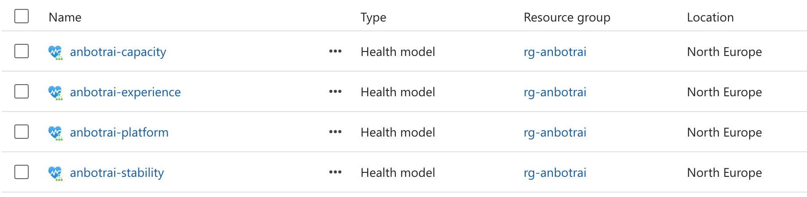
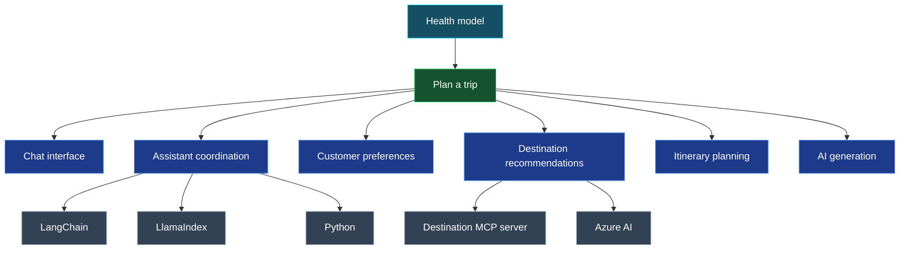
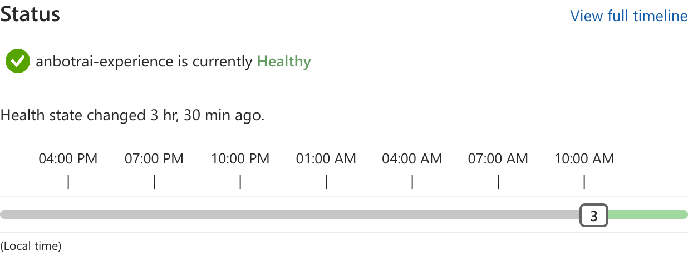
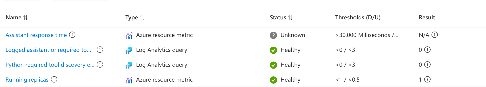

# Travel agent health models

The health models describe whether the **Plan a trip** flow and its dependencies are healthy. Four profiles monitor the same application with different signals, so their behavior can be compared.

## What is included

| File | Purpose |
|------|---------|
| `infra/healthmodels.bicep` | Deploys one model for each comparison profile. |
| `infra/healthmodel.bicep` | Defines the shared topology, signals, identities, roles, and alerts for one profile. |

These are standalone templates. They do not change the application, its deployment, or `azd up`.

## Profiles

All profiles monitor running replicas, Azure AI availability and Resource Health, and selected assistant or required-tool errors.

| Profile | Additional evidence | Signals |
|---------|---------------------|---------|
| Platform | Common signals only | 15 |
| Stability | Container terminations and a stricter error threshold | 22 |
| Capacity | CPU and memory | 29 |
| Experience | UI, tool, assistant, and AI response time | 24 |

Each model has 17 entities, including its automatic root, and 16 relationships. The trip flow depends on the chat interface, assistant coordination, customer preferences, destination recommendations, itinerary planning, and AI generation. The three assistant implementations are alternatives. Destination recommendations can use the destination MCP server or AI.

One non-healthy assistant or destination alternative is intended to make its component Degraded; all alternatives non-healthy are intended to make it Unhealthy. The one-Degraded-assistant case was observed. The all-Unhealthy and all-Unknown cases were not tested.

## Signals and assumptions

Metric and log windows are five minutes and refresh every minute. The trip flow's 99.9% health objective is an assumption, not a service-level commitment.

| Signal | Degraded | Unhealthy |
|--------|----------|-----------|
| Running replicas | Below 1 | Below 0.5 |
| AI availability | Below 99% | Below 95% |
| Logged assistant or required-tool errors | Above 0 | Above 2 in Stability; above 3 elsewhere |
| Container terminations, Stability | Above 0 | Above 3 |
| CPU or memory, Capacity | Above 80% | Above 95% |
| UI or tool response, Experience | Above 1 second | Above 3 seconds |
| Assistant or AI response, Experience | Above 30 seconds | Above 60 seconds |

The error queries count selected log messages, not failed requests. Termination counts can include planned deployments. Response times are averages across routes, not per-chat latency or proof of a complete answer.

## What was observed

In a bounded Python exercise, two requests completed in 56.74 and 82.93 seconds; a third hit the 110-second client deadline. Experience became Degraded while the other model roots remained Healthy. Its Python response signal reported a 46.37-second average across routes, which cannot be attributed to the timed-out request alone.

The Experience trip-flow alert fired and its monitor condition later resolved. No notification action group was configured.

The following Experience signal view shows why a Healthy entity is not proof of a successful chat: the assistant response-time signal is Unknown while the other shown signals are Healthy.

These screenshots are point-in-time Azure Portal views from 28 October 2026. Some response metrics are Unknown when no samples are available; a Healthy parent can still include Unknown signals.

## Deployment requirements

These templates are separate from `azd up`. Deploy `infra/healthmodels.bicep` to the resource group containing the workload, with the following prerequisites:

- The `Microsoft.CloudHealth` provider is registered, supports API version `2026-11-01`, and offers health models in the selected region. The evaluated models use North Europe.
- The deployer can create resource-group deployments, Cloud Health resources, and role assignments at the resource-group and Log Analytics workspace scopes.
- The resource group has an Azure AI account, a Log Analytics workspace, and an Application Insights component linked to that workspace. Their names are deployment parameters.
- For meaningful signals, the monitored Container Apps exist with the names in `infra/healthmodel.bicep`: `ui-angular`, `api-langchain-js`, `api-llamaindex-ts`, `api-maf-python`, `mcp-customer-query`, `mcp-destination-recommendation`, and `mcp-itinerary-planning`.

Supply `environmentName`, `location`, `aiAccountName`, `logAnalyticsWorkspaceName`, and `applicationInsightsName`. The environment name prefixes the four model names. Run `az deployment group validate` and `az deployment group what-if`, review the proposed changes, then use `az deployment group create` to deploy the template.

Each model receives a system-assigned managed identity, **Reader** on the resource group, and **Monitoring Reader** on the workspace. Creating the four models therefore creates eight role assignments. Monitoring Reader grants access to workspace telemetry beyond the aggregate queries in these templates. The alert configurations have no action groups or recipients.

The log signals depend on application telemetry arriving in the expected Log Analytics tables and matching the queries. In particular, the Python required-tool discovery signal expects Application Insights traces with the configured logger name. A zero count without that telemetry is not evidence that the tool is healthy.

The models schedule approximately 33,120 log and 84,960 metric evaluations per day in total. Actual billing is unknown. The local Bicep compiler may report `BCP081` warnings if it lacks types for the CloudHealth API.

### Application work outside this branch

These are not prerequisites for creating the health models, but the evaluated application needed them for a usable deployment or meaningful signals:

- Build and deploy the actual application images. The initial provisioning used hello-world placeholders; a later application deployment supplied the real images.
- Align the Python Container App ingress and `PORT` with the image's listening port. At the base revision, the deployment specifies 4000 while the image listens on 4010.
- Resolve Python Agent Framework SDK compatibility. The base revision allows newer SDK versions while importing `ChatAgent`; the evaluated deployment failed to import it. Use a compatible SDK and code combination.
- Correct the LangChain Azure OpenAI Responses endpoint. The evaluated deployment returned 404 when the client used the resource root rather than an endpoint containing `/openai/v1`.
- Configure Python telemetry export to the workspace-backed Application Insights component, or provide an equivalent source for the required-tool discovery query. The base revision does not explicitly configure an Azure Monitor exporter.

The Python partial-work guard and MCP connection cleanup are separate correctness and reliability concerns. They are not included here or required to provision the models.

### Validation

On 28 October 2026, the templates compiled locally with seven `BCP081` warnings because the installed Bicep version lacked CloudHealth types. Azure provider validation succeeded for both the existing model names and a new model-name prefix.

An incremental what-if for the new prefix predicted 157 creations, including four models and eight role assignments, with no modifications or deletions of existing resources. A preview using the existing names reported 72 modifications: 64 entities and eight role assignments. Entity differences included service-populated health/status values and defaults; role principal IDs remained unresolved expressions in the preview. Do not assume a redeployment is a no-op without reviewing its what-if.

These exact templates were deployed earlier. A later readback matched the four model configurations and their expected role assignments; it did not enumerate additional assignments or establish signal health. The new-prefix validation and previews did not deploy another set of models, and they do not guarantee deployment in another subscription.
