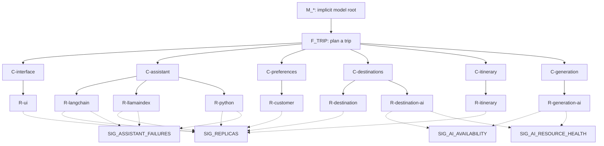

# Health model modelspec: Azure AI Travel Agents comparison

## modelspec CONCEPT

Stable IDs below describe the deployed four-candidate design. `done` means the row's specific work is evidenced, not that the app or model is healthy. The one observed Degraded rollup does not establish every alternative-choice scenario.

## What does health mean for my workload?

Opening the UI, selecting an orchestrator, discovering tools, understanding preferences, recommending destinations and producing a streamed itinerary work without unacceptable failures or delay.

## Glossary

| Term | Where it's found | Status |
|------|------------------|--------|
| LangChain, LlamaIndex, Python assistants | S2; azure.yaml services and API server entry points | done |
| Customer Query, Destination Recommendation, Itinerary Planning, Echo Test | S3; tools configuration | done |
| azd environment anbotrai | S4; azd environment output | done |

## Health modelling strategy

| Model Name | Purpose and platform/workload role | Owner and team/organizational/legal boundary | Tenant, subscription and resource scope | Sources or gap | Status |
|------------|------------------------------------|---------------------------------------------|-----------------------------------------|----------------|--------|
| M_PLATFORM; anbotrai-platform | Availability baseline | Owner not supplied; same workload comparison boundary | Subscription 6fc552c5-06b6-43d7-ac70-2f1eda1be033; proposed rg-anbotrai | S1-S5; G_DEPLOYMENT | new |
| M_STABILITY; anbotrai-stability | Baseline plus container-termination evidence | Same as M_PLATFORM | Same proposed scope | S1-S6,S31 | new |
| M_CAPACITY; anbotrai-capacity | Baseline plus CPU/memory pressure | Same as M_PLATFORM | Same proposed scope | S1-S6 | new |
| M_EXPERIENCE; anbotrai-experience | Baseline plus response duration | Same as M_PLATFORM | Same proposed scope | S1-S6; G_STREAM | new |

## High-level health model diagram

Each model has one user flow, six functional components and nine resource leaves. Assistant and destination alternatives aggregate their own resource states. Resource copies have one parent, never shared edges. The readable diagram is in plan.md.



## User concerns and priorities

| Concern or priority | User impact and service expectations | Sources or gap | Status |
|---------------------|--------------------------------------|----------------|--------|
| Complete travel planning | People can open chat, get preferences analyzed, explore destinations and receive an itinerary | S2-S3; G_DEPLOYMENT | new |
| Timely answers | Slow or interrupted responses affect the chat experience; no response-time commitment was supplied | S3; G_TARGETS,G_STREAM | new |
| Available assistant choices | A selectable assistant should perform its requested work | S2-S3,S174,S180; G_DEPLOYMENT | problem: partial independent tool work can be reported as complete |

## User flows

| Flow | User outcome and steps | Health objective | Dependencies and resources | Sources or gap | Status |
|------|------------------------|------------------|----------------------------|----------------|--------|
| F_TRIP: Plan a trip | Open chat, describe preferences, explore destinations and build an itinerary | 99.9%, assumed | Six components below; three selectable assistant implementations | S2-S3,S26,S143; G_TARGETS,G_FLOW_TOPOLOGY | new |

## System flows

Let `RG=/subscriptions/6fc552c5-06b6-43d7-ac70-2f1eda1be033/resourceGroups/rg-anbotrai`. IDs derived from IaC are proposed, not observed live IDs.

| Flow | System interactions | Health objective | Dependencies and resources | Sources or gap | Status |
|------|---------------------|------------------|----------------------------|----------------|--------|
| C-interface | Serve Angular chat | Running, responsive UI | RG/providers/Microsoft.App/containerApps/ui-angular | S2 | new |
| C-assistant | GET /api/health, GET /api/tools, POST /api/chat through three selectable assistants | One not-healthy option degrades; all three not-healthy options are unhealthy (assumed) | RG/providers/Microsoft.App/containerApps/{api-langchain-js,api-llamaindex-ts,api-maf-python} | S2-S3,S143; G_STREAM,G_FLOW_TOPOLOGY | new |
| C-preferences | Customer Query MCP call | Required selected tool works | RG/providers/Microsoft.App/containerApps/mcp-customer-query | S2-S3 | new |
| C-destinations | LangChain/LlamaIndex call Destination Recommendation MCP; Python uses LLM knowledge | One not-healthy source degrades; both not-healthy sources are unhealthy (assumed) | RG/providers/Microsoft.App/containerApps/mcp-destination-recommendation; RG/providers/Microsoft.CognitiveServices/accounts/cog-uuj7bntzehqsu | S2-S3,S26,S143; G_FLOW_TOPOLOGY | new |
| C-itinerary | Itinerary Planning MCP call | Required selected tool works | RG/providers/Microsoft.App/containerApps/mcp-itinerary-planning | S2-S3 | new |
| C-generation | Azure AI model inference | Successful, timely generation | RG/providers/Microsoft.CognitiveServices/accounts/cog-uuj7bntzehqsu | S2,S12; G_DEPLOYMENT | new |

## Alerts

| Alert | Confirmed placement and health objective | Existing rule and suitability | Sources, lookup coverage or gap | Status |
|-------|-----------------------------------------|-------------------------------|---------------------------------|--------|
| A_FLOW | Proposed degraded Sev2 and unhealthy Sev1 on F_TRIP, all four models | Existing enabled rule `/subscriptions/6fc552c5-06b6-43d7-ac70-2f1eda1be033/resourcegroups/rg-anbotrai/providers/microsoft.alertsmanagement/smartdetectoralertrules/failure anomalies - appi-uuj7bntzehqsu` targets Application Insights and detects anomalous increases in failed requests/dependencies, not model entity health; it is not a substitute. No action group chosen | S20; G_ROUTING, G_APPROVAL | new |

## Shared source material

### S1: User task

- Evidence class: user-stated request, not exact deployment approval.
- Original location/reference: current conversation, 2026-10-27T21:37:27.865+01:00.
- Precise locator and version: autonomous plan/build; research and deploy 3-4 models; evaluate under usage/load; open tasks; 30-minute reminder.
- Status: done.

### S41: Stderr-scoped model preview

- Evidence class: observed result.
- Original location/reference: S17 commands and parameters; coordinating session what-if v7.
- Precise locator and version: 2026-10-27T21:41:50Z. Cloud validation and what-if Succeeded with four models, 156 explicit entities, 156 relationships, 144 signals, 13 definitions and eight scoped assignments; no existing resource changes/deletes. A parameterized diff check showed only the 12 assistant-error queries changed from S36, each adding `Stream_s == 'stderr'`. Subsequent S43 usage evidence prompted a threshold refinement; this version is superseded.
- Deployment file hashes at that time: infra/healthmodel.bicep SHA256 e3ca5b8a56034687585a128dde8f7d5ac72484b9c512425c8488b0fae1f380f4; infra/healthmodels.bicep SHA256 7b2d31febd2377f6cd931c28a231d1fc160b97c88b273db6e7f13e9d3f3c7ac2.
- Status: done.

### S42: Bounded partial application usage

- Evidence class: observed result.
- Original location/reference: `python3 infra/healthmodel-evaluate.py usage --environment anbotrai --backends langchain llamaindex`; coordinating session files/usage-partial.json and derived files/usage-partial-summary.json.
- Precise locator and version: 2026-10-27T21:40:47.391Z to 21:41:10.681Z. UI and selected API health/tool checks passed. Four of at most six synthetic requests were sent at concurrency at most two. Three LangChain requests returned HTTP 200 with explicit workflow-error events. One LlamaIndex response exceeded the harness's 2 MiB limit and is incomplete, not proven to be an application failure; its remaining two requests were not sent. Python was omitted, so full-app readiness was not established. The saved initial harness summary incorrectly counted all four as `http_200_stream_failures`; interpret its per-request records. The harness was subsequently corrected and its matching offline fixture reports three explicit errors and one incomplete response.
- Status: problem: three confirmed workflow errors; one incomplete response.

### S43: Signals observed after partial usage

- Evidence class: observed source values and conditional inference.
- Original location/reference: exact stderr-scoped assistant-error KQL and Azure Monitor metrics for the selected API resources and cog-uuj7bntzehqsu.
- Precise locator and version: 2026-10-27T21:43:02-21:43:10Z. Five-minute log counts were LangChain 3, LlamaIndex 1 and Python 1; counts were not correlated to individual requests. AI availability was 100% in the 21:38Z bucket and time-to-last-byte 5190ms; selected API average response-time samples were 1911ms and 164ms. AI availability alone therefore did not establish successful LangChain workflows. Under S41's initial >3 unhealthy threshold, three LangChain log entries would be Degraded, despite S42's three explicit failed streams. Stability's proposed unhealthy threshold is refined to >2 as an assumed comparison setting, not a user commitment.
- Status: done.

### S44: Partial usage diagnosis

- Evidence class: observed report from application deployment session 75b7ca9f-2be1-4928-b755-49071aad3bd6.
- Original location/reference: scoped LangChain logs and Responses client source; exact original report time unavailable.
- Precise locator and version: after S42. LangChain's failed streams reported 404 Resource not found because its Responses client used the Azure resource root rather than `/openai/v1`. The deployment session corrected the client URL locally, pending redeployment. LlamaIndex duplicated event data and logged full serialized events; S46 supersedes the initial investigation.
- Status: problem: fixes not yet deployed and retested.

### S45: Evidence-tuned model validation and what-if

- Evidence class: observed result and recorded assumption.
- Original location/reference: S17 commands and parameters; coordinating session what-if v8.
- Precise locator and version: 2026-10-27T21:45:57Z. Compilation, cloud validation and what-if Succeeded with four models, 156 explicit entities, 156 relationships, 144 signals, 13 definitions and eight scoped assignments; no existing resource changes/deletes. Parameterized diff checks verified that only the three Stability assistant-error unhealthy thresholds changed from >3 to >2 relative to S41, and all 144 harness entity/signal pairs still match. Applying the previewed rules to S43's three logged failures yields Degraded for Platform/Capacity/Experience and Unhealthy for Stability. The threshold is an assumed comparison setting, not a user commitment or a live model state. S50 supersedes the file hash by adding AI Resource Health.
- Deployment file hashes: infra/healthmodel.bicep SHA256 5567926a53686d8d8b469db9a9289615c48a3b02212981b1f358a7aec81ab8e0; infra/healthmodels.bicep SHA256 7b2d31febd2377f6cd931c28a231d1fc160b97c88b273db6e7f13e9d3f3c7ac2.
- Status: done.

### S46: LlamaIndex stream-size diagnosis

- Evidence class: observed report from application deployment session 75b7ca9f-2be1-4928-b755-49071aad3bd6.
- Original location/reference: scoped LlamaIndex event logs and local stream changes; exact original report time unavailable.
- Precise locator and version: after S42. One test produced 863 events and about 4.2 MB of event logs in one minute. Token events repeated complete response metadata twice; a local change reduced sampled token payloads from 36,712 to 870 bytes, used backpressure-aware streaming and stopped logging full serialized events. Actual SDK events expose their type via `toJSON()`; the deployment session corrected that projection and verified token, tool, output and stop events plus Angular consumer fixtures. Deployment, harness compatibility and live retest remain pending. S42's capped response remains incomplete, not a proven application failure.
- Status: problem: fix not yet deployed and retested.

### S47: Evidence-tuned model approval request

- Evidence class: observed interaction, not user confirmation.
- Original location/reference: coordinating session ask_user, after S45 validation, hashes and resolved scope.
- Precise locator and version: captured 2026-10-27T21:49:17Z. The question listed S45's four models, exact command, 144 signals, 13 definitions, eight scoped Reader/Monitoring Reader assignments, unrouted alerts, tuned thresholds, observed partial-usage evidence and approximate log-evaluation volume. Tool returned "The user is not available to respond and will review your work later. Work autonomously and make good decisions." This is not a yes. S50 supersedes the scope with AI Resource Health. No models or roles were deployed.
- Status: problem: explicit exact-change approval unavailable.

### S48: AI Resource Health at idle

- Evidence class: observed result and product documentation.
- Original location/reference: `GET /subscriptions/6fc552c5-06b6-43d7-ac70-2f1eda1be033/resourceGroups/rg-anbotrai/providers/Microsoft.CognitiveServices/accounts/cog-uuj7bntzehqsu/providers/Microsoft.ResourceHealth/availabilityStatuses/current?api-version=2022-10-01`; https://learn.microsoft.com/azure/azure-monitor/health-models/signals .
- Precise locator and version: captured 2026-10-27T21:53:11Z. Azure Resource Health returned Available for the AI account, with reported occurrence 2026-10-27T20:50:35Z. Built-in Resource Health signals can contribute the represented resource's platform-reported state without request traffic. Adding this evidence does not establish inference or chat correctness, and model-identity access/evaluation remains unverified.
- Status: done.

### S49: Python SDK recovery progress

- Evidence class: observed report from application deployment session 75b7ca9f-2be1-4928-b755-49071aad3bd6.
- Original location/reference: Python 3.12 local imports/startup and MCP discovery checks; exact original report time unavailable.
- Precise locator and version: after S33. Python imports and starts locally with the current Agent Framework SDK, and its migrated workflow passes local stream-event checks. A real local MCP discovery check exposed a missing SDK optional dependency and a cancellation bug in the existing ten-second timeout. The deployment session installed the required SDK package cohort; Python reached all four MCP servers, but skipped Customer Query because that server advertised optional MCP Tasks without a task store. The session is correcting the tool metadata before `azd up`; the current cloud revision remains unverified.
- Status: problem: fixes not yet deployed and retested.

### S50: AI Resource Health model validation and what-if

- Evidence class: observed result.
- Original location/reference: S17 commands and parameters; coordinating session what-if v9.
- Precise locator and version: 2026-10-27T21:58:47Z. Compilation, cloud validation and what-if Succeeded with four models, 156 explicit entities, 156 relationships, 144 explicit metric/log signals plus 16 enabled AI Resource Health signals, 13 definitions and eight scoped assignments; no existing resource changes/deletes. Parameterized diff checks against S45 verified that only 16 Resource Health settings were added, each on an AI account leaf; all 160 harness entity/signal pairs match. Actual model-identity evaluation is still unverified. S59 supersedes the assistant query and file hash.
- Deployment file hashes: infra/healthmodel.bicep SHA256 800829f72023fb09c2711e97f928708f47d40a2c36d1ded61811d105db8a173a; infra/healthmodels.bicep SHA256 7b2d31febd2377f6cd931c28a231d1fc160b97c88b273db6e7f13e9d3f3c7ac2.
- Status: done.

### S51: AI Resource Health model approval request

- Evidence class: observed interaction, not user confirmation.
- Original location/reference: coordinating session ask_user, after S50 validation, hashes and resolved scope.
- Precise locator and version: captured 2026-10-27T22:01:15Z. The question listed S50's four models, exact command, 160 signals including 16 Resource Health signals, 13 definitions, eight scoped Reader/Monitoring Reader assignments, unrouted alerts, tuned thresholds, observed partial-usage evidence and approximate log-evaluation volume. Tool returned "The user is not available to respond and will review your work later. Work autonomously and make good decisions." This is not a yes. S59 supersedes the assistant query. No models or roles were deployed.
- Status: problem: explicit exact-change approval unavailable.

### S52: Proposed role definitions

- Evidence class: observed result.
- Original location/reference: `az role definition list --subscription 6fc552c5-06b6-43d7-ac70-2f1eda1be033 --name Reader` and `--name 'Monitoring Reader'`.
- Precise locator and version: exact lookup time unavailable. Reader contains `*/read`; Monitoring Reader describes access to monitoring data and includes `Microsoft.OperationalInsights/workspaces/search/action`. The roles are proposed for model identities only; effective access and propagation cannot be checked before approved assignments exist.
- Status: done.

### S53: AI metrics during quiet windows

- Evidence class: observed result.
- Original location/reference: `az monitor metrics list` on cog-uuj7bntzehqsu for AzureOpenAIAvailabilityRate and AzureOpenAITTLTInMS (Average), and AzureOpenAIRequests and TotalCalls (Total), PT5M.
- Precise locator and version: 2026-10-27T22:04:54-22:06:39Z. Availability was 100% and time-to-last-byte was 0ms in recent quiet buckets. Overlapping request-count buckets were 0; the most recent nonzero bucket contained 2 calls at 21:41Z. A 100% availability or 0ms latency value in a zero-call period is not evidence that inference was actually exercised. Resource Health independently remained Available.
- Status: done.

### S54: Initial error-query cooldown attempt

- Evidence class: observed result.
- Original location/reference: the exact stderr-scoped assistant-error KQL queries against log-uuj7bntzehqsu after S42.
- Precise locator and version: after S43; exact cancellation time unavailable. The first cooldown query did not return after more than three minutes, so the coordinating session stopped its own read-only command. No cooldown result or model recovery state is inferred from this attempt; S55 records the successful bounded REST alternative.
- Status: problem: query did not complete.

### S55: Bounded REST cooldown query

- Evidence class: observed source values and conditional inference.
- Original location/reference: exact stderr-scoped assistant-error queries via the Log Analytics REST API, explicit workspace and PT5M time range; each CLI subprocess bounded to 60 seconds.
- Precise locator and version: 2026-10-27T22:08:05Z. The same source returned LangChain 0, LlamaIndex 0 and Python 1; S43 had returned 3, 1 and 1 respectively at 21:43:10Z. LangChain's error-count signal would now be Healthy if model evaluation and identity access worked, even though its last live test failed and no later successful chat was recorded. This bounds source recovery between those observations; no exact model transition or recovery time was observed.
- Status: done.

### S56: Partial-usage error timestamps

- Evidence class: observed source values.
- Original location/reference: bounded read-only Log Analytics REST query over the same stderr predicates, grouped into five-minute bins.
- Precise locator and version: queried 2026-10-27T22:10:39Z for 21:35-21:55Z. LangChain had three matching entries in the 21:40Z bucket, last at 21:40:55.0338704Z; LlamaIndex had one, last at 21:41:12.549821Z. S55 later observed zero for both. The LlamaIndex entry was not correlated to a specific stream and may relate to the client stopping at its size cap. Model detection and recovery timestamps remain unobserved.
- Status: done.

### S57: Required versus optional MCP discovery logs

- Evidence class: observed source values and deployment-session report.
- Original location/reference: bounded aggregate KQL over ContainerAppConsoleLogs_CL; application deployment session 75b7ca9f-2be1-4928-b755-49071aad3bd6.
- Precise locator and version: queried the preceding two hours before 2026-10-27T22:13:42Z. LangChain logged seven Echo Test discovery failures, LlamaIndex three, and neither logged a required-tool discovery failure. Discovery failures and timeouts use display names `Echo Test`, `Customer Query`, `Itinerary Planning` and `Destination Recommendation`; TypeScript bridge errors use tool IDs. Python's DestinationAgent remains LLM-only. Treating every discovery failure as required would incorrectly degrade health for optional Echo and Python destination discovery.
- Status: done.

### S58: Required-tool query verification

- Evidence class: observed query results and synthetic predicate checks.
- Original location/reference: exact per-flow S59 KQL via the Log Analytics REST API; bounded `datatable` fixtures with no resource writes.
- Precise locator and version: 2026-10-27T22:13:42Z. Exact five-minute queries returned LangChain 0, LlamaIndex 0 and Python 1. Fixtures returned 4 matching failures for each TypeScript flow and 2 for Python: they excluded Echo and stdout user text for all flows and excluded destination discovery/bridge errors for Python. These fixtures verify query selection, not live model state.
- Status: done.

### S59: Required-tool model validation and what-if

- Evidence class: observed result.
- Original location/reference: S17 commands and parameters; coordinating session what-if v10.
- Precise locator and version: 2026-10-27T22:14:36Z. Compilation, cloud validation and what-if Succeeded with four models, 156 explicit entities, 156 relationships, 144 explicit metric/log plus 16 AI Resource Health signals, 13 definitions and eight scoped assignments; no existing resource changes/deletes. Parameterized comparison against S50 verified that only 12 assistant query texts/display names changed; each exactly matched its S58 live-verified per-flow query, and all 160 harness entity/signal pairs still match. The documented query template was separately expanded for all three flows and matched the previewed query tokens. Parameterized threshold checks also reproduced the conditional S31, S39, S43 and S55 comparison states; they are not live-model evaluations.
- Deployment file hashes: infra/healthmodel.bicep SHA256 c58ef8b222f203a012a61541c28e009950489362cebdb0a50c074d484cb752d9; infra/healthmodels.bicep SHA256 7b2d31febd2377f6cd931c28a231d1fc160b97c88b273db6e7f13e9d3f3c7ac2.
- Status: superseded by S76.

### S60: Requested full application deployment

- Evidence class: observed report from application deployment session 75b7ca9f-2be1-4928-b755-49071aad3bd6.
- Original location/reference: the session's local SDK/MCP/frontend checks and requested `azd up`; exact original report time unavailable.
- Precise locator and version: after S49. Python on the current SDK passed startup, Magentic workflow construction, four local MCP discovery checks, timeout isolation and all four provider-constructor checks. The Customer Query tool was made normally discoverable without changing its async behavior. LlamaIndex server and Angular consumer fixtures passed non-token preservation, completion, errors, deduplication and cancellation. The requested `azd up --environment anbotrai --no-prompt` completed successfully for all eight services. LangChain/LlamaIndex disconnect fixes, a Python final-result fix and a UI partial-overlap fix were made after their earlier image builds; follow-up redeploys or exact revision verification, safe persistent remote-build configuration, live readiness and usage remain pending.
- Status: done.

### S61: Required-tool model approval request

- Evidence class: observed interaction, not user confirmation.
- Original location/reference: coordinating session ask_user, after S59 validation, hashes and resolved scope.
- Precise locator and version: captured 2026-10-27T22:17:28Z. The question listed S59's four models, exact command, 160 signals, 13 definitions, eight scoped Reader/Monitoring Reader assignments, unrouted alerts, tuned thresholds, required/optional tool filters, observed partial-usage evidence, quiet-data caveats and approximate log-evaluation volume. Tool returned "The user is not available to respond and will review your work later. Work autonomously and make good decisions." This is not a yes. No models or roles were deployed.
- Status: superseded by S76; no explicit exact-change approval was received.

### S62: Benign stream-disconnect logging

- Evidence class: observed report from application deployment session 75b7ca9f-2be1-4928-b755-49071aad3bd6.
- Original location/reference: LlamaIndex server cancellation path and local tests; exact original report time unavailable.
- Precise locator and version: after S56. A benign LlamaIndex client disconnect logged both `Error during streaming: Premature close` and `Error occurred: ... ERR_STREAM_PREMATURE_CLOSE`, matching the model's error query. The analogous LangChain path also logged benign premature-close errors and left its iterator open. The deployment session reports both revised local paths close quietly on actual client cancellation, while a connected client's genuine upstream `ERR_STREAM_PREMATURE_CLOSE` remains logged and returned as a structured error. Angular consumer fixtures also passed partial-overlap, repeated-pattern, Unicode, full-dedup and no-overlap final-text cases. Both images had already started building or deployed, so follow-up redeploys remain necessary. The historical S56 LlamaIndex log was not individually correlated and remains only possibly related.
- Status: problem: fix not yet deployed and retested.

### S63: Actual LlamaIndex SDK event compatibility

- Evidence class: observed report from evaluation session 0f12afb7-7285-492a-b011-9fa6e8ca396f.
- Original location/reference: six offline cases using installed LlamaIndex SDK event objects, current workflow/server projection and the evaluation harness.
- Precise locator and version: after S46. Token, tool, output and stop event objects passed through the current projection and were classified correctly, including missing stops, missing tool evidence and errors. Non-token event data still appears both in the event and top-level data; an unusually large stop state can exceed the 2 MiB safety cap and must remain incomplete, not presumed an application failure.
- Status: done.

### S64: Source-timestamp comparison after partial usage

- Evidence class: observed source timestamps and hypothetical calculation.
- Original location/reference: bounded Log Analytics REST query of matching LangChain stderr event timestamps from 21:40-21:50Z; S59's expanded threshold rules.
- Precise locator and version: queried 2026-10-27T22:10:39Z or later; exact query capture clock unavailable. Three matching log entries occurred at 21:40:53.780121Z, 21:40:53.780121Z and 21:40:55.033870Z. Assuming immediate ingestion and evaluations on whole-minute boundaries, the error signal would be Degraded in Platform/Capacity/Experience and Unhealthy in Stability from 21:41 through 21:45Z, then Healthy at 21:46Z. This is a calculation from source timestamps, not observed model detection or recovery; identical timestamps do not establish three distinct requests.
- Status: done.

### S65: Documented model service limits

- Evidence class: source fact and calculated comparison.
- Original location/reference: https://learn.microsoft.com/azure/azure-monitor/fundamentals/service-limits#azure-monitor-health-models ; Microsoft Learn documentation search.
- Precise locator and version: documentation lists 10,000 entities per model, 1,000 relationships per entity and 50 signals per entity. Parameterized checks of S59's expanded preview confirmed each model has 40 entities including the implicit root and at most three configured metric/log/Resource Health signals per entity; the largest flow has six children and one parent. These sizes are below the documented limits. The documentation excerpt did not establish a per-subscription model count limit.
- Status: done.

### S66: Python revision starts in Azure

- Evidence class: observed report from application deployment session 75b7ca9f-2be1-4928-b755-49071aad3bd6.
- Original location/reference: deployed Python revision status and sanitized startup logs; exact original report time unavailable.
- Precise locator and version: after S60. The new Python revision reported Healthy and RunningAtMaxScale, and startup logs showed the server started without the earlier import error. The full `azd up` was still running; no live usage was sent during the rollout. RunningAtMaxScale reflects the configured one-replica maximum and does not by itself establish chat readiness.
- Status: new.

### S67: Python source signals after revision recovery

- Evidence class: observed source values and conditional inference.
- Original location/reference: exact S59 Python Stability assistant-error and termination queries, extracted from the expanded preview and run together through the bounded Log Analytics REST API.
- Precise locator and version: 2026-10-27T22:28:36Z. Both counts were 0 over five minutes, after S66 reported the new Python revision Healthy; S39 had earlier returned one error and two terminations. These two source signals would be Healthy under the configured thresholds, but no model state or successful Python chat has yet been observed.
- Status: done.

### S68: Resource Graph revision-filter experiment

- Evidence class: observed result and product documentation.
- Original location/reference: bounded Log Analytics REST cross-service query using `arg('').Resources` for the Python Container App; `az containerapp show` on the same resource; https://learn.microsoft.com/azure/azure-monitor/logs/azure-monitor-data-explorer-proxy#query-data-in-azure-resource-graph-using-arg-preview .
- Precise locator and version: 2026-10-27T22:30:59-22:31:10Z. Resource Graph reported latest ready revision `api-maf-python--t60878m`, while direct Container Apps metadata reported `api-maf-python--azd-1793139828`. The cross-service query is preview, returns at most 1,000 ARG rows and Azure Monitor does not return ARG query errors. ARG revision data was therefore not used to filter SIG_TERMINATIONS: stale or silently missing metadata could hide active-revision failures. This observation does not establish a general propagation-time bound.
- Status: done.

### S69: Deployment follow-up checks

- Evidence class: observed source diff and deployment-session reports.
- Original location/reference: `azure.yaml`; service Docker build contexts; packages/api-maf-python/src/orchestrator/magentic_workflow.py; packages/ui-angular/src/app/chat-conversation/chat-conversation.service.ts; application deployment session 75b7ca9f-2be1-4928-b755-49071aad3bd6.
- Precise locator and version: after S60. The initial local diff lacked persistent `remoteBuild: true` for five services; all eight services now have it. The deployment session reports Docker fixture builds confirmed all contexts exclude local environment files, git metadata and local dependencies, with only the UI's generated `.env.production` retained. Parent review identified the missing Python final-result marker and partial-overlap final-text duplication risks; the session reports actual FastAPI/Magentic and Angular fixtures now pass. Those Python/UI changes and both API disconnect fixes were made after prior image builds. The two TypeScript API follow-up redeploys succeeded; five newly remote-configured services still need actual ACR rebuilds/redeploys. The postprovision hook still runs Docker Compose locally, so `azd up` is not Docker-free.
- Status: problem: actual ACR rebuilds and live verification pending.

### S70: Python managed-identity token lifetime

- Evidence class: observed source fact.
- Original location/reference: packages/api-maf-python/src/orchestrator/providers/azure_openai.py; packages/api-maf-python/src/orchestrator/magentic_workflow.py:46-54.
- Precise locator and version: during app recovery, exact lookup time unavailable. The Python provider obtained one managed-identity token and passed its static string to the Azure OpenAI client; the orchestrator retained that client for the process lifetime. After token expiry, subsequent chats could fail without a restart. The deployment session replaced it with Azure's async refreshable token provider; local fixtures confirmed reacquisition of an expiring token across two requests, API-key behavior without managed identity, and shutdown of both OpenAI client and credential. The no-argument factory retains owned resources and exposes `close_llm_clients()`; tests cover its cleanup, other local providers and unchanged Foundry-local behavior. The final Python image still needs verification.
- Status: problem: fix not yet deployed.

### S71: Python API and evaluation harness compatibility

- Evidence class: observed report from evaluation session 0f12afb7-7285-492a-b011-9fa6e8ca396f.
- Original location/reference: offline FastAPI TestClient with the current `/api/chat` SSE route and deterministic Magentic agents; exact original report time unavailable.
- Precise locator and version: after S69. The actual `FinalResult` followed by `Complete` was accepted by the evaluation harness, which correctly reported tool execution unverified when no tool-call evidence was exposed. Missing completion and workflow errors remained failures. Network access was disabled; no live app readiness is inferred.
- Status: done.

### S73: Workspace table plans and pricing limits

- Evidence class: observed resource metadata and official documentation.
- Original location/reference: ARM table metadata for log-uuj7bntzehqsu; https://learn.microsoft.com/azure/azure-monitor/logs/cost-logs#table-plans ; https://learn.microsoft.com/azure/azure-monitor/health-models/health-models-faq#pricing .
- Precise locator and version: 2026-10-27T22:50:18Z. ContainerAppConsoleLogs_CL and ContainerAppSystemLogs_CL both use the Analytics plan with 30-day retention. Official documentation says interactive Analytics queries are not billed by scanned data, whereas Basic/Auxiliary queries can be. The FAQ points to Azure Monitor pricing but does not establish how these scheduled health-model evaluations are billed; actual model, alert and query costs remain unknown.
- Status: done.

### S74: Full remote-build deployment started

- Evidence class: observed report from application deployment session 75b7ca9f-2be1-4928-b755-49071aad3bd6.
- Original location/reference: `azure.yaml`, service build-context fixtures and the session's requested `azd up`; exact original report time unavailable.
- Precise locator and version: after S69. All eight services are configured for ACR remote builds. Local Docker fixtures verified that all build contexts exclude local environment files, git metadata, local dependencies, `.npmrc`, `.pypirc`, `.azure`, private key/certificate formats and common credential/secrets files; the UI retains its generated `.env.production`. With no competing deployment active, the session started a full `azd up` using ACR builds. All eight submitted existing-resource flags were true, preserving application images during infrastructure reconciliation. The session later reported the run was still provisioning before any remote image build, so the latest Python lifecycle fixes can be included. The existing postprovision hook still requires local Docker Compose.
- Status: superseded by S75.

### S75: ACR BuildKit incompatibility and retry

- Evidence class: deployment-session report.
- Original location/reference: application deployment session 75b7ca9f-2be1-4928-b755-49071aad3bd6; the two TypeScript API Dockerfiles and ACR build output.
- Precise locator and version: after S74, exact build and report times unavailable. The first ACR image build failed because `RUN --mount=type=cache` requires BuildKit, which the ACR builder did not enable. The failed run stopped without replacing existing app images. The deployment session removed the cache-only mounts from both TypeScript API Dockerfiles, checked all eight selected Dockerfiles for BuildKit-only mounts, network/security flags, heredocs and COPY/ADD link or exclusion options, and restarted the full `azd up`.
- Status: problem: retry, remote builds and live verification are pending.

### S76: Explicit Resource Health signal scope

- Evidence class: schema documentation and validation.
- Original location/reference: https://learn.microsoft.com/azure/templates/microsoft.cloudhealth/2026-11-01/healthmodels/entities; https://learn.microsoft.com/rest/api/health-models/entities/get?view=rest-health-models-2026-11-01; `az bicep build` and `az deployment group validate` using S17 parameters.
- Precise locator and version: 2026-10-27T23:06:58-23:09:29Z. The schema describes `resourceHealth` as optional and says its `enabled` field defaults to Enabled, but does not establish whether omitting the whole object enables a signal. To make the planned scope deterministic, the template explicitly enables Resource Health on the four AI leaves and disables it on the 14 Container App leaves in each model. Running-replica signals remain. Bicep compilation, Azure validation and full what-if Succeeded; local Bicep cannot validate CloudHealth property types (BCP081). The preview creates 341 resources, ignores 23 existing resources and changes or deletes none. Compared with S59, only 56 Container App entity payloads gained `resourceHealth.enabled: Disabled`; the same 160 entity/signal pairs match the harness (25/39/53/43). No models or roles were deployed.
- Deployment file hashes: infra/healthmodel.bicep SHA256 0454296b072d2f3a1131e8f33f1e17d39ff8cac209ae872bca499ba4f5e0e5a1; infra/healthmodels.bicep SHA256 7b2d31febd2377f6cd931c28a231d1fc160b97c88b273db6e7f13e9d3f3c7ac2.
- Status: superseded by S89.

### S77: Explicit-scope model approval request

- Evidence class: observed interaction, not user confirmation.
- Original location/reference: coordinating session ask_user, after S76 validation, what-if, hashes and resolved scope.
- Precise locator and version: captured 2026-10-27T23:11:11Z. The question listed S76's four models, exact command and hashes, 160 signals, explicit AI/Container App Resource Health settings, 13 definitions, eight scoped Reader/Monitoring Reader assignments, unrouted alerts, thresholds, unknowns and estimated log evaluation volume. Tool returned "The user is not available to respond and will review your work later. Work autonomously and make good decisions." This is not a yes. No models or roles were deployed.
- Status: superseded by S89; no explicit exact-change approval was received.

### S78: Public retail meter lookup

- Evidence class: public Azure Retail Prices API results.
- Original location/reference: `https://prices.azure.com/api/retail/prices`, filtered for Azure Monitor meter names containing `Health` or `Signal`, and product names containing `Health Model`.
- Precise locator and version: queried 2026-10-27 after S77. No product containing `Health Model` or Azure Monitor meter containing `Signal` was returned. Two `Health Criteria Monitored time-series` results were returned for US Government regions; their applicability to these models is not established. These name searches do not prove which meters apply, so scheduled signal, model and alert costs remain unknown.
- Status: done.

### S79: Remote application rollout progress

- Evidence class: deployment-session report.
- Original location/reference: application deployment session 75b7ca9f-2be1-4928-b755-49071aad3bd6.
- Precise locator and version: after S75, exact report time unavailable. The ACR retry deployed the LangChain and LlamaIndex services and started the Python remote build. Its build context was captured after the token-refresh, no-stack lifecycle and final-result fixes. Other services and end-to-end workflows remain to be verified; application traffic remains paused.
- Status: superseded by S85.

### S80: Model topology readback fixtures

- Evidence class: parameterized offline fixtures and read-only Azure snapshot.
- Original location/reference: `infra/healthmodel-evaluate.py`; S76 what-if resource payloads; Microsoft CloudHealth entities and relationships REST list examples; coordinating session snapshot-before-deployment-v4.json.
- Precise locator and version: 2026-10-27T23:15-23:19Z. The snapshot now checks expected and unexpected entity names, signal placement and 39 relationship names/edges per model. Coverage uses expected signals only, so an unexpected signal cannot mask missing coverage. Parameterized fixtures for all four S76 profiles passed exact, missing, unexpected, duplicate and denied topology cases, pagination and unsafe continuation links; Ruff and Python compilation passed. Additional offline stream fixtures verified completion, error classification, the readiness gate, partial scope, the nine-request limit and concurrency of two. The live read-only snapshot reports all four models unavailable, with 160 missing/unknown signals and relationship counts unknown. There is no live topology or identity verification before deployment.
- Status: done.

### S81: GPT-5 chat API constraints

- Evidence class: Microsoft documentation and deployment-session coordination.
- Original location/reference: https://learn.microsoft.com/azure/foundry/openai/how-to/chatgpt; https://learn.microsoft.com/azure/foundry/openai/api-version-lifecycle; https://learn.microsoft.com/answers/questions/5546468/deploy-gpt5-through-azure-foundry-but-no-chat-comp .
- Precise locator and version: researched 2026-10-27 after S80. Microsoft documents that the GPT-5 series uses `max_completion_tokens` instead of `max_tokens` and does not support `temperature`, `top_p` or penalty parameters on Chat Completions. Its v1 API uses `/openai/v1/` and does not require a dated API version. A Microsoft Q&A GPT-5 example uses `2024-08-01-preview`, but neither source establishes that `2024-02-15-preview` supports this deployed GPT-5-mini configuration. The application session received the documented parameter constraints; the live check is still required.
- Status: done.

### S82: Read-only termination observation during rollout

- Evidence class: observed source data, not a deployed model state.
- Original location/reference: Log Analytics REST query against `ContainerAppSystemLogs_CL` for the eight workload Container App names, `Reason_s == 'ContainerTerminated'`, `TimeGenerated > ago(5m)`; coordinating session rollout-terminations.json.
- Precise locator and version: 2026-10-27T23:19:35Z during S79's rollout. The grouped query returned no matching events for those names in its five-minute window. The corresponding Stability termination checks would evaluate to zero if the same data is available to the model identity; no models were deployed. Ingestion delay and other rollout windows remain unmeasured, so this is not evidence that planned deployments can never trigger warnings.
- Status: done.

### S83: Read-only assistant-error observation during rollout

- Evidence class: observed source data, not a deployed model state.
- Original location/reference: exact S76 `logged-assistant-failures` queries for the three assistant components, combined with KQL `union` and run through the Log Analytics REST API; coordinating session rollout-assistant-errors.json.
- Precise locator and version: 2026-10-27T23:20:18Z during S79's rollout. The three five-minute query results were numeric zero for LangChain, LlamaIndex and Python. If the model identities read the same data, the corresponding log signals would be Healthy. Application traffic was paused, so these zero counts do not establish that any chat succeeded, and ingestion lag remains possible.
- Status: done.

### S84: Bounded rollout source timeline

- Evidence class: read-only experiment in progress.
- Original location/reference: coordinating session rollout-source-timeline.jsonl, rollout-source-timeline-v2.jsonl and rollout-source-timeline-v3.jsonl; Log Analytics REST API and S76 assistant-error queries.
- Precise locator and version: started after S83. The first combined query returned `BadArgumentError` / `SYN0002` near the `kind` alias and collected no sample. Renaming it to `sourceKind` passed a dry run. The second run was stopped after five samples because it did not retain or check the response's partial-error field; those samples cannot establish complete query coverage. The corrected run checked that field and captured 11 samples between 2026-10-27T23:29:33Z and 23:39:59Z, spanning 626 seconds. S76's console-error queries returned zero for all three assistants in every sample, and no ContainerTerminated events were returned for the selected apps. It did not include S89's later AppTraces signal, which captured the real S88 Python errors. These are source observations during deployment, not live model states or application load; delayed ingestion and other windows are not ruled out.
- Status: done.

### S85: ACR rollout completed; Python tool discovery incomplete

- Evidence class: deployment-session report.
- Original location/reference: application deployment session 75b7ca9f-2be1-4928-b755-49071aad3bd6.
- Precise locator and version: after S79, exact report time unavailable. The requested remote-build `azd up` completed for all eight services; all revisions reported Running/Succeeded, and the UI and three API health endpoints responded. Python tool discovery reported itinerary-planning unreachable, while the two TypeScript APIs discovered it. The deployment session is diagnosing this before its bounded Python chat and verifying Python image contents. The Python and UI source modification times preceded their remote build snapshots. Application usage remains paused.
- Status: superseded by S87.

### S86: Discovery-failure visibility

- Evidence class: deployment-session report and read-only source observations.
- Original location/reference: S85; S84 sample 2 and v3 sample 1; coordinating session python-discovery-telemetry.json, python-discovery-streams.json and python-tools-probes.json; deployment-session source report.
- Precise locator and version: after S85, the exact Python `logged-assistant-failures` query returned zero at 2026-10-27T23:25:39Z. At 23:27:37Z, a separate aggregate of the preceding ten minutes found 18 Python stderr and 9 stdout entries, none containing `itinerary`. Access-log aggregates show three Python `/api/tools` requests between 23:24:15Z and 23:24:46Z, ingested by 23:24:50Z. The deployment session reports its three earlier probes failed, but did not independently timestamp them. A separately timestamped failing probe started at 23:29:24.416Z; the exact error query returned zero at 23:29:33-34Z, only about nine seconds later. The session reports registry code logs failures at ERROR with the prefix `MCP server Itinerary Planning is not reachable:`, which matches the proposed query, but has not observed that line live. Error-log ingestion lag and live stream classification remain unverified; the ongoing timeline will observe later windows. No model was deployed, and zero logged errors does not prove a successful workflow.
- Status: superseded by S88.

### S87: Itinerary MCP redirect root cause

- Evidence class: deployment-session report.
- Original location/reference: application deployment session 75b7ca9f-2be1-4928-b755-49071aad3bd6.
- Precise locator and version: after S85, exact report time unavailable. The itinerary server redirects `/mcp` to `/mcp/` using HTTP behind Azure TLS termination; the Python MCP SDK rejects the HTTPS downgrade. Both TypeScript clients also follow that redirect. The deployment session is changing all three clients to use `/mcp/` directly and will redeploy only those APIs. It is also restoring Python's console error handler without enabling user-message INFO logging. The live Python revision's provider, factory, workflow and response files byte-match the local token-refresh, lifecycle and final-result fixes. All eight build contexts received further common credential/certificate exclusions, and local fixtures report no tracked inputs excluded.
- Status: superseded by S91.

### S88: Python discovery errors in Application Insights

- Evidence class: deployment-session diagnosis and read-only source observations.
- Original location/reference: application deployment session 75b7ca9f-2be1-4928-b755-49071aad3bd6; Log Analytics AppTraces; coordinating session python-discovery-apptraces.json, python-discovery-identity.json, python-discovery-apptraces-latency.json and python-apptraces-aligned.json.
- Precise locator and version: 2026-10-27T23:31-23:37Z. The live Python root logger had an Azure Monitor `LoggingHandler` but no console handler because monitor initialization preceded `logging.basicConfig`. Five required-itinerary discovery errors were exported to AppTraces with logger `src.orchestrator.tools.tool_registry`, severity 3 and resource `appi-uuj7bntzehqsu`; observed ingestion delays were 3-6 seconds. A confirmed failed probe logged at 23:29:24.639963Z and was ingested at 23:29:29.7029477Z. At 23:29:33-34Z, S76's exact stderr query returned zero while three matching AppTraces events were already available in the same five-minute window. S76 would therefore miss this evidence. The application session is restoring an error-level console handler without exposing user-message INFO logs.
- Status: done.

### S89: Python Application Insights discovery signal

- Evidence class: observed source data, synthetic predicate checks and validated preview.
- Original location/reference: `infra/healthmodel.bicep`; `infra/healthmodels.bicep`; `infra/healthmodel-evaluate.py`; coordinating session python-apptraces-candidate.json, python-apptraces-predicate.json, healthmodels-whatif-v12.json and snapshot-before-deployment-v5.json.
- Precise locator and version: 2026-10-27T23:34-23:37Z. The exact five-minute AppTraces query returned one observed failure. A synthetic predicate fixture matched four Customer Query/Itinerary Planning unreachable or timeout cases, excluded optional Echo, Python destination, other logger/resource and unrelated INFO cases, and returned zero for an empty input. Bicep compilation, Azure validation and what-if Succeeded; local Bicep still reports BCP081. Compared with S76, only four Python assistant entity payloads gained one AppTraces signal each; resource IDs, relationships, definitions and roles are unchanged. The new totals are 26/40/54/44 signals (164 overall, including 16 AI Resource Health signals); all 164 expected pairs match the harness. A live read-only snapshot reports all four models unavailable. Three AppTraces failures were available in S88's 23:29:33Z window: Stability's new signal would be Unhealthy and the others Degraded, assuming other signals healthy; these are not live model states. The AppTraces table uses the Analytics plan with 90-day retention.
- Deployment file hashes: infra/healthmodel.bicep SHA256 f99a7ddabba08fbd8fdf8e276799aeaea99de6c5ec1c8687c522e5662eb75296; infra/healthmodels.bicep SHA256 3855dc4623004f9ad5e7c02284a6025acc71eb786d71381472c1d8d6dc53636c.
- Status: done.

### S90: Revised model approval request

- Evidence class: observed interaction, not user confirmation.
- Original location/reference: coordinating session ask_user, after S89 validation, what-if, hashes and resolved scope.
- Precise locator and version: captured 2026-10-27T23:41:12Z. The question listed S89's four models, exact command and hashes, 164 signals including Python AppTraces, 13 definitions, eight scoped Reader/Monitoring Reader assignments, unrouted alerts, thresholds, unknowns, estimated log and metric evaluation volumes, and the observed Python discovery failure. Tool returned "The user is not available to respond and will review your work later. Work autonomously and make good decisions." This is not a yes. No models or roles were deployed.
- Status: problem: explicit exact-change approval unavailable.

### S91: API discovery restored; Python chat pending

- Evidence class: deployment-session report.
- Original location/reference: application deployment session 75b7ca9f-2be1-4928-b755-49071aad3bd6; Python revision `api-maf-python--azd-1793144419`.
- Precise locator and version: after S87, exact report time unavailable. The live Python provider, factory, workflow, tool configuration and main module byte-match current source. Its logging initialization has both stderr and Azure Monitor handlers. All three APIs now discover all four MCP servers, including itinerary. The deployment session has started one bounded Python gpt-5-mini chat; other usage remains paused until its result.
- Status: superseded by S92.

### S92: Bounded Python chat succeeded

- Evidence class: deployment-session report.
- Original location/reference: application deployment session 75b7ca9f-2be1-4928-b755-49071aad3bd6; live Python revision `api-maf-python--azd-1793144419`.
- Precise locator and version: after S91, exact chat time unavailable. One bounded Python gpt-5-mini chat on API version `2024-02-15-preview` returned a nonempty `FinalResult`, then `Complete`, with no reported error and 101,064 streamed bytes. The deployment session confirms this used the user-assigned managed identity: the live revision has a client ID and identity, no configured Azure OpenAI API key, and the verified provider chooses managed identity. All three APIs reported all four MCP servers reachable; all eight active revisions were Healthy, RunningAtMaxScale, 100% traffic and used workload ACR images. The Angular page rendered in a browser without console errors and contained all three API URLs. The deployment session released the parent to run bounded evaluation. Python's stream does not expose tool-call evidence, so this completion alone does not establish semantic tool execution.
- Status: done.

### S93: Full readiness after deployment

- Evidence class: observed read-only readiness checks.
- Original location/reference: `python3 infra/healthmodel-evaluate.py readiness --environment anbotrai`; coordinating session readiness-after-acr.json.
- Precise locator and version: 2026-10-27T23:45:12-23:45:17Z. All seven checks passed: the UI HTML and each assistant's health and tool-discovery endpoints returned HTTP 200. Each assistant discovered the required Customer Query, Destination Recommendation and Itinerary Planning servers with 1, 5 and 2 tool definitions respectively. This establishes endpoint and discovery readiness, not successful chats.
- Status: done.

### S94: Pre-usage signal baseline

- Evidence class: read-only source observations, not live model states.
- Original location/reference: exact S89 assistant console/AppTraces queries and the S31 termination predicate through Log Analytics REST; coordinating session usage-baseline-source.json.
- Precise locator and version: 2026-10-27T23:45:11-23:45:13Z. The three assistant console queries and Python required-tool AppTraces query each returned zero for their five-minute windows. No ContainerTerminated events were returned for the seven required apps. The preceding S92 Python chat completed; these source values do not prove all workflows succeed or that model identities can read the data.
- Status: done.

### S95: Partial full-scope usage after deployment

- Evidence class: bounded observed usage, incomplete.
- Original location/reference: `python3 infra/healthmodel-evaluate.py usage --environment anbotrai`; coordinating session usage-full-after-acr.json.
- Precise locator and version: 2026-10-27T23:45:35-23:45:56Z. Readiness passed for all three assistants. Of the maximum nine requests, two were sent concurrently: LangChain preferences returned HTTP 200, a verified Customer Query tool result and useful final output in 21.1 seconds; LangChain destinations returned HTTP 200 but exceeded the 2 MiB response cap after 11.4 seconds. It is incomplete, not a confirmed application failure. The harness stopped and did not send the other seven requests, so LlamaIndex and Python usage were not exercised in this run. The deployment session is investigating the oversized LangChain stream before any further traffic.
- Status: problem: full-scope usage incomplete.

### S96: Post-usage source observation

- Evidence class: read-only source observations, not live model states.
- Original location/reference: exact S89 assistant console/AppTraces queries and the S31 termination predicate through Log Analytics REST; coordinating session usage-partial-post-source.json.
- Precise locator and version: 2026-10-27T23:46:23-23:46:24Z, after S95. All three assistant console queries and Python required-tool AppTraces query returned zero; no ContainerTerminated events were returned for the seven required apps. These checks do not determine whether the capped LangChain stream would have completed, and ingestion lag remains possible.
- Status: done.

### S97: ACR context snapshot verification

- Evidence class: deployment-session report.
- Original location/reference: application deployment session 75b7ca9f-2be1-4928-b755-49071aad3bd6; eight local Docker context-exclusion fixtures and filename-only context scan.
- Precise locator and version: after S92, exact check time unavailable. Only the final LlamaIndex and Python remote snapshots included the latest expanded credential/certificate filename exclusions; LangChain, UI and four MCP snapshots were built earlier. A filename-only scan, including ignored local files outside already-excluded dependency/build directories, found no newly excluded sensitive-file types in those six contexts. No file contents were read. All eight final Dockerfiles passed local exclusion fixtures, and future ACR builds use the expanded exclusions.
- Status: done.

### S98: Oversized LangChain stream diagnosis

- Evidence class: deployment-session aggregate log analysis.
- Original location/reference: application deployment session 75b7ca9f-2be1-4928-b755-49071aad3bd6; aggregate Azure console-log sizes for S95.
- Precise locator and version: after S95, exact query time unavailable. The session reports 61 `on_chain_start` and 57 `on_chain_end` records with at least 1,033,680 logged bytes in total; individual records were truncated at 16 KiB. Tool start/end records totalled about 4 KiB. Repeated graph snapshots dominate the observed logs; actual wire size is not established by truncated logs. An offline fixture using real LangChain SDK events with two 50 KB tool results fell from 4,446,847 bytes to 254,126 bytes after compacting diagnostic previews. The actual Angular consumer accepted the compact events; full tool inputs/outputs, token text, completion and UI-facing fields were retained. A local sentinel fixture found no request, graph or tool content in console logs. The LangChain-only `azd deploy` exited on `BlobNotFound` for its remote build log. ACR run `dtk` later succeeded; the session confirmed that installed azd supports deploying its exact image with `--from-package` without rebuilding and is applying it. A new active revision and live stream remain to be verified.
- Status: superseded by S109.

### S99: Metrics after partial usage

- Evidence class: observed source metrics, not live model states.
- Original location/reference: Azure Monitor metrics for `cog-uuj7bntzehqsu` and `api-langchain-js`; coordinating session usage-ai-metrics.json, usage-ai-requests.json and usage-langchain-latency.json.
- Precise locator and version: queried 2026-10-27T23:50:11Z with PT5M buckets. In the 23:45Z bucket containing S95, the AI account reported five requests, 100% average availability and 5,867.394ms average time to last byte; LangChain reported 3,536.833ms average response time while the successful S95 chat took 21.1 seconds end to end. Both metric averages are below Experience's 30-second warning thresholds; the individual chat is also below that threshold. AI metrics are account-wide, and API response time includes non-chat routes; calls cannot be attributed to specific prompts, and late metric arrival is possible. These values do not prove the capped stream completed.
- Status: done.

### S100: Python tool-call telemetry exploration

- Evidence class: read-only aggregate telemetry.
- Original location/reference: Log Analytics AppRequests, AppDependencies and AppTraces; coordinating session python-chat-request-telemetry.json, python-chat-dependency-telemetry.json, python-chat-trace-telemetry.json, python-mcp-dependency-keys.json, python-mcp-methods.json, python-agent-span-keys.json and python-tool-span-coverage.json.
- Precise locator and version: queried 2026-10-27T23:52-23:55Z over 45 minutes. AppRequests returned no rows. AppDependencies exposed `mcp.method.name` and agent metadata, including successful `initialize` and `tools/list` spans for CustomerQueryAgent around 23:42:05Z. Among 532 dependency spans, none contained `gen_ai.tool.name`, `mcp.tool.name` or a `tools/call` method. Several `server/discover` spans reported `Success=false` despite successful subsequent discovery, so that field alone is not a reliable failure signal. These aggregates do not prove that the S92 chat did or did not execute a tool.
- Status: problem: Python semantic tool execution remains unverified.

### S101: Python response-time source samples

- Evidence class: observed source metrics, not live model states.
- Original location/reference: Azure Monitor `ResponseTime` for `api-maf-python`; coordinating session python-response-metrics.json.
- Precise locator and version: queried 2026-10-27T23:54:09Z using PT5M Average. The 23:40Z and 23:45Z buckets were 9,492.25ms and 175.25ms respectively, both below Experience's 30-second warning threshold. The metric includes health and tool-discovery routes as well as chat, so it does not establish a particular chat's duration or correctness. Other quiet buckets can still lack data; model-identity evaluation is unverified.
- Status: done.

### S102: Tool-server call timing

- Evidence class: read-only aggregate telemetry; no log content retained.
- Original location/reference: `packages/mcp-servers/customer-query/AITravelAgent.CustomerQueryServer/Tools/CustomerQueryTool.cs`; Log Analytics ContainerAppConsoleLogs_CL; coordinating session customer-tool-call-timing.json and tool-server-call-coverage.json.
- Precise locator and version: queried 2026-10-27T23:56:36Z for selected tool-call log prefixes. One Customer Query invocation was logged at 23:45:47Z, within S95's successful LangChain preferences request, whose stream also reported a successful Customer Query result. The selected server-log prefixes did not produce tool-call evidence for S92's earlier Python chat; absence does not prove a tool was not called. The queries returned counts and timestamps only, not request content.
- Status: done.

### S103: Post-deployment replica source samples

- Evidence class: observed source metrics, not live model states.
- Original location/reference: Azure Monitor `Replicas` metrics for the UI, three assistants and three required MCP Container Apps; coordinating session replicas-*-after.json.
- Precise locator and version: queried 2026-10-27T23:59:06Z using PT5M Average. All seven apps reported exactly 1.0 in each of the completed 23:45Z and 23:50Z buckets (14 samples). The 23:55Z bucket was still partial and is not scored. The proposed replica checks would be Healthy for those completed buckets if model identities see the same data; replicas alone do not prove a chat completed.
- Status: done.

### S104: Post-usage capacity source samples

- Evidence class: observed source metrics, not live model states.
- Original location/reference: Azure Monitor `CpuPercentage` and `MemoryPercentage` metrics for the UI, three assistants and three required MCP Container Apps; coordinating session capacity-*-after.json.
- Precise locator and version: queried 2026-10-28T00:00:21Z using PT5M Average. Across all seven apps in the completed 23:45Z and 23:50Z buckets, CPU ranged from 0% to 1.3% and memory from 0% to 19% (14 samples per metric). All are below Capacity's 80% warning threshold. The limited S95 usage did not exercise a pressure scenario; model-identity evaluation remains unverified.
- Status: done.

### S105: Quiet-window Experience signal coverage

- Evidence class: observed source metrics and conditional projection, not live model states.
- Original location/reference: Azure Monitor `ResponseTime` for the UI, three assistants and three required MCP apps; `AzureOpenAIAvailabilityRate`, `AzureOpenAITTLTInMS` and `AzureOpenAIRequests` for the AI account; coordinating session response-*-after.json, ai-quiet-metrics.json and ai-quiet-requests.json.
- Precise locator and version: queried after 2026-10-28T00:01Z for the completed 23:50Z and 23:55Z PT5M buckets. UI, Customer Query, Itinerary Planning and all three APIs had no response-time sample in both buckets; their Experience copies represent 12 signal instances. The two Destination Recommendation copies had 2.5ms and 2.6ms source values. All four AI latency copies would read 0ms while the account reported zero requests and 100% availability. A parameterized check mapped all 18 response signals from S89's expanded preview to the actual metric buckets and confirmed these counts. If missing samples evaluate Unknown and all other 26 signals are known, Experience would have at most 32 of 44 known signals (72.7%) at those aligned windows. The other models do not have these response-time signals. Model-identity evaluation, service interpolation behavior and overall health states remain unverified; 0ms with zero requests is not an observed inference latency.
- Status: problem: quiet-window source coverage is incomplete.

### S106: Bounded stream diagnostics

- Evidence class: evaluation-session report and parent offline integration checks.
- Original location/reference: `infra/healthmodel-evaluate.py`; evaluation session 0f12afb7-7285-492a-b011-9fa6e8ca396f.
- Precise locator and version: after S95, exact fixture times unavailable. Completed and capped chat streams now report observed bytes and allowlisted event-type counts/bytes, with incomplete frames unattributed; prompts and response content are not retained or printed. The 2 MiB cap is unchanged, and overflow is reported as a 2,097,153-byte lower bound. The evaluation session reports 13 parameterized fixtures on Python 3.12/3.15 and seven caught mutations. Parent checks verified five chunk sizes, CRLF/UTF-8, byte accounting, exact cap and cap+1, malformed/truncated streams, content redaction, real local HTTP worker behavior and the hard deadline; Ruff passed. A subsequent fixture showed that an explicit error before a capped response was previously classified only as incomplete; the summary now records such observed errors as stream failures while a pure cap remains incomplete. A worker killed by the hard deadline may not return partial statistics. At that time all 164 S89 planned signal pairs matched the evaluator; S147 replaces that topology.
- Status: done.

### S107: Deploying an already built ACR image

- Evidence class: local CLI help and Microsoft documentation.
- Original location/reference: `azd deploy --help`; https://learn.microsoft.com/azure/developer/azure-developer-cli/publishing-workflows .
- Precise locator and version: checked after S98. The installed CLI accepts `azd deploy <service> --from-package <image>` for a container image; Microsoft documents this path as deploying a prepublished image without rebuilding or pushing it. The deployment session has this option for `dtk` if the build succeeds, but no resulting app revision has yet been verified.
- Status: done.

### S108: Current AI Resource Health source

- Evidence class: observed source data, not a live model state.
- Original location/reference: Azure Resource Health availability status for `cog-uuj7bntzehqsu`; coordinating session ai-resourcehealth-after.json.
- Precise locator and version: queried 2026-10-28T00:15:08Z. The account reported `Available` with a reported time of 00:15:08Z. This verifies the source state for the current workload but does not prove a successful inference or that any model identity can read it.
- Status: done.

### S109: Compact LangChain revision deployed

- Evidence class: deployment-session report.
- Original location/reference: application deployment session 75b7ca9f-2be1-4928-b755-49071aad3bd6; ACR run `dtk`; LangChain revision `api-langchain-js--azd-1793146455`.
- Precise locator and version: after S98, exact report time unavailable. ACR run `dtk` succeeded; `azd deploy api-langchain-js --environment anbotrai --no-prompt --from-package cruuj7bntzehqsu.azurecr.io/ai-travel-agents/api-langchain-js-anbotrai:azd-deploy-1793145639` applied the exact prepublished image without rebuilding. The new revision is the sole active revision, Healthy with 100% traffic; health and all four MCP discoveries pass. Five affected compiled modules match the tested local build, and the azd image-preservation setting matches the revision. The offline 2 MiB regression, Angular consumer and no-content logging fixtures passed. During the parent's usage run, an aggregate console-log check found three LangChain chat starts and zero entries in the checked raw request-body, pushed-event, verbose model and raw tool-argument categories; no message or tool content was read. The deployment session sent no live chat and released the parent to resume bounded usage.
- Status: done.

### S110: Readiness and baseline after compact rollout

- Evidence class: observed endpoint checks and source metrics, not live model states.
- Original location/reference: `python3 infra/healthmodel-evaluate.py readiness --environment anbotrai`; exact S89 assistant console/AppTraces queries and the S31 termination predicate through Log Analytics REST; coordinating session readiness-compact.json and usage-baseline-compact.json.
- Precise locator and version: 2026-10-28T00:16:26-00:16:32Z. All seven readiness checks passed for the UI and all three assistants; every assistant discovered the three required tools with 1, 5 and 2 definitions. The three assistant console queries and Python required-tool AppTraces query returned zero, and no selected ContainerTerminated events were returned for their five-minute windows. This establishes endpoint and discovery readiness, not successful chats or model-identity access.
- Status: done.

### S111: Source timeline during bounded usage

- Evidence class: read-only experiment in progress.
- Original location/reference: exact S89 assistant console/AppTraces queries and the S31 termination predicate through Log Analytics REST; coordinating session usage-source-timeline.jsonl.
- Precise locator and version: 2026-10-28T00:17:48-00:31:41Z. Thirteen samples of the four assistant error queries and required-app termination counts spanned 833 seconds, including 680 seconds after S112 ended at 00:20:21Z. All four error queries returned zero in every sample, and no selected terminations were returned; each response was checked for partial errors and expected shape. The completed 00:25Z AI metric bucket reported zero requests. The Python client timeout was therefore not represented by these selected error queries during the observed window; actual model states and late log arrival remain unverified.
- Status: done.

### S112: Bounded usage after compact rollout

- Evidence class: observed bounded usage, partial.
- Original location/reference: `python3 infra/healthmodel-evaluate.py usage --environment anbotrai`; coordinating session usage-full-compact.json.
- Precise locator and version: 2026-10-28T00:16:46-00:20:21Z. Eight of nine requests were sent at concurrency at most two. LangChain preferences and destinations completed with requested-tool evidence; the previously capped destinations response was 167,014 bytes. LangChain itinerary completed with useful output in 64.44 seconds but its one tool-start/tool-end pair did not match a required tool ID. All three LlamaIndex requests completed with requested-tool evidence. Python destinations completed in 106.02 seconds with useful output but no exposed tool-call evidence; its shared test prompt requested a destination MCP tool that Python's DestinationAgent intentionally does not use, so that case is not a valid test of the intended Python path. Python preferences hit the 110-second client deadline, and Python itinerary was not sent. S114 independently found one successful Customer Query tool call in each Python trace, but that does not make the timed-out response complete or imply Python used the destination MCP. No HTTP-200 explicit stream error was observed; the timed-out worker returned no HTTP status or partial statistics. The deployment session is investigating Python latency, and the evaluation session is checking LangChain event matching offline.
- Status: problem: full usage and tool evidence remain incomplete.

### S113: Latency metrics during bounded usage

- Evidence class: observed source metrics, not live model states.
- Original location/reference: Azure Monitor `ResponseTime` for the three APIs and AI account availability, latency and request metrics; coordinating session usage-compact-*-latency.json, usage-compact-ai-metrics.json, usage-compact-ai-requests.json and their `-closed` follow-ups.
- Precise locator and version: queried 2026-10-28T00:23:29Z and rechecked at 00:28:05Z with PT5M buckets. In the completed 00:15Z bucket containing S112's 64.44-second LangChain itinerary stream, the LangChain API average across routes was 21,500.25ms, below Experience's 30-second average warning threshold; LlamaIndex averaged 10,810ms. The now-closed 00:20Z Python bucket remained 52,947ms, between Experience's 30/60-second thresholds. AI availability was 100%, with 22 and 11 requests in the completed 00:15Z and 00:20Z buckets; AI average latency was 8,305.26ms and 13,475.6ms respectively. API averages include non-chat routes, AI values are account-wide, and aligned buckets are not proof of actual model state or per-request attribution; late metric arrival is possible.
- Status: problem: live model evaluation is unavailable.

### S114: Python latency trace evidence

- Evidence class: deployment-session trace analysis.
- Original location/reference: application deployment session 75b7ca9f-2be1-4928-b755-49071aad3bd6; S112 Python request timestamps.
- Precise locator and version: after S112, exact analysis time unavailable. The two Python requests started 85ms apart on one 0.5-CPU replica. The timed-out customer-analysis trace made nine sequential Azure OpenAI calls totalling about 87.3 seconds of HTTP duration and selected Customer Query, Destination and Itinerary agents despite the narrower request. The completed destination-request trace made eight model calls totalling about 80.6 seconds and completed in about 105.9 seconds; it selected Customer Query twice and did not invoke Destination. Its test prompt incorrectly requested the destination MCP tool despite Python's LLM-only DestinationAgent, so that trace alone does not establish a routing defect for the intended destination path. The Magentic manager accounted for five and six calls respectively for facts/plan, progress assessments and final synthesis. Its SDK prompt already says not all agents need participate and checks request satisfaction; the generic app-level manager prompt and overlapping agent descriptions are plausible, not proven, causes of unnecessary selections. No transport retry, failed progress-ledger attempt or replan was logged. An earlier single Python chat took 111.6 seconds with 15 model calls, so concurrency alone does not explain the delay. No model HTTP 429 or 5xx was reported in that window. MCP requests took at most 54ms, and `analyze_customer_query` succeeded once in each trace in about 1.0-1.2 seconds. Three MCP `server/discover` probes returned HTTP 400 before successful legacy initialization; the session identified these as expected SDK negotiation fallbacks, not the latency cause. Python's DestinationAgent is intentionally LLM-only.
- Status: problem: misrouting and orchestration latency remain under investigation.

### S115: LangChain itinerary evidence investigation

- Evidence class: evaluation-session offline fixtures and read-only server-log aggregates.
- Original location/reference: evaluation session 0f12afb7-7285-492a-b011-9fa6e8ca396f; coordinating session langchain-itinerary-server-window.json.
- Precise locator and version: after S112, exact fixture time unavailable. The discovery client and LangChain MCP adapter use tool names unchanged by default. Offline SDK `ToolMessage` fixtures recognized `suggest_hotels` and `suggest_flights`, including adapter prefixes; `task` delegation, empty output and ambiguous aliases remained unverified. In S112's itinerary window, aggregate itinerary-server logs had no `CallToolRequest`, `tools/call`, `suggest_hotels` or `suggest_flights` mentions, but logging coverage is unverified. The live tool name and output shape were not retained, so neither matcher failure nor absent tool execution is established. The evaluation session is adding bounded, sanitized tool-result categories for a later run.
- Status: superseded by S123 for the new run; S112's original event remains unverified.

### S116: Capacity sources during bounded usage

- Evidence class: observed source metrics, not live model states.
- Original location/reference: Azure Monitor `CpuPercentage` and `MemoryPercentage` metrics for the UI, three assistants and three required MCP Container Apps; coordinating session usage-compact-capacity-*.json.
- Precise locator and version: queried after S112 for the completed 2026-10-28T00:15Z PT5M bucket. Across all seven apps, CPU ranged from 0% to 1.82% and memory from 0% to 19% (seven samples per metric), below Capacity's 80% warning threshold. The 00:20Z bucket was still partial. These averages do not rule out short spikes or establish the cause of Python's timeout, and no pressure scenario was deliberately exercised.
- Status: done.

### S117: Per-chat HTTP telemetry availability and privacy

- Evidence class: observed workspace/environment metadata and Microsoft documentation.
- Original location/reference: Log Analytics `ContainerAppHTTPLogs` schema and aggregate coverage; `az monitor diagnostic-settings list` and categories for `cae-uuj7bntzehqsu`; https://learn.microsoft.com/azure/azure-monitor/reference/tables/containerapphttplogs ; https://learn.microsoft.com/azure/container-apps/log-monitoring ; https://learn.microsoft.com/azure/container-apps/log-options .
- Precise locator and version: queried 2026-10-28T00:31-00:34Z. The Analytics-plan table exists with 30-day retention but returned zero rows over two hours. The managed environment uses the `log-analytics` destination, has no diagnostic settings, and advertises the `ContainerAppHTTPLogs` category. The documented ingress table can provide per-request paths, status codes and `RequestDuration` in milliseconds, but `Path` can include query-string secrets and `XForwardedFor` contains client IPs. Enabling or rerouting logs could incur cost and affect existing console/system ingestion; exact configuration and privacy handling need separate review and explicit approval. HTTP status alone would still miss errors inside HTTP-200 streams. No diagnostic settings were changed.
- Status: problem: route-level HTTP telemetry is not currently available.

### S118: Sanitized tool-event diagnostics

- Evidence class: evaluation-session report and parent offline checks.
- Original location/reference: `infra/healthmodel-evaluate.py`; evaluation session 0f12afb7-7285-492a-b011-9fa6e8ca396f.
- Precise locator and version: after S115, exact fixture times unavailable. `stream_stats.tool_events` now aggregates starts and ends under the three known tool IDs, `task` or `other`; end outputs are grouped by fixed kind, nonempty and reported-error flags. Arbitrary names, IDs, arguments and output content are not retained, and incomplete frames are not classified. The session reports 10 parameterized fixtures on Python 3.12/3.15, real installed LangChain/LlamaIndex SDK event fixtures and 13 caught mutations. Parent checks verified recognized/prefixed, task, unknown, empty, missing, error, ambiguous and capped-error cases with a content sentinel; Ruff passed. S112's original event name was not retained, so its itinerary result remains unverified until a new safe run.
- Status: done.

### S119: Python manager instruction refinement

- Evidence class: deployment-session implementation report and source review.
- Original location/reference: `packages/api-maf-python/src/orchestrator/magentic_workflow.py`; `packages/api-maf-python/src/tests/test_magentic_routing.py`; application deployment session 75b7ca9f-2be1-4928-b755-49071aad3bd6.
- Precise locator and version: after S114, exact local test time unavailable. The proposed change modifies only MagenticManager's instructions: map customer analysis, destination recommendations and itinerary/hotel/flight planning to their respective agents; use only needed agents, combine them for multi-part requests, avoid repeated work and finish when the request is satisfied. Agent responsibilities, MCP tools, Magentic settings and timeouts remain unchanged. The session reports 15 targeted tests passed, including five parameterized real-SDK runs with a scripted fake model covering customer-only, destination-only, itinerary-only, destination-plus-itinerary and three-part requests; the runs verify instruction delivery, selected-agent sequencing, tool wiring and FinalResult. Those fixtures do not establish that the real model follows the prompt or meets the 110-second deadline. A Python-only ACR redeploy is being started; bounded live verification is required.
- Status: superseded by S121 for deployment; live routing and latency remain unverified.

### S120: Existing Python workflow-duration telemetry

- Evidence class: observed AppDependencies metadata and source-only query.
- Original location/reference: Log Analytics AppDependencies; coordinating session python-workflow-span-duration.json, python-workflow-span-identities.json, python-workflow-spans.json, python-workflow-latency-candidate.json and python-workflow-latency-aligned.json.
- Precise locator and version: queried 2026-10-28T00:41-00:42Z. Three `Magentic` InProc workflow spans in the app's Application Insights resource had durations 105,877-111,609ms. The two S112 workflows started around 00:18:31Z and were ingested by 00:20:30Z; both recorded `Success=true`, including the client-timed-out request. An aligned 00:20:57Z window contained two spans with maximum duration 109,810ms. A source-only maximum-duration query returned 0 for an empty five-minute window, which would not prove readiness. This existing Python-specific telemetry could support a separate worst-workflow latency signal without enabling HTTP logs, but its generic `Magentic` identity, start-time windowing, delayed completion/export, quiet-window false-green behavior and changed sensitivity require design review. It does not cover the TypeScript assistants and is not included in S89.
- Status: problem: optional per-workflow signal needs a deliberate design decision.

### S121: Python routing revision deployed

- Evidence class: deployment-session report.
- Original location/reference: `azd deploy api-maf-python --environment anbotrai --no-prompt`; application deployment session 75b7ca9f-2be1-4928-b755-49071aad3bd6; Python revision `api-maf-python--azd-1793148068`.
- Precise locator and version: after S119, exact deployment completion time unavailable. The Python-only ACR build and deploy completed. The new revision is the sole active revision, Healthy with 100% traffic; health and all four MCP discoveries pass. Its workflow, provider, registry/config, main module and pyproject hashes match the locally tested source, and azd's image-preservation setting matches the revision. The session sent no live chat and released the parent to run coordinated bounded routing and latency checks.
- Status: done.

### S122: Readiness and baseline after Python rollout

- Evidence class: observed endpoint checks and source metrics, not live model states.
- Original location/reference: `python3 infra/healthmodel-evaluate.py readiness --environment anbotrai`; exact S89 assistant console/AppTraces queries and the S31 termination predicate through Log Analytics REST; coordinating session readiness-routing.json and usage-baseline-routing.json.
- Precise locator and version: 2026-10-28T00:44:21-00:44:28Z. All seven readiness checks passed for the UI and all three assistants; every assistant discovered the three required tools with 1, 5 and 2 definitions. The three assistant console queries and Python required-tool AppTraces query returned zero, and no selected ContainerTerminated events were returned for their five-minute windows. This establishes endpoint and discovery readiness, not successful chats or model-identity access.
- Status: done.

### S123: LangChain/Python routing retest

- Evidence class: bounded observed usage, partial scope.
- Original location/reference: `python3 infra/healthmodel-evaluate.py usage --environment anbotrai --backends langchain python`; coordinating session usage-routing-partial.json.
- Precise locator and version: 2026-10-28T00:44:44-00:48:00Z. All six requests were sent at concurrency at most two; LlamaIndex was omitted and remains covered by S112's three verified requests before the Python-only deploy. All three LangChain requests completed with requested-tool evidence; itinerary produced one recognized, nonempty itinerary-tool result in 18.40 seconds. Python preferences completed in 62.37 seconds with useful output; the stream did not expose tool calls, but S126 independently confirmed CustomerQueryAgent and a successful Customer Query tool call. Python destinations completed in 41.80 seconds, but its shared prompt incorrectly requested the destination MCP although Python's destination path is LLM-only. Python itinerary started alongside the destination request and hit the 110-second client deadline; S126 confirmed its underlying Customer Query and hotel tool calls, but final synthesis did not complete before the client deadline. No HTTP-200 explicit stream error was observed. A backend-appropriate destination request and a completed itinerary response remain necessary.
- Status: problem: Python itinerary timed out and destination test intent was mismatched.

### S124: Post-routing signal sources

- Evidence class: read-only source observations, not live model states.
- Original location/reference: exact S89 assistant console/AppTraces queries and the S31 termination predicate through Log Analytics REST; coordinating session usage-routing-post-source.json.
- Precise locator and version: 2026-10-28T00:49:30-00:49:33Z, after S123's Python itinerary client deadline. All three assistant console queries and Python required-tool AppTraces query returned zero; no ContainerTerminated events were returned for the seven required apps. These values do not prove the timed-out server workflow failed or completed, and late log arrival remains possible.
- Status: done.

### S125: Backend-appropriate Python destination evaluation

- Evidence class: evaluator change and parameterized offline checks.
- Original location/reference: `infra/healthmodel-evaluate.py`; S112/S123 test intent; coordinating session offline fixtures.
- Precise locator and version: after S123, exact local test time unavailable. The Python destination case now asks for a destination without requiring the unavailable destination MCP tool; LangChain and LlamaIndex retain the tool-specific prompt. Python's result has no requested tool ID and remains unverified until destination-agent routing is confirmed independently. Parameterized checks covered all nine backend/prompt combinations, unchanged required tools for the other cases, SSE unverified semantics, redaction and Ruff. No live request was sent for this change.
- Status: problem: backend-appropriate live destination and routing evidence remain pending.

### S126: Python retest trace correlation

- Evidence class: deployment-session trace analysis.
- Original location/reference: application deployment session 75b7ca9f-2be1-4928-b755-49071aad3bd6; S123 request intervals.
- Precise locator and version: after S123, exact analysis time unavailable. The preferences trace selected CustomerQueryAgent only, completed `analyze_customer_query`, and had seven observed model spans over a 62.23-second workflow. The tool-mismatched destination trace had four manager model spans and no participant execution span, so it cannot establish destination routing. The itinerary trace selected CustomerQueryAgent then ItineraryAgent and successfully called `analyze_customer_query` and `suggest_hotels`; nine model spans comprised five manager, two customer and two itinerary calls. They reported at least 10,536 output tokens, including 4,096 reasoning tokens; the cancelled call had no final usage count. The itinerary agent ran 28.6 seconds; after it finished, two manager calls consumed 19.2 seconds and the final one was cancelled at the 110-second client deadline. No workflow error, rate limit, retry or replan was logged. Two model HTTP dependency spans were absent, and the initial roughly 20 seconds before the first observed model span remain unattributed.
- Status: problem: itinerary completion and neutral destination routing remain unverified.

### S127: Python-only retest baseline

- Evidence class: read-only source observations, not live model states.
- Original location/reference: exact S89 assistant console/AppTraces queries and the S31 termination predicate through Log Analytics REST; coordinating session usage-baseline-python-neutral.json.
- Precise locator and version: 2026-10-28T00:53:06-00:53:09Z, before the Python-only retest. All three assistant console queries and Python required-tool AppTraces query returned zero; no ContainerTerminated events were returned for the seven required apps. The separate retest uses the neutral Python destination prompt from S125 and does not repeat the already verified TypeScript paths.
- Status: done.

### S128: Python-only retest with neutral destination intent

- Evidence class: bounded observed usage, partial scope.
- Original location/reference: `python3 infra/healthmodel-evaluate.py usage --environment anbotrai --backends python`; coordinating session usage-python-neutral.json.
- Precise locator and version: 2026-10-28T00:53:36-00:55:13Z. Three requests were sent at concurrency at most two; LangChain and LlamaIndex were intentionally omitted and remain covered by S123 and S112 respectively. Python customer analysis and a neutral destination request ran together and completed in 40.06 and 31.58 seconds; itinerary ran alone afterward and completed in 56.97 seconds. All three returned HTTP 200, useful `FinalResult` and `Complete`, with 17,493, 11,242 and 23,831 bytes respectively. S130 found no specialist-agent or MCP tool evidence in the corresponding traces or selected server logs, so these completions do not establish the requested routing. There were no explicit HTTP-200 stream errors or incomplete responses. The previous itinerary timeout overlapped another request, so this single isolated result does not establish a general latency guarantee.
- Status: problem: requested agent/tool routing was not observed.

### S129: Signal sources after Python-only retest

- Evidence class: read-only source observations, not live model states.
- Original location/reference: exact S89 assistant console/AppTraces queries and the S31 termination predicate through Log Analytics REST; Azure Monitor Python response-time and AI metrics; coordinating session usage-python-neutral-post-source.json, usage-python-neutral-latency.json, usage-python-neutral-ai-metrics.json and usage-python-neutral-ai-requests.json.
- Precise locator and version: queried 2026-10-28T00:56:41-00:56:43Z after S128. All selected assistant error queries returned zero and no required-app ContainerTerminated events were returned. The completed 00:50Z bucket showed Python API response average 136ms, six AI requests, 100% AI availability and 8,194ms average AI time to last byte. The still-open 00:55Z bucket showed a provisional 35,692ms Python API average, six AI requests, 100% availability and 11,088ms AI latency; those values may change. API averages include non-chat routes and AI values are account-wide, so neither bucket proves per-request routing or actual model state.
- Status: superseded by the completed bucket in S132; model evaluation is unavailable.

### S130: Manager-only Python completion evidence

- Evidence class: deployment-session trace and server-log analysis.
- Original location/reference: application deployment session 75b7ca9f-2be1-4928-b755-49071aad3bd6; S128 request intervals.
- Precise locator and version: after S128, exact analysis time unavailable. The customer-analysis trace had four manager model spans and no agent/tool spans; the neutral destination trace had three manager model spans and no agent spans; the itinerary trace had four manager model spans and no agent/tool spans. No correlated MCP HTTP calls were found in these traces, and selected server logs showed no Customer Query or Itinerary tool execution in that window. All three streams emitted `Complete` without workflow errors. The model appears to have declared each request satisfied without a specialist; telemetry completeness is not independently established. The deployment session is investigating a correction that preserves natural-language routing and requires appropriate agent/tool evidence before treating the work as complete.
- Status: problem: requested Python agent/tool routing was not observed.

### S131: Refreshed deployment preview

- Evidence class: read-only Azure what-if and local hash comparison.
- Original location/reference: `az deployment group what-if` using S89's exact target, template and parameters; coordinating session healthmodels-whatif-v13.json.
- Precise locator and version: completed by 2026-10-28T01:00:40Z. The two template hashes match S89. The preview succeeded with 341 creates, 23 ignored existing resources, no modifications and no deletions. The 341 sorted create payloads exactly match S89's prior preview. Local Bicep emitted the same missing CloudHealth type warnings.
- Status: done; no approval or Azure write.

### S132: Closed source buckets after Python retest

- Evidence class: observed source metrics, not live model states.
- Original location/reference: `az monitor metrics list` for the Python Container App and shared AI account; coordinating session usage-python-neutral-latency-closed.json, usage-python-neutral-ai-metrics-closed.json and usage-python-neutral-ai-requests-closed.json.
- Precise locator and version: queried by 2026-10-28T01:01:03Z for the completed 00:55-01:00Z bucket. Python API response time averaged 46,244.5ms across routes, replacing S129's provisional 35,692ms. AI recorded six account-wide requests, 100% availability and 11,088ms average time to last byte. Experience's Python response-time rule would be Degraded at this value; the other profiles have no response-time rule. This is not a measured model state or a per-chat duration.
- Status: done; live model evaluation remains pending.

### S133: Python delegation safeguard investigation

- Evidence class: deployment-session offline SDK investigation.
- Original location/reference: application deployment session 75b7ca9f-2be1-4928-b755-49071aad3bd6; installed Microsoft Agent Framework Magentic SDK.
- Precise locator and version: after S130, exact lookup time unavailable. Public manager APIs allow overriding progress-ledger creation; in an offline workflow, participant-authored messages and paired function calls/results appeared in context history, and middleware observed tool failure. There is no built-in required-specialist list. The orchestrator can also emit output at a round/reset limit or after invalid-speaker handling, so a progress-ledger guard alone would not ensure final-output validation. Distinguishing greetings and required specialists for arbitrary natural language needs a semantic decision, and a model-produced plan remains fallible. A narrow instruction refinement is being tested without claiming deterministic enforcement.
- Status: research complete; correction and live verification remain pending.

### S134: Deployed UI completion handling

- Evidence class: read-only deployment metadata and static bundle inspection.
- Original location/reference: Container App `ui-angular--azd-1793143021`; deployed `main-5654KSLH.js`; `packages/ui-angular/src/app/chat-conversation/chat-conversation.service.ts`; coordinating session ui-live-main.js.
- Precise locator and version: inspected by 2026-10-28T01:03:37Z. The live bundle contains the same prefix/overlap calculation for `llamaindex-stop` and suppresses duplicate `Complete` text. Bundle SHA256: `024ec99785999f3a1d679472ec11ad586c901f78b6d3eb5319a5aaac9015de3d`. This is static code evidence, not a new browser interaction or end-to-end rendering test.
- Status: done.

### S135: Deployed LlamaIndex stream handler

- Evidence class: read-only deployment metadata, local build and deployed-file hash.
- Original location/reference: Container App `api-llamaindex-ts--azd-1793144257`; `packages/api-llamaindex-ts/src/server.ts`; `npm run build -- --outDir <session>/llamaindex-compiled`; `az containerapp exec` running `sha256sum /app/dist/server.js`.
- Precise locator and version: checked after 2026-10-28T01:04Z and before 01:08:44Z. The deployed server's SHA256 `805a4041d036732017fbb357f3f45c77cebea9e187c31b7613e693b3d2ce3b96` matches the locally compiled server containing S62's disconnect handling. S62 reports offline disconnected-client and genuine-upstream-error fixtures; S112 observed three successful deployed LlamaIndex streams. A live cancellation was not repeated for this check.
- Status: done.

### S136: User-flow topology and alternative assistants

- Evidence class: source review and Azure health-rollup documentation.
- Original location/reference: `infra/healthmodel.bicep` flows and bindings; `packages/ui-angular/src/app/services/api.service.ts`; https://learn.microsoft.com/azure/azure-monitor/health-models/rollup; https://learn.microsoft.com/azure/templates/microsoft.cloudhealth/2026-11-01/healthmodels/entities.
- Precise locator and version: reviewed after S135 and before 2026-10-28T01:08:44Z. The current draft presents the three assistant implementations as separate user flows even though they serve the same travel-planning outcome. Azure supports child-impact settings and count-based dependency aggregation, but the desired overall impact when one selectable assistant fails is not established by the workload evidence. A single user-facing travel-planning flow should distinguish the implementation alternatives underneath it without losing their individual evidence. S131 remains a preview of the old draft, not approval of a revised topology.
- Status: problem: alternative-assistant impact and revised topology unresolved.

### S137: Assistant-availability impact question

- Evidence class: observed interaction, not user confirmation.
- Original location/reference: coordinating session ask_user after S136.
- Precise locator and version: asked after S136 and before 2026-10-28T01:08:44Z whether one unavailable assistant with alternatives still working should make the travel-planning flow Degraded or Unhealthy. The recommended choice was Degraded. The tool reported that the user was unavailable; neither choice was selected.
- Status: problem: decision unavailable; no topology change or deployment approved.

### S138: Alternative rollup constraints

- Evidence class: Azure documentation lookup, not a live health-model evaluation.
- Original location/reference: https://learn.microsoft.com/azure/azure-monitor/health-models/rollup; https://learn.microsoft.com/azure/templates/microsoft.cloudhealth/2026-11-01/healthmodels/entities.
- Precise locator and version: reviewed after S136. `WorstOf` propagates a single unhealthy child; `Limited` reduces an unhealthy child to Degraded and suppresses a degraded child; `MaxNotHealthy` supports separate degraded and unhealthy count thresholds and excludes Unknown children by default. `BestOf` is also supported by the entity schema. The documentation does not establish a verified way in this workload to distinguish all unavailable assistants from all merely degraded assistants while also warning on a single failed choice. Candidate aggregation and missing-data behavior must be validated before relying on them.
- Status: problem: alternative rollup not yet verified.

### S139: Python manager prompt experiment

- Evidence class: deployment-session offline implementation and test report.
- Original location/reference: `packages/api-maf-python/src/orchestrator/magentic_workflow.py`; `packages/api-maf-python/src/tests/test_magentic_routing.py`; application deployment session 75b7ca9f-2be1-4928-b755-49071aad3bd6.
- Precise locator and version: after S130, exact test time unavailable. The manager instructions now say requested customer analysis and itinerary work require their specialists and appropriate MCP tools, destination recommendations use the LLM-only specialist, the manager's own facts and plan do not complete travel work, and greetings can be answered directly. The session reports 21 targeted offline cases, including real SDK workflows with scripted responses and mocked tool calls, all passing without network. This tests instruction delivery and wiring, not real-model compliance or latency. The session was authorized to deploy only the Python revision; rollout completion and live traces are pending.
- Status: superseded by S140 deployment; real-model routing remains unverified.

### S140: Python prompt experiment deployed

- Evidence class: deployment-session rollout report.
- Original location/reference: `azd deploy api-maf-python --environment anbotrai --no-prompt`; application deployment session 75b7ca9f-2be1-4928-b755-49071aad3bd6; revision `api-maf-python--azd-1793149781`.
- Precise locator and version: completed before 2026-10-28T01:12Z. The revision is the sole active revision, Healthy with 100% traffic. Its workflow, main, provider, registry/config and pyproject hashes match the tested source; azd preserves its new image, and the other seven service images are unchanged. Python health and all four MCP discoveries passed. The deployment session sent no live chat.
- Status: problem: real-model specialist/tool routing remains unverified.

### S141: Readiness after Python prompt rollout

- Evidence class: observed read-only endpoint and discovery checks.
- Original location/reference: `python3 infra/healthmodel-evaluate.py readiness --environment anbotrai`; coordinating session readiness-python-prompt.json.
- Precise locator and version: 2026-10-28T01:12:21-01:12:28Z. All seven UI, assistant health and tool-discovery checks passed with HTTP 200; each assistant discovered Customer Query, Destination Recommendation and Itinerary Planning with 1, 5 and 2 definitions respectively. Endpoint and discovery readiness do not establish successful specialist routing or chats.
- Status: done.

### S142: Source metrics before Python prompt retest

- Evidence class: read-only Azure Monitor metrics, not live model states.
- Original location/reference: `az monitor metrics list` on the Python Container App and shared AI account; coordinating session usage-python-prompt-baseline-*-bounded.json.
- Precise locator and version: queried for 2026-10-28T01:05:00-01:14:00Z before the retest. Python replicas averaged 1 in the completed 01:05Z bucket and the still-open 01:10Z bucket. Response time had no 01:05Z sample and was provisionally 286.3ms in 01:10Z across routes. Both buckets showed zero AI requests, 100% AI availability and 0ms AI latency; the quiet AI values do not demonstrate inference. An initial query supplied a start but no end, so the CLI extended it one hour and returned future buckets; those future values were discarded and the queries repeated with an explicit end.
- Status: done; 01:10Z values are provisional.

### S143: Provisional assistant-option impact

- Evidence class: local planning assumption, not user approval.
- Original location/reference: S1 autonomous planning request; S137 unanswered impact question; Azure health-rollup documentation in S138.
- Precise locator and version: after S137, choose Degraded when one assistant is unavailable but another remains usable, and Unhealthy when all choices are unavailable. This is a draft default based on reduced availability, not a confirmed user commitment. Count-based aggregation can also classify all degraded choices as Unhealthy and may exclude Unknown children; those semantics must be checked and disclosed. No Azure write is authorized by this assumption.
- Status: in progress: revise, validate and present the exact model scope for approval.

### S144: Python prompt-experiment usage

- Evidence class: bounded observed usage, partial scope.
- Original location/reference: `python3 infra/healthmodel-evaluate.py usage --environment anbotrai --backends python`; coordinating session usage-python-prompt-test.json; application deployment session 75b7ca9f-2be1-4928-b755-49071aad3bd6.
- Precise locator and version: 2026-10-28T01:16:09.508-01:18:00.621Z. Three requests were sent at concurrency at most two: preferences and a neutral destination request completed in 43.53s and 51.57s; the itinerary request then completed in 59.30s. All returned HTTP 200 with useful `FinalResult` and `Complete`, with no explicit stream error. The Python stream does not expose specialist or tool execution, so all remain unverified pending trace correlation. The first S89/S31 source sample began at 01:17:10.325Z, after traffic started; it returned zero for all 11 selected counts with no partial error, but is not a pre-usage log baseline.
- Status: superseded by S145 trace correlation.

### S145: Python prompt-experiment trace correlation

- Evidence class: deployment-session trace and server-log analysis.
- Original location/reference: application deployment session 75b7ca9f-2be1-4928-b755-49071aad3bd6; S144 request intervals.
- Precise locator and version: after S144. Customer preferences had four manager model spans and no observed CustomerQueryAgent span or customer MCP call. Neutral destination had five manager spans and one DestinationAgent model span lasting 9.97s, satisfying the LLM-only specialist-routing expectation. Itinerary/hotel had four manager spans and no observed ItineraryAgent span or itinerary MCP call. All three completed without logged workflow errors or model retries; correlated dependencies contained only model HTTP calls, and selected server logs showed no customer or itinerary tool execution. Both telemetry sources agree, although absence of spans alone is not proof of nonexecution. The session is investigating an SDK-supported guard that preserves greetings and natural-language routing.
- Status: problem: the two required-tool cases remain unverified and appear skipped.

### S146: Quiet-window coverage for revised topology

- Evidence class: observed source metrics and conditional projection, not live model states.
- Original location/reference: S105 `response-*-after.json`, `ai-quiet-metrics.json` and `ai-quiet-requests.json`; proposed nine resource leaves in the revised entity plan.
- Precise locator and version: remapped S105's completed 2026-10-27T23:50Z and 23:55Z five-minute buckets to the revised Experience resources. UI, Customer Query, Itinerary Planning and all three APIs lacked response-time samples in both windows; Destination Recommendation had 2.5ms and 2.6ms. That is six missing response signals under the revised topology. If they evaluate Unknown and all other 18 proposed signals are known, Experience would have at most 18 of 24 known (75%). Both AI latency copies would read 0ms while the account reported zero requests and 100% availability. S147 confirms the resource/signal mapping; service interpolation and model-identity evaluation remain unverified.
- Status: problem: conditional quiet-window coverage gap.

### S147: Revised model validation

- Evidence class: local compilation, read-only Azure validation/what-if and offline structural checks.
- Original location/reference: `infra/healthmodel.bicep`; `infra/healthmodels.bicep`; coordinating session healthmodels-whatif-v14.json and test_revised_healthmodel_snapshot.py; topology implementation agent.
- Precise locator and version: after S143 and before 2026-10-28T01:26:49Z. Bicep compilation and Azure validation succeeded; local Bicep reported BCP081 because CloudHealth types are unavailable locally. Azure what-if succeeded with 157 creates, 23 ignored existing resources, no modifications and no deletions. Each model has 16 explicit entities plus its implicit root and 16 relationships; signal counts are 15/22/29/24, with two AI Resource Health instances per model. The scope includes 13 metric definitions, eight role assignments and eight unrouted flow alert configurations. The implementation agent compared expanded metric definitions, deduplicated resource bindings, Resource Health, KQL and role scopes with S89 and ran 112 simulated known-state rollup checks. These simulations assume Degraded counts as not healthy; Azure's actual rollup and Unknown behavior remain unverified. Parent snapshot fixtures matched all 90 signal pairs and exercised missing/extra signals, missing entities/edges, partial errors and per-assistant state. Ruff passed.
- Deployment file hashes: infra/healthmodel.bicep SHA256 `0e70cee9ce008c99fcf70444654a8eda176c9894394c1bc2690cb2905fe51450`; infra/healthmodels.bicep SHA256 `3855dc4623004f9ad5e7c02284a6025acc71eb786d71381472c1d8d6dc53636c`.
- Status: done: validation only; no deployment or role assignment.

### S148: Revised pre-deployment snapshot

- Evidence class: read-only Azure model snapshot.
- Original location/reference: `python3 infra/healthmodel-evaluate.py snapshot --environment anbotrai --label revised-before-approval`; coordinating session snapshot-revised-before-approval.json.
- Precise locator and version: after S147 and before 2026-10-28T01:26:49Z. All four models returned resource not found. The evaluator reports 15/22/29/24 missing and Unknown expected signals respectively; this confirms absence, not signal failure or a live comparison.
- Status: problem: models await exact approval and deployment.

### S149: Revised exact deployment approval request

- Evidence class: observed interaction, not user confirmation.
- Original location/reference: coordinating session ask_user after S147-S148.
- Precise locator and version: requested after S147 and before 2026-10-28T01:28:12Z. The question listed the four model names, 16 entities and 16 relationships each, 90 signals, 13 definitions, eight unrouted alert configurations, eight scoped Reader/Monitoring Reader assignments, both file hashes, the exact command and target, estimated evaluation volumes, and quiet, routing and rollup limitations. It did not explicitly list the thresholds, alert severities or 28 Container App Resource Health settings disabled in the new entities; S152 subsequently found a destination-response anomaly. The tool reported that the user was unavailable; neither approval nor rejection was selected.
- Status: problem: no exact-change approval; no Azure model or role writes.

### S150: Source timeline through Python retest cooldown

- Evidence class: evaluation-session read-only Log Analytics source observations.
- Original location/reference: exact S89 assistant-error and Python AppTraces queries and S31 required-app termination predicates; evaluation session `python-retest-source-timeline.jsonl`.
- Precise locator and version: 12 one-minute samples from 2026-10-28T01:17:10.325Z to 01:28:10.332Z; 132/132 expected results, no missing samples, malformed responses or partial errors. All three assistant-error counts, the Python required-tool AppTraces count and all seven termination counts were zero in every sample. The first sample was during S144 usage, not before it; the final sample began 609.723 seconds after the last request ended. S145 found no customer/itinerary tool evidence despite these zero counts. S147 retained the same source queries on the revised API resource entities; these observations are not model states.
- Status: done: selected source timeline captured; unlogged failure coverage remains open.

### S151: Closed source metrics during Python retest

- Evidence class: read-only Azure Monitor metrics, not live model states.
- Original location/reference: `az monitor metrics list` for the Python Container App and shared AI account; coordinating session usage-python-prompt-api-closed.json, usage-python-prompt-ai-closed.json and usage-python-prompt-ai-requests-closed.json.
- Precise locator and version: queried after 2026-10-28T01:28Z for the completed 01:15-01:20Z bucket containing S144. Python averaged one replica, 38,524.5ms response time across routes, 1.4% CPU and 16.6% memory. AI recorded 14 account-wide requests, 100% availability and 9,888.9ms average time to last byte. The Experience Python response signal would be Degraded; the observed capacity and availability values are below their warning thresholds. Other sources, actual model states and per-chat attribution are not established by these metrics.
- Status: done: bounded source evidence only.

### S152: Shared resource metrics during Python retest

- Evidence class: read-only Azure Monitor metrics, not live model states.
- Original location/reference: `az monitor metrics list` for the six other required Container Apps; coordinating session usage-python-prompt-*-closed.json.
- Precise locator and version: queried after 2026-10-28T01:28Z for the completed 01:15-01:20Z bucket. All seven Container Apps averaged one replica. Across them CPU ranged 0-1.4% and memory 0-20%. ResponseTime averages were UI 4ms, Customer Query 3.33ms, Itinerary Planning 6.11ms, Destination Recommendation 16,005.2ms and Python API 38,524.5ms; LangChain and LlamaIndex APIs had no response-time sample. Under the proposed Experience thresholds, the destination resource signal would be Unhealthy and the Python API signal Degraded; two response signals could be Unknown. The destination metric's cause is unverified: the test used Python's LLM-only destination agent, while discovery can still contact the destination MCP. Neither average proves per-request success, and no live model state was observed.
- Status: problem: investigate destination-response meaning before approval.

### S153: Revised Experience response projection

- Evidence class: exact preview-rule/source comparison, not live model states.
- Original location/reference: S147 expanded Experience preview and S152 closed source metrics; coordinating session usage-python-prompt-response-projection.json.
- Precise locator and version: after S152. A parameterized mapping checked all seven revised Container App response signals against their configured thresholds and the 01:15-01:20Z source bucket. Three values fell in Healthy ranges, Python API in Degraded, Destination Recommendation in Unhealthy and two API values had no sample. If missing samples evaluate Unknown and the other 22 signals are known, Experience would have at most 22 of 24 known in that window. This does not establish service interpolation, identity access, overall rollup or whether destination's 16.01s measures user-visible delay.
- Status: problem: source meaning and live evaluation remain unverified.

### S154: Aligned source-only comparison

- Evidence class: read-only metric and Log Analytics source values, not live model states.
- Original location/reference: S147 expanded preview; S151-S153 closed 01:15-01:20Z metrics; coordinating session usage-python-prompt-aligned-query.json and usage-python-prompt-aligned-logs.json.
- Precise locator and version: after S152. The 11 exact S147 log predicates were rerun with the rolling five-minute condition replaced by the absolute 2026-10-28T01:15:00-01:20:00Z interval. All 11 expected entity/signal rows were present with value zero, no partial error and the expected column types. The nine Azure metric responses covered the same interval and reported Success. Without an aligned Resource Health observation, Platform had source values for 13 of 15 configured signals, Stability 20 of 22, Capacity 27 of 29, and Experience 20 of 24; the remaining two per model are Resource Health and Experience has two additional response samples missing. Experience's observed response values include one Degraded and one Unhealthy classification (S153). Values on the two AI leaves are copies of one account's metrics, not independent samples. This is coverage of observed sources only, not evaluated signals, identity access, live rollup, detection time or recovery.
- Status: done: aligned source comparison; destination response interpretation and live evaluation remain open.

### S155: Destination response-time anomaly, preliminary

- Evidence class: evaluation-session aggregate Azure metric analysis.
- Original location/reference: destination Container App ResponseTime metric for the S152 window; evaluation session 0f12afb7-7285-492a-b011-9fa6e8ca396f; https://learn.microsoft.com/azure/container-apps/ingress-overview#http.
- Precise locator and version: after S152. In the 01:15-01:20Z bucket, ResponseTime maximum was 239,998ms and total was 240,078ms. A status-split metric attributes the long observation to HTTP 504 at 01:19Z, dominating the 16,005.2ms average. Azure documents a 240-second Container Apps HTTP request timeout. The route, caller and whether this was a long-lived MCP stream are not yet established; aggregate telemetry investigation is ongoing.
- Status: problem: timeout impact and signal interpretation unverified.

### S156: Persisted Azure validation

- Evidence class: read-only Azure template validation.
- Original location/reference: `az deployment group validate` for the S147 files, target and parameters; coordinating session healthmodels-validation-v14.json.
- Precise locator and version: completed by 2026-10-28T01:40:34Z. Azure returned provisioning state `Succeeded` and no error. This validates the resource configuration, not the meaning of S155's response metric or live signal behavior.
- Status: done.

### S157: Workspace request-body logging exposure

- Evidence class: source code and aggregate read-only Log Analytics query.
- Original location/reference: `packages/api-llamaindex-ts/src/server.ts`; coordinating session request-body-log-count-query.json and request-body-log-count.json.
- Precise locator and version: after S156. A six-hour query returned four stdout entries containing the `Request body:` log prefix for the LlamaIndex API, latest at 2026-10-28T00:18:16.518Z. The source logs serialized request bodies; this query returned only a count and timestamp, not their contents. The proposed Monitoring Reader grants permit each model identity to read workspace logs, although the configured health queries return aggregate counts.
- Status: problem: disclose workspace-log access before approving roles.

### S158: Local Python delegation guard and review

- Evidence class: deployment-session offline implementation and focused review.
- Original location/reference: `packages/api-maf-python/src/orchestrator/delegation_guard.py`; `packages/api-maf-python/src/orchestrator/magentic_workflow.py`; deployment session 75b7ca9f-2be1-4928-b755-49071aad3bd6.
- Precise locator and version: after S145. A request-local Magentic manager validates a model-produced specialist/tool plan, requires matched function-call/result and specialist-response evidence, and blocks unverified final output even on SDK round/reset or invalid-speaker exits. The session reported 64 initial network-disabled tests, including concurrent requests, and later added call/result provenance checks. Intent selection remains model-driven, so a valid but incorrect plan can omit necessary work. A parent review found that an empty MCP `Content` containing `null`, an empty object and a known flight-tool `Error:` return could be accepted as completed work, and that itinerary-only requests could be forced to request hotels or flights unnecessarily. These findings were returned for correction; the latest edits have not yet been validated or deployed.
- Status: superseded by S162 local corrections; real-model verification remains pending.

### S159: Destination 504 and keepalive investigation

- Evidence class: evaluation-session aggregate Azure metrics, telemetry and source inspection.
- Original location/reference: `az monitor metrics list` for destination `ResponseTime` and `Requests`, aggregations Average/Minimum/Maximum/Total split by `statusCode`; `ContainerAppConsoleLogs_CL` filtered to `mcp-destination-recommendation` and five-minute `countif` aggregates on `Failed to send keep-alive` and `Stream unavailable for session`; evaluation session 0f12afb7-7285-492a-b011-9fa6e8ca396f; https://learn.microsoft.com/azure/container-apps/ingress-overview#http. Sanitized outputs and exact commands are in that session's transcript.
- Precise locator and version: after S155. During 01:15-01:20Z, the 239,998ms maximum was in the HTTP 504 response-time series and accounted for 99.97% of its 240,078ms total. The separate Requests metric totaled 29: nine HTTP 200, 16 HTTP 202, one HTTP 400 and three HTTP 504; the two metric sample counts must not be equated. During 01:20-01:25Z the response average was 55,389.77ms, maximum 240,000ms, with five HTTP 504 requests. The following 01:25Z, 01:30Z and 01:35Z buckets averaged 10.3, 4.2 and 6.7ms with zero 504 requests; the 504-specific response-time series had no later samples, not measured zeros.
- Seven Python destination-targeted dependency records began 01:16:09.253-01:16:09.445Z before S144's first chat; three were direct children of `server/discover`, `initialize` and `tools/list` spans. Their recorded durations were 5-114ms. The GET span's result code was `0`, so it does not identify a completed 504. The destination server logged 313 failed-keepalive messages in 01:15-01:20Z, 305 also containing `Stream unavailable for session`; each subsequent five-minute bucket through 01:40Z had 310 matching both. Its Streamable MCP configuration uses a 30-second keepalive, and clients support long-lived SSE GET streams.
- The 240-second 504s and keepalive failures are consistent with long-lived or abandoned streams, but available ingress HTTP logs and AppRequests had zero records, so method, path, caller and connection cannot be correlated. A genuinely stalled request cannot be excluded. These are real transport errors; their impact on the LLM-only Python destination path is not established. The Experience destination response signal would have crossed its unhealthy threshold in both early buckets and later returned to a healthy source range, not a measured model recovery.
- Status: problem: cause and user impact unverified; disclose the finding before deployment approval.

### S160: Live entity response schema

- Evidence class: official Azure REST documentation, not a live model read.
- Original location/reference: https://learn.microsoft.com/rest/api/health-models/entities/get?view=rest-health-models-2026-11-01; https://learn.microsoft.com/rest/api/health-models/entities/list-by-health-model?view=rest-health-models-2026-11-01.
- Precise locator and version: reviewed after S147. The GET and LIST examples place entity `healthState` under `properties`, each metric or log signal's `healthState`, numeric `value`, `reportedAt` and optional `error` under its `signalGroups` entry's `status`, and Azure Resource Health under `azureResource.resourceHealth.status` with `availabilityState`. The LIST example includes both Azure resource and Log Analytics groups on one entity. The revised evaluator's fixture shape matches these documented fields; actual deployed responses remain unverified.
- Status: done: response contract checked against documentation.

### S161: Current AI Resource Health source

- Evidence class: read-only Azure Resource Health status, not a live model signal.
- Original location/reference: `az rest` GET for `cog-uuj7bntzehqsu` Resource Health `availabilityStatuses/current`; coordinating session ai-resourcehealth-recent.json.
- Precise locator and version: queried 2026-10-28T01:51:28Z. The account reported `Available` with reported time 01:51:28Z and occurrence time 2026-10-27T20:50:35Z. This current platform status does not establish a successful inference, model-identity access or an aligned model observation for S154's earlier usage bucket.
- Status: done: current source only.

### S162: Corrected Python guard validated locally

- Evidence class: deployment-session implementation and independent network-disabled tests.
- Original location/reference: `packages/api-maf-python/src/orchestrator/delegation_guard.py`; `magentic_workflow.py`; `src/tests/test_delegation_guard.py`; `src/tests/test_magentic_routing.py`; deployment session 75b7ca9f-2be1-4928-b755-49071aad3bd6.
- Precise locator and version: after S158. The guard now rejects normalized empty MCP payloads and the known flight date-error return, while preserving valid empty results such as `{"hotels":[]}`. Activities-only itineraries can use the specialist without an unrelated hotel/flight tool; requested hotel/flight work still requires the corresponding planned tool. A parent SDK probe confirmed the earlier empty-object, error-text and MCP-null cases remain pending while a valid empty flight list is accepted. An independent network-disabled run passed 84 targeted SDK, routing, error-envelope, concurrency, logging and provider tests. The session reports Ruff clean for the new guard/focused tests and no new workflow lint findings. A syntactically valid but semantically wrong model plan can still omit required work. Python-only deployment was authorized; live revision and routing remain pending.
- Status: problem: deployment and real-model behavior remain unverified.

### S163: Refreshed revised deployment preview

- Evidence class: read-only Azure what-if and local hash/payload comparison.
- Original location/reference: S147's `az deployment group what-if` target and parameters; coordinating session healthmodels-whatif-v15.json.
- Precise locator and version: completed 2026-10-28T01:52:40Z. Both Bicep hashes match S147. Azure returned Succeeded with 157 creates, 23 ignored existing resources, no modifications and no deletions. All sorted create payloads exactly match S147's captured preview. This does not resolve S159's timeout attribution or constitute user approval.
- Status: done: preview only.

### S164: Candidate stale MCP session mechanism

- Evidence class: evaluation-session offline source and local-image inspection.
- Original location/reference: destination MCP Java SDK 0.16.0 in a local image; LangChain and LlamaIndex MCP discovery clients; evaluation session 0f12afb7-7285-492a-b011-9fa6e8ca396f.
- Precise locator and version: after S159. In the inspected Java SDK, ending a GET stream closes the stream but leaves its session in the provider map; the configured 30-second keepalive continues pinging mapped sessions, logs `Stream unavailable` and suppresses the error. Supported session DELETE closes and removes the session when allowed. LangChain's discovery cleanup closes the TypeScript transport without its separate `terminateSession()` DELETE; LlamaIndex discovery lacks a cleanup `finally`. This is a credible leak mechanism, not proof which client created the live stale sessions or that the deployed image uses the same snapshot dependencies. The evaluation session is checking those details offline.
- Status: problem: live attribution and safe cleanup behavior unverified.

### S165: Fully disclosed deployment approval request

- Evidence class: observed interaction, not user confirmation.
- Original location/reference: coordinating session ask_user after S157, S159 and S163.
- Precise locator and version: requested after S163 and before 2026-10-28T01:54:22Z. The question listed S163's exact command, target and hashes; all entity names and counts; signal counts, windows and thresholds; 99.9% assumed objective; eight Sev2/Sev1 alert configurations without routing; the eight Reader/Monitoring Reader assignments; AI and Container App Resource Health settings; estimated evaluation volumes; workspace request-body logging exposure; and the observed 504, routing and Unknown-state limitations. The tool reported the user unavailable; neither approval nor rejection was selected.
- Status: problem: no exact-change approval; no Azure model or role writes.

### S166: Offline MCP session-leak reproduction

- Evidence class: evaluation-session network-disabled SDK reproduction.
- Original location/reference: local destination MCP Java SDK 0.16.0 and local Python Agent Framework 1.23.0/MCP 2.3.0 images; evaluation session 0f12afb7-7285-492a-b011-9fa6e8ca396f.
- Precise locator and version: after S164. An in-process synthetic Java session produced `Stream unavailable` before a listening GET and after stream closure. The scheduler retried three times while the session remained registered; the local DELETE handler returned 200, removed it and prevented further pings during the next 320ms. The local Python transport defaults `terminate_on_close=true`, and `/api/tools` uses `async with`, so successful context exit should attempt DELETE, not proof that live DELETEs succeeded. Removing the server keepalive setting disables the local scheduler but does not remove sessions and sacrifices keepalive. S159's 504s cannot yet be attributed to GET or POST, and the deployed Java dependency versions remain unverified.
- Status: problem: identify live client ownership and verify safe session cleanup.

### S167: TypeScript MCP session cleanup ordering

- Evidence class: evaluation-session network-disabled SDK checks.
- Original location/reference: locally installed LangChain MCP SDK 1.20.2 and LlamaIndex MCP SDK 1.20.1; evaluation session 0f12afb7-7285-492a-b011-9fa6e8ca396f.
- Precise locator and version: after S166. Mock-fetch checks for both SDKs showed `close()` alone sends no session DELETE, `terminateSession()` before `close()` sends DELETE, and calling `close()` first leaves the subsequent DELETE with an aborted signal. A local fix is being developed for owned short-lived discovery sessions, with cleanup on both success and failure. This does not establish which client produced S159's live 504s or whether the deployed destination SDK matches the local image.
- Status: problem: fix, deployed versions and live attribution remain unverified.

### S168: MCP lifecycle source boundaries

- Evidence class: evaluation-session local SDK and repository source inspection.
- Original location/reference: `packages/mcp-servers/destination-recommendation/src/main/resources/application.yml:6,15-16`; destination `pom.xml:33-35,44`; `packages/api-langchain-js/src/mcp/mcp-tools.ts:51-55`; `packages/api-langchain-js/src/mcp/mcp-http-client.ts:60-63`; `packages/api-llamaindex-ts/src/mcp/mcp-tools.ts:16-53`; the two `src/tools/mcp-bridge.ts` implementations; evaluation session 0f12afb7-7285-492a-b011-9fa6e8ca396f.
- Precise locator and version: after S166-S167. The destination configuration selects Streamable HTTP with a 30-second keepalive and a Spring AI snapshot. In the inspected local Java SDK, missing-stream ping failures also occur before a listening GET and make no HTTP request, so they do not themselves establish the cause of an ingress 504. The TypeScript discovery paths omit session termination or cleanup, and the tool bridges do not expose a workflow-lifetime cleanup handle. Python's local MCP client attempts termination on context exit. A network-disabled TypeScript fix is investigating ownership of both discovery and per-chat sessions; active or shared sessions must not be terminated. Deployed Java snapshot dependencies and live client attribution remain unverified.
- Status: problem: cleanup fix and live attribution pending.

### S169: Deployed destination library versions

- Evidence class: read-only deployed JAR listing and local/deployed JAR hashes.
- Original location/reference: destination revision `mcp-destination-recommendation--azd-1793143253`; local `ai-travel-agents-mcp-destination-recommendation:latest` image.
- Precise locator and version: after S168. The deployed JAR lists `mcp-spring-webmvc-0.16.0.jar`, `mcp-core-0.16.0.jar` and `spring-ai-mcp-1.1.0-SNAPSHOT.jar`, matching the local SDK version labels. The deployed outer JAR SHA256 `2c22f95720049629ebf3107aa26609928d44e0e4060138e55317db5de7d696d6` differs from the local outer JAR SHA256 `17173ff525b7e3424c06235b36069802643acf1152eea47918672600393b22f5`; matching filenames alone do not prove embedded library binaries match or identify the live client.
- Status: superseded by S207 for embedded hashes; live attribution remains unverified.

### S170: Guarded Python revision deployed

- Evidence class: deployment-session rollout and offline test report.
- Original location/reference: `azd deploy api-maf-python --environment anbotrai --no-prompt`; deployment session 75b7ca9f-2be1-4928-b755-49071aad3bd6; revision `api-maf-python--azd-1793152638`.
- Precise locator and version: after S162. The revision is sole active, Healthy, one running replica, 100% traffic and provisioning Succeeded; the other seven service images and ready revisions are unchanged. The deployed image digest is `sha256:6f8fe643feb83501adff8051ee264fb1d30d2b7380b3a705aee4bd3148f7b7ac`. All 26 runtime Python files and pyproject in the pulled image match the pre-build source; live guard/workflow hashes and SDK versions match the tested image. Health and all four MCP discoveries passed. The focused network-disabled suite passed 87 cases against the deployed image. No live chat was sent by the deployment session.
- Status: problem: real-model specialist/tool routing remains unverified.

### S171: MCP regression-test seam question

- Evidence class: observed interaction, not user confirmation.
- Original location/reference: coordinating session ask_user after S167-S168.
- Precise locator and version: after S167-S168. The question requested confirmation to add regression tests around the TypeScript MCP discovery and completed-chat cleanup paths, asserting owned-session termination before transport close. The tool reported the user unavailable; neither choice was selected. Work on new tests at those seams is paused.
- Status: problem: test-seam confirmation unavailable.

### S172: Out-of-order guard result and test-seam question

- Evidence class: deployment-session offline reproduction and observed interaction.
- Original location/reference: `packages/api-maf-python/src/orchestrator/delegation_guard.py`; deployment session 75b7ca9f-2be1-4928-b755-49071aad3bd6; coordinating session ask_user.
- Precise locator and version: after S170. Synthetic SDK message histories reproduced two orderings where an older successful result can satisfy a newer missing or failed call to the same specialist tool. Ordinary same-batch execution in the installed SDK uses `asyncio.gather` and preserves call order, so those histories are not established as live-reachable. A separate network-disabled full Magentic run issued two calls with different inputs, the first failed and the second succeeded, and the guard allowed `FinalResult`; whether that represents a valid retry or incomplete independent work depends on the request. Confirmation to extend guard regression tests at this seam was requested; the tool reported the user unavailable and neither choice was selected. Existing single-call HTTP usage can still assess model planning, but cannot resolve the repeated-call gap.
- Status: problem: test-seam confirmation and fix unavailable.

### S173: Guarded revision source baseline

- Evidence class: read-only Log Analytics source observations, not live model states.
- Original location/reference: S147's eleven exact assistant-error, Python AppTraces and termination queries; coordinating session usage-python-guard-baseline-query.json and usage-python-guard-baseline.json.
- Precise locator and version: queried 2026-10-28T02:01:46-02:01:49Z, before guarded-revision usage. All eleven expected entity/signal rows were present, unique, numeric and zero, with no partial error. This measures only selected logs and not end-to-end readiness.
- Status: done.

### S174: Independent same-tool work can be omitted

- Evidence class: deployment-session network-disabled full-workflow reproduction.
- Original location/reference: deployed-image SDK with mocked model/tool transport; deployment session `python-guard-two-hotels-repro.py` and `python-guard-two-hotels-output.txt`.
- Precise locator and version: after S172, checkout HEAD `67e16b9075cc1f9e279e4dfae1d7102b9bef6c8e` with the existing uncommitted deployment work intact. A request and structured plan both required hotel options in Paris and Tokyo. The scripted specialist called `suggest_hotels` for both; the Paris call failed, the Tokyo call succeeded, and the scripted response contained only Tokyo. The guarded workflow still emitted `FinalResult` without an error. This reproduces the partial-work gap with normal SDK call ordering; scripted output is not evidence that the live model made the same omission. S172's separate out-of-order cases remain synthetic.
- Status: problem: repeated same-tool work can be incompletely reported; regression-test seam confirmation and correction pending.

### S175: Partial-batch regression-test seam question

- Evidence class: observed interaction, not user confirmation.
- Original location/reference: coordinating session ask_user after S174.
- Precise locator and version: after S174. The question requested confirmation to extend the Python delegation-guard tests for two independent calls to the same tool when one fails and the other succeeds. The tool reported the user unavailable; neither choice was selected.
- Status: problem: test-seam confirmation unavailable.

### S176: Guarded Python single-call usage

- Evidence class: bounded observed usage, partial scope.
- Original location/reference: `python3 infra/healthmodel-evaluate.py usage --environment anbotrai --backends python`; coordinating session usage-python-guarded.json.
- Precise locator and version: 2026-10-28T02:02:43.868-02:05:43.446Z against S170. Three requests were sent at concurrency at most two: preferences and a neutral destination request completed in 66.44s and 73.39s; hotel/itinerary then completed in 105.94s. All returned HTTP 200 with useful `FinalResult` and `Complete`, with 224,870, 140,881 and 436,054 bytes respectively and no explicit stream error. Specialist and tool evidence remains unverified until trace correlation; the single-call cases do not exercise S174's partial-batch gap. These samples are not a latency or throughput guarantee.
- Status: superseded by S180 trace correlation; S174's partial-batch gap remains.

### S177: Incomplete TypeScript cleanup reverted

- Evidence class: implementation-agent report.
- Original location/reference: TypeScript MCP discovery paths; background implementation agent 94a14c4d-064c-409a-9a02-f65bccccd675.
- Precise locator and version: after S171. An initial local cleanup attempt could hang on session DELETE and mask discovery results if close failed. The agent removed only its incomplete changes and task-created tests, preserving pre-existing work. No build, deployment or new tests ran after the pause. The MCP lifecycle issue remains open; per-chat cleanup is additionally unsafe until cancellation is understood.
- Status: problem: cleanup fix and regression seam confirmation pending.

### S178: Post-usage source check for guarded Python

- Evidence class: read-only Log Analytics source observations, not live model states.
- Original location/reference: S173's eleven exact assistant-error, Python AppTraces and termination queries; coordinating session usage-python-guard-post.json.
- Precise locator and version: queried 2026-10-28T02:07:50-02:07:52Z, after S176. All eleven expected entity/signal rows were present, unique, numeric and zero, with no partial error. The rolling five-minute window begins a few seconds after the first two requests started, so it is not an exact full-run window. It does not establish specialist/tool execution or rule out late log ingestion.
- Status: done: selected source check only.

### S179: Closed metrics during guarded Python usage

- Evidence class: read-only Azure Monitor metrics, not live model states.
- Original location/reference: `az monitor metrics list` for the seven required Container Apps and shared AI account; coordinating session usage-python-guard-*-closed.json.
- Precise locator and version: queried by 2026-10-28T02:11:32Z for the completed 02:00-02:05Z and 02:05-02:10Z buckets covering S176. All seven apps averaged one replica in each bucket; CPU ranged 0-2.1% and memory 0-25%. Python API response time averaged 22,162ms and 89,507.5ms across routes, respectively. Experience's Python response signal would be Healthy then Unhealthy at those values. LangChain and LlamaIndex response samples were absent in both buckets; UI and destination samples were also absent in the later bucket. AI recorded 17 and 10 account-wide requests, 100% availability, and 8,251.8ms and 7,704.6ms average time to last byte, respectively. These account/route aggregates are not per-chat attribution or evaluated model states.
- Status: done: closed source metrics only.

### S180: Guarded Python trace correlation

- Evidence class: deployment-session trace and server-log analysis.
- Original location/reference: application deployment session 75b7ca9f-2be1-4928-b755-49071aad3bd6; S176 request intervals.
- Precise locator and version: after S176. Preferences invoked CustomerQueryAgent once and `analyze_customer_query` once, with successful invocation and MCP spans; seven model spans and seven AI HTTP calls were observed. Neutral destination invoked both CustomerQueryAgent and the LLM-only DestinationAgent once, with a successful customer invocation span and a temporally consistent server log; its MCP child span was missing. Seven model spans and eight AI HTTP calls were observed, so the exact count is uncertain. Hotel/itinerary invoked CustomerQueryAgent and ItineraryAgent once each; two customer analyses, one `echo` and one `suggest_hotels` invocation were observed successful, with a successful hotel MCP span. Ten model spans and ten AI HTTP calls were observed. Some telemetry has sampling weights greater than one, so counts are lower bounds.
- All observed model HTTP responses were 200, with no observed 429, correlated application error-severity logs or timeouts. The observed MCP HTTP 400s were compatibility probes followed by successful tool calls. Tool payload contents were not inspected, so span success does not establish result quality. The intended specialists and required tools were observed in the three narrow cases, but destination and itinerary also selected CustomerQueryAgent; S174's independent same-tool partial-work gap was not exercised. S176's latency is not comparable to S144's manager-only work.
- Status: done: narrow live routing evidence; partial-work and general latency remain open.

### S181: LlamaIndex workflow cancellation risk

- Evidence class: implementation-agent offline SDK probes and source inspection.
- Original location/reference: `packages/api-llamaindex-ts/src/server.ts:59-65,90-129`, `src/agents/index.ts:73-92`, `src/tools/mcp-bridge.ts:19-23`; installed `@llamaindex/tools/dist/index.js:765-782` and `@llamaindex/workflow-core/dist/index.js:284-292`; implementation agent 94a14c4d-064c-409a-9a02-f65bccccd675.
- Precise locator and version: after S177. With the installed SDK, mock fetch and scripted model, cancelling a workflow reader or destroying a chat-shaped pipeline left a pending MCP tool active; once released, the tool completed and a second model call ran. Normal completion also left the MCP transport open; explicit cleanup closed it without a session DELETE. Tools are shared within the workflow, and the bridge does not expose its MCP owner, so terminating on stream close could interrupt work still running. Probes used Node 26.12.1; the service targets Node 22. Actual Express-disconnect timing, deployed behavior and a link to S159's 504s are unverified. The commands and sanitized outputs are preserved in the implementation agent's session transcript.
- Status: problem: ownership and cancellation-safe cleanup remain unresolved.

### S182: Aligned source comparison during guarded usage

- Evidence class: read-only metric and Log Analytics source values, not live model states.
- Original location/reference: S179's closed metric files; coordinating session usage-python-guard-aligned-query.json and usage-python-guard-aligned-logs.json.
- Precise locator and version: queried by 2026-10-28T02:12:03Z. The eleven S147 log predicates were evaluated for both absolute five-minute windows 02:00-02:05Z and 02:05-02:10Z. All 22 expected entity/signal/window rows were unique, numeric and zero, with no partial error. With no aligned Resource Health observations, Platform had 13/15, Stability 20/22 and Capacity 27/29 source values in each window. Experience had 20/24 source values in the first window and 18/24 in the second: in the latter, four response metrics lacked samples and both AI Resource Health copies lacked aligned observations. Python's observed response-time value in the second window crossed Experience's unhealthy threshold (S179); no other observed source crossed a threshold. The two AI leaves duplicate one account's evidence. This does not establish model state, identity access or live rollup.
- Status: done: aligned source comparison only.

### S183: Coordinated partial-batch input remains pending

- Evidence class: observed session state and relay outcome, not user confirmation.
- Original location/reference: application deployment session 75b7ca9f-2be1-4928-b755-49071aad3bd6; awaiting-input request `33a62b71-01f6-4aab-aaa3-f8da32536b9b`.
- Precise locator and version: checked 2026-10-28T02:43:17Z. The child is waiting on its question to add focused same-tool batch regression cases and fix the guard locally. Relaying that exact question timed out after 1,800 seconds; a fresh session read still showed the same unanswered request. Do not retry the relay or infer approval from the timeout.
- Status: problem: user decision still pending.

### S184: Later destination timeout and keepalive sources

- Evidence class: read-only Azure Monitor metrics and aggregate Log Analytics counts.
- Original location/reference: destination `Requests` and `ResponseTime` split by `statusCode`; coordinating session destination-status-0140-0240.json, destination-keepalive-0140-0240-query.json and destination-keepalive-0140-0240.json.
- Precise locator and version: queried after 2026-10-28T02:43Z for the completed 01:40-02:40Z interval. Requests reported one HTTP 504 in each of the 01:45Z and 01:50Z buckets, with corresponding response durations 240,004ms and 240,001ms. The nine buckets from 01:55Z through 02:35Z reported zero 504 requests; the 504-specific response-time series had no samples, not measured zeros. Across the same hour, failed-keepalive counts were 315 in the first bucket and 320 in each of the next eleven, totaling 3,835 entries; 3,833 also matched `Stream unavailable for session`. These are real source counts, but do not identify HTTP paths, callers or user impact.
- Status: problem: persistent keepalive failures and intermittent 504 attribution remain unresolved.

### S185: Current service resource status

- Evidence class: read-only Azure Container Apps control-plane status.
- Original location/reference: `az containerapp list --subscription 6fc552c5-06b6-43d7-ac70-2f1eda1be033 --resource-group rg-anbotrai`; coordinating session app-status-sanitized.json.
- Precise locator and version: queried 2026-10-28T02:47:48Z. All eight expected apps reported provisioning `Succeeded`, running status `Running` and a latest ready revision; Python remained on `api-maf-python--azd-1793152638`. This does not check endpoints, chat correctness or resolve S174/S184.
- Status: done: resource status only.

### S186: Current model availability

- Evidence class: read-only Azure model snapshot.
- Original location/reference: `python3 infra/healthmodel-evaluate.py snapshot --environment anbotrai --label current-approval-blocker`; coordinating session snapshot-current-approval-blocker.json.
- Precise locator and version: completed 2026-10-28T02:48:41Z. All four models returned resource not found. The evaluator reports 15/22/29/24 missing expected signals respectively; this confirms absence, not signal failure or a live comparison.
- Status: problem: models await exact approval and deployment.

### S187: Expected readback contract

- Evidence class: deterministic extraction from the validated Azure what-if, not deployed-resource evidence.
- Original location/reference: S163 expanded preview; coordinating session healthmodel-readback-contract-v2.json.
- Precise locator and version: after S186. The contract records the validated candidate template hashes, model locations and identity types, 16 entities and 16 relationship payloads per model, one authentication setting per model, 2/2/4/5 signal definitions, and eight role assignment IDs, scopes, role definitions and referenced model identities. Its SHA256 is `d55ef9c77462fbc51c2bfd0eae524040f72a0f6b2e85d46bc33503a3882c9cdb`. Parameterized checks verified two assignments per model, Reader at the resource group and Monitoring Reader at the workspace. The preview's principal IDs are unresolved expressions; after deployment, compare role assignments to each model's actual identity instead of comparing those expressions literally.
- Status: done: expected configuration prepared; actual readback awaits deployment.

### S188: Readback verifier

- Evidence class: local implementation, parameterized fixtures and read-only Azure absence check.
- Original location/reference: `infra/healthmodel-evaluate.py` `readback` mode; coordinating session test_model_readback.py, healthmodel-readback-contract-v2.json and readback-current-unavailable-final.json; S160 REST schema references.
- Precise locator and version: after S187. The verifier requires the recorded contract SHA256, checks that the contract matches the local Bicep hashes and scoped role identities, then reads each model, entity, relationship, signal definition, authentication setting and expected role assignment. It compares configured health properties, resource bindings, metric overrides, queries, alert routing and each role's actual model principal without printing query contents. Fixtures cover all four profiles, 28 configuration-drift mutations, 12 malformed/tampered contracts and a missing role; reordered signals, runtime status fields and ARM ID casing are accepted. Ruff and the existing snapshot fixtures passed. The current Azure run reported all four models unavailable, not verified; actual successful readback has not been exercised. Additional role assignments are not enumerated, and signal health is inspected separately by `snapshot`.
- Status: done: verifier prepared; live comparison remains blocked.

### S189: Current deployment preview

- Evidence class: read-only Azure what-if and local hash/payload comparison.
- Original location/reference: S147's `az deployment group what-if` target and parameters; coordinating session healthmodels-whatif-v16.json.
- Precise locator and version: completed 2026-10-28T03:09Z after the user requested autonomous completion. Both Bicep hashes match S187. Azure returned Succeeded with 157 creates and 23 ignored resources, no modifications or deletions. The sorted create payloads match S163 exactly. This is not deployment approval.
- Status: done: current preview only.

### S190: Azure Monitor pricing limits

- Evidence class: official pricing guidance, not an invoice or deployment measurement.
- Original location/reference: https://learn.microsoft.com/azure/azure-monitor/fundamentals/cost-usage; https://learn.microsoft.com/azure/azure-monitor/health-models/health-models-faq#what-is-the-pricing-for-azure-monitor-health-models.
- Precise locator and version: reviewed 2026-10-28T03:12Z. Azure Monitor documents no separate query charge for Analytics-plan log data, while metric retrieval through the REST API and alert rules can incur charges. S73/S89 found the model's three queried log tables use Analytics. The health-model FAQ refers to the general Azure Monitor pricing page; the reviewed guidance does not establish whether model evaluations count as billable REST calls, how they are batched, or the effective alert cost for this subscription. No exact or zero-cost claim is supported.
- Status: problem: measure actual charges after deployment; estimates remain unknown.

### S191: Destination dependency-span check

- Evidence class: read-only, privacy-filtered Application Insights aggregate, not ingress request evidence.
- Original location/reference: coordinating session destination-dependencies-0135-0205.kql and destination-dependencies-0135-0205.json; S184 destination 504 metrics.
- Precise locator and version: queried 2026-10-28T03:14Z for 01:35-02:05Z. Among 20 observed dependency spans matching the destination service by host or name, the maximum duration was 151ms; none had result code 504 or duration at least 230 seconds. Three spans had `Success=false`; their cause and client were not identified by the selected fields. The spans ended around 01:43:46, 01:58:02 and 02:02:43, not in S184's 01:45 and 01:50 504 buckets. One aggregate carried sampling weight greater than one. The filter cannot establish complete client coverage or capture unexported/incomplete streams, so neither the cause nor the absence of affected requests is proved.
- Status: problem: destination 504 route and impact remain unknown.

### S192: Guarded Python workflow-duration coverage

- Evidence class: trace-correlated read-only telemetry and deployed-image SDK source, not a live health-model signal.
- Original location/reference: coordinating session python-guarded-workflow-duration.kql/json and python-guarded-span-identities.kql/json; S176/S179/S180; deployed-image Agent Framework `observability.py:298,302` and `_workflows/_workflow.py:563,567`.
- Precise locator and version: queried 2026-10-28T03:17Z. The SDK names run spans `workflow.run` with `workflow.name=Magentic`. Of the three S180 trace IDs, preferences and itinerary had matching completed spans of 66,300ms and 105,772ms, ingested 9.19s and 5.65s after their respective ends. The destination trace had no matching run span despite its 73.39s client completion; its trace was incomplete. The preferences span exceeded 60s while the same five-minute Python ingress response average was 22,162ms, below Experience's warning threshold. Two observed spans had sampling weight one; these three cases do not establish completeness. A candidate duration query must not interpret a missing sampled span or a quiet window as proof of healthy chat; it must also account for export delay and start-versus-completion time.
- Status: problem: existing workflow telemetry can help diagnose slow Python chats, but is not a complete availability or latency signal.

### S193: Current application endpoint status

- Evidence class: read-only Azure control-plane and bounded public endpoint checks.
- Original location/reference: `az containerapp list` for the S185 subscription and resource group; coordinating session app-status-0318.json and public-health-0318.json.
- Precise locator and version: checked by 2026-10-28T03:18:31Z. All eight Container Apps reported provisioning Succeeded, running Running and a latest ready revision; the Python ready revision remained `api-maf-python--azd-1793152638`. The UI root returned HTTP 200, and all three API `/api/health` endpoints returned `status=OK`. These endpoints do not establish tool reachability, requested work or chat correctness. No tool-discovery or chat request was sent.
- Status: done: resource and basic endpoint checks only.

### S194: Refreshed deployment approval request

- Evidence class: observed interaction, not user confirmation.
- Original location/reference: coordinating session ask_user after S189.
- Precise locator and version: requested 2026-10-28T03:10Z. The question disclosed the exact command, target, template hashes, 157-create preview, entity and signal counts, alert routing, eight scoped roles, thresholds, scheduled evaluation estimates and known runtime/Unknown-state limits. The user was unavailable; neither approval nor rejection was selected.
- Status: problem: no exact-change approval; no Azure model or role writes.

### S195: Published rollup semantics

- Evidence class: official documentation comparison, not observed Azure behavior.
- Original location/reference: https://learn.microsoft.com/azure/templates/microsoft.cloudhealth/2026-11-01/healthmodels/entities#dependenciessignalgroupv2; https://learn.microsoft.com/azure/azure-monitor/health-models/rollup; https://learn.microsoft.com/azure/azure-monitor/health-models/concepts#dependencies-parent.
- Precise locator and version: reviewed 2026-10-28T03:20Z. The API schema says `MaxNotHealthy` crosses a threshold when the not-healthy count reaches or exceeds it, and `ignoreUnknown=true` excludes Unknown children; the count-based tutorial likewise says three or more for a threshold of three. The concepts page also says a threshold of one becomes unhealthy only when more than one child is not healthy, which conflicts with the schema's inclusive boundary. The proposed assistant and destination aggregations have unhealthy thresholds of three and two, matching their child counts. If the service used a strict greater-than boundary, those dependency aggregations could not reach Unhealthy even when all of their children were not healthy. The reviewed child-dependency descriptions do not explicitly resolve whether Degraded contributes to the count or what happens when every child is Unknown. Signal aggregation-group Unknown behavior cannot establish child-dependency behavior.
- Status: problem: verify boundary, Degraded and all-Unknown behavior against evaluated model states before asserting these scenarios.

### S196: Caller permission summary

- Evidence class: read-only Azure Authorization permission summaries, not a deployment attempt.
- Original location/reference: `GET .../providers/Microsoft.Authorization/permissions?api-version=2022-04-01` at the S189 resource-group and workspace scopes; coordinating session healthmodel-permissions-0321.json.
- Precise locator and version: queried by 2026-10-28T03:21:57Z. Returned actions, after per-permission `notActions` exclusions, included the requested health-model, entity, relationship, signal-definition, authentication-setting and deployment writes at resource-group scope, plus role-assignment write at both the resource-group and workspace scopes. Neither response had a continuation page. Only booleans were saved; no caller identity or raw permission list was recorded. This check does not prove a future write will satisfy deny assignments, conditions, policy or runtime validation and is not approval.
- Status: done: preliminary permission evidence only.

### S197: Quiet and health-probe source comparison

- Evidence class: read-only metric and Log Analytics source values, compared to the S187 expected thresholds; not live model states.
- Original location/reference: coordinating session probe-window-*.json, probe-window-logs-query.json and probe-window-comparison.jq/json; S193 public endpoint checks.
- Precise locator and version: queried by 2026-10-28T03:26Z for the closed 03:10-03:15Z and 03:15-03:20Z windows. All 22 expected selected-log rows were unique, numeric and zero, without a partial query error. Source values were present for Platform 13/15, Stability 20/22 and Capacity 27/29 signals in both windows; Experience had 16/24 then 20/24. Every observed value was within its configured healthy range. The two missing values in the first three profiles are AI Resource Health copies without aligned observations, not proven Unknown model states. Seven offline comparator mutations exercised latency boundaries, AI availability, log counts, CPU and missing data; these do not test Azure's evaluated rollup.
- In the earlier window six Experience response sources had no samples. In the later window the UI and each API had one recorded ingress request and response averages of 7ms, 11ms, 4ms and 10ms respectively, consistent with the four S193 health checks but not independently route-correlated. Customer and destination response samples remained absent. The AI account reported zero requests in both windows while reporting 100% availability and 0ms latency. Itinerary ingress recorded 2 and 15 requests with 0ms average response; their routes are unknown. No chat or tool-discovery request was sent by this session in these windows. Metrics can arrive late, and healthy source ranges do not prove a chat or inference succeeded.
- Status: done: source-only comparison; live identity access, signal states and rollup remain blocked by deployment.

### S198: Keepalive warnings in comparison windows

- Evidence class: read-only aggregate Log Analytics source values, not live model states or request attribution.
- Original location/reference: coordinating session probe-window-keepalive.kql, probe-window-keepalive-query.json and probe-window-keepalive.json; S197 aligned comparison.
- Precise locator and version: queried by 2026-10-28T03:29Z for the two S197 windows. Each five-minute bucket contained 320 destination-server log entries matching both `Failed to send keep-alive` and `Stream unavailable for session`; the query returned no partial error. All S197 source values that were observed remained in configured healthy ranges, and the destination response metric had no sample. The four proposed profiles do not directly count these destination keepalive messages. Repeated logs do not establish the affected client, route or user impact.
- Status: problem: persistent transport warnings can remain outside direct model coverage; live impact is unverified.

### S199: Python regression seam approved

- Evidence class: application-session report of a direct user decision.
- Original location/reference: application deployment session 75b7ca9f-2be1-4928-b755-49071aad3bd6, prior request `33a62b71-01f6-4aab-aaa3-f8da32536b9b`.
- Precise locator and version: reported 2026-10-28T05:31Z. The user selected “Yes, add tests and fix locally (Recommended)” for the same-tool batch guard. The decision covers local tests and a local fix, not deployment.
- Status: done: regression seam approved; live revision unchanged.

### S200: Python retry-policy decision pending

- Evidence class: observed application-session question and relay timeout, not a user decision.
- Original location/reference: application deployment session 75b7ca9f-2be1-4928-b755-49071aad3bd6, request `21083054-057e-458b-a900-05142b6a2cec`.
- Precise locator and version: checked 2026-10-28T06:02Z. The child asks whether a failed lookup remains unresolved until the same inputs succeed, or whether a later different-input success can clear it. The former prevents an unrelated destination from masking failure but also rejects retries that correct inputs. Relaying the exact question timed out after 1,800 seconds; the child still showed the same unanswered request. Do not retry the relay or infer an answer.
- Status: problem: local fix paused on retry semantics.

### S201: Conservative Python retry policy

- Evidence class: coordinator decision made on the user's behalf, not an explicit user selection.
- Original location/reference: application-session request `21083054-057e-458b-a900-05142b6a2cec`; user direction to “make good decisions and keep working.”
- Precise locator and version: after S200. The coordinator selected “Keep it unresolved unless the same inputs succeed” to preserve the requested protection against one destination's success masking another's failure. A retry that changes inputs may remain blocked even if the corrected lookup succeeds. The decision concerns the approved local fix only, not a deployment.
- Status: done: retry policy chosen; local implementation and verification are in progress.

### S202: Refreshed deployment preview

- Evidence class: read-only Azure what-if and local hash/payload comparison.
- Original location/reference: S147's `az deployment group what-if` target and parameters; coordinating session healthmodels-whatif-v17.json.
- Precise locator and version: completed by 2026-10-28T06:10Z. Both proposed-candidate Bicep hashes matched S187 before and after the preview. Azure returned Succeeded with 157 creates and 23 ignored resources, no modifications or deletions. The sorted create payloads match S189. S195's rollup ambiguity remains unresolved; this preview is not deployment approval.
- Status: done: refreshed preview only.

### S203: Deployment approval unavailable

- Evidence class: observed interaction, not user confirmation.
- Original location/reference: coordinating session ask_user after S202.
- Precise locator and version: requested 2026-10-28T06:10Z. The question disclosed the exact command and target, unchanged hashes and preview, all eight role assignments, thresholds, unrouted alerts, potential charges, Unknown coverage and S195's conflicting rollup-boundary descriptions. The user was unavailable; neither approval nor rejection was selected.
- Status: problem: no exact-change approval; no Azure model or role writes.

### S204: MCP discovery test-seam request

- Evidence class: observed interaction, not user confirmation.
- Original location/reference: coordinating session ask_user after S171 and S177.
- Precise locator and version: requested 2026-10-28T06:11Z. The question narrowed S171 to local TypeScript discovery cleanup tests and a local fix: terminate owned sessions before closing, and still close when termination fails or times out. It excluded deployment and active chat-session cleanup. The user was unavailable; neither choice was selected.
- Status: problem: discovery seam remains unconfirmed; no new tests or fixes at that seam.

### S205: Local Python partial-batch guard fix

- Evidence class: application-session implementation and network-disabled verification report.
- Original location/reference: `packages/api-maf-python/src/orchestrator/delegation_guard.py`, `src/tests/test_delegation_guard.py`, `src/tests/test_magentic_routing.py` and `README.md`; application deployment session 75b7ca9f-2be1-4928-b755-49071aad3bd6.
- Precise locator and version: reported 2026-10-28T06:13Z. Required-tool evidence is tracked per normalized inputs and call ID. Every call in a same-input batch must succeed; a later success clears failures only for the same normalized inputs. The session initially reported 109 focused cases passed in a network-disabled container using the deployed SDK and local source, including full-workflow two-city failure and same-input retry cases. Guard/test Ruff checks and workflow import ordering passed. The first local guard SHA256 was `ae5067a7808e00a863732b3d1f6b75daa4cd68c924be7298fe7b28b19bbd126e`; the live Python revision is unchanged. Offline QA later found a same-input retry with a reused tool-call ID was incorrectly rejected through `/api/chat`; the SDK permits IDs to be reused in later unrelated calls. Offline review also found that an optional tool reusing an earlier required-tool ID could either trigger a false rejection or, if the required result was missing, be misattributed and allow missing work. Reuse without distinguishable occurrence IDs can also make stale and current results ambiguous. The session is correcting these local regressions and rerunning QA. It also reports two collection errors and 20 other full-suite failures on both the deployed-image baseline and local source; their categories are being checked. The model still chooses the plan, and a corrected-input retry can remain blocked.
- Final local report at 2026-10-28T06:52Z: the session corrected the reproduced call-ID reuse regressions, added actionable incomplete-work errors, and reported 134 focused SDK cases, 16 offline `/api/chat` scenarios, 14 caught mutations, a socket-disconnect check and direct review without remaining verified findings. The final guard SHA256 is `4c0995429f38241f71aadd645a8148e8f375573cc69155bd63dbf5a18d6e72ef`; workflow SHA256 is `fa0e53109c60636565fceaaeedcdb17d826484c3f003ba42808c4c33b192408b`. The complete suite has two collection errors. Excluding those files, local source produced 20 failures and 136 passes; the deployed-image baseline had the same 20 failing tests and 89 passes. Those failures predate this batch fix; one collection issue is tied to legacy code expecting `ChatAgent` under SDK 1.23. The review was not independent. No live model or MCP server was tested, and configured reset limit one prevents post-reset continuation.
- Status: done: local fix and focused verification, with full-suite and live-verification gaps; no deployment.

### S206: Destination embedded-library hash attempt

- Evidence class: local image hashes and read-only deployed-replica diagnostics.
- Original location/reference: destination revision `mcp-destination-recommendation--azd-1793143253`; local `ai-travel-agents-mcp-destination-recommendation:latest` image; coordinating session `DestinationSdkHashes.java` and `destination-sdk-local-hashes.json`.
- Precise locator and version: checked by 2026-10-28T06:21Z. The live outer JAR still had S169's SHA256, while the local reproduction image still had its previously recorded different outer hash. The local embedded `mcp-spring-webmvc-0.16.0.jar`, `mcp-core-0.16.0.jar` and `spring-ai-mcp-1.1.0-SNAPSHOT.jar` hashes were recorded, but a remote stdin probe stalled before producing them. The temporary Java process was stopped by its verified PID and confirmed absent. A subsequent Container Apps exec handshake returned HTTP 429 with `Retry-After: 600`; do not retry that endpoint before 06:31:44Z. A 20-second bounded, explicitly EOF-terminated variant produced the expected hashes in a network-disabled local PTY; it has not been run against the deployed replica. No deployed embedded hash was obtained, and the registry pull required authentication.
- Status: superseded by S207 for embedded hashes; live attribution remains unverified.

### S207: Destination embedded-library comparison

- Evidence class: bounded read-only deployed-replica and local-image hash comparison.
- Original location/reference: destination revision `mcp-destination-recommendation--azd-1793143253`; coordinating session `destination-sdk-local-hashes.json` and `destination-sdk-deployed-hashes.json`.
- Precise locator and version: completed by 2026-10-28T06:36Z after S206's cooldown. The sole active revision and exact running replica were checked before the probe. SHA256 hashes of `mcp-spring-webmvc-0.16.0.jar`, `mcp-core-0.16.0.jar` and `spring-ai-mcp-1.1.0-SNAPSHOT.jar` matched the local image byte-for-byte, despite the different outer JAR hashes. The remote digest process exited successfully. These matches strengthen the relevance of S166's local SDK reproduction, but do not establish live configuration, the client responsible for stale sessions, or the cause or user impact of the 504s.
- Status: done: three embedded libraries matched; live attribution remains open.

### S208: Repeated destination session warnings

- Evidence class: read-only, privacy-filtered Log Analytics aggregates; no session identifiers returned.
- Original location/reference: coordinating session destination-session-shape.kql/json, destination-session-counts.kql/json and destination-session-intervals.kql/json; S198 and S207.
- Precise locator and version: queried by 2026-10-28T06:39Z for 03:10-03:20Z. Each five-minute bucket contained the same 32 session identifiers, each with exactly 10 failed keepalive/unavailable-stream entries. All 32 identifiers appeared in both buckets. The 608 consecutive same-session gaps ranged from 28,930ms to 30,988ms and averaged 29,994.7ms; 596 gaps were between 29 and 31 seconds. The API returned no partial errors. Together with S207's matching SDK binaries and S166's offline reproduction, this strongly supports repeated scheduled warnings for the same sessions. It does not identify their clients, prove the streams had previously closed rather than never opened, or establish the 504s' cause or user impact.
- Status: problem: repeated session warnings established; client and 504 attribution remain unknown.

### S209: Session-correlation telemetry coverage

- Evidence class: read-only, privacy-filtered Application Insights aggregate.
- Original location/reference: coordinating session destination-session-telemetry-coverage.kql/json; S180's three trace IDs.
- Precise locator and version: queried by 2026-10-28T06:40Z. Across 27 observed MCP or destination-matching dependency spans in the three S180 traces, none exposed `mcp.session.id`, `session.id`, `gen_ai.conversation.id`, `http.request.method` or `http.method` in the selected properties. The query returned no partial error and no property values or session identifiers. Other telemetry, unobserved spans or different property names may exist, so this does not prove which client created the 32 S208 sessions or whether any 504 was a GET or POST.
- Status: problem: the inspected trace fields do not support session or HTTP-method attribution.

### S210: Destination warning persistence

- Evidence class: read-only, privacy-filtered Log Analytics aggregates; no session identifiers returned.
- Original location/reference: coordinating session destination-session-lifetimes.kql/json and S208.
- Precise locator and version: queried by 2026-10-28T06:41Z for 00:00-06:30Z. The same 32 S208 session identifiers produced 22,763 matching warning records in the query window. Every one had its first observed warning before 02:00Z and its last after 06:20Z. The shortest interval between a session's first and last observed warning was 286 minutes; the longest was 389.5 minutes and may be truncated by the query boundary. These are warning-observation spans, not proven session-creation or stream-lifetime durations. Client identity, stream history and any connection to 504s remain unverified.
- Status: problem: repeated warning persistence is established; attribution remains open.

### S211: Destination stream-error ordering and client-log coverage

- Evidence class: read-only, privacy-filtered Log Analytics aggregates; no session identifiers or log contents returned.
- Original location/reference: coordinating session destination-client-log-matches.kql/json, destination-session-other-events.kql/json and destination-session-error-order.kql/json; S159 and S208.
- Precise locator and version: queried by 2026-10-28T06:48Z for 00:00-06:30Z. The join targeted all 32 S208 sessions and found no matching UUID in API console records containing `session`; a destination-server positive control matched all 32. For 25 of the 32 sessions, a stream-related `IOException`/`Broken pipe` record preceded that session's first observed unavailable-stream keepalive warning within the query window by 29,664-30,217ms. Each of those 25 records also mentioned `servlet` and `send` or `write`, but none named SSE, GET, POST, or a known client. Four broken-pipe records fell in S159's 01:15-01:20Z bucket, which also contained three HTTP 504s; counts and timestamps alone do not link individual events. The remaining seven sessions had no matching broken-pipe record under these filters. API logs without the selected text or UUID pattern, earlier events outside the window, missing telemetry and other client paths are not excluded.
- Status: problem: a preceding stream write failure is observed for 25 sessions, but client, HTTP method and 504 attribution remain unknown.

### S212: LlamaIndex lifecycle on Node 22

- Evidence class: network-disabled non-test CLI probe using a cached image and scripted model/transport.
- Original location/reference: implementation agent 94a14c4d-064c-409a-9a02-f65bccccd675; cached image `sha256:a7abce5114d83e120e0733458d38976b3d2e02ccfa610858a17f3218057b9117`; S181 and S135.
- Precise locator and version: after S211. Node `v22.23.4` with LlamaIndex tools `0.1.12`, workflow `1.1.24`, workflow-core `1.3.3` and MCP `1.20.1` reproduced S181's Node 26 observations. Cancelling a reader or simulating a pipeline disconnect left a tool pending and its transport open; after release, a second model call ran. Normal completion also left the transport open. Explicit probe cleanup after the tool finished closed it without a session DELETE. The cached lockfile matched the current checkout, six SDK files matched the S181 host copies, and its server hash matched S135's historical live-file observation. This is not proof the cached image matches the current live revision. Scripted fetch returned 405 for GET; Express, a real MCP server, live cancellation and 504 attribution were not exercised.
- Status: done: Node 22 offline lifecycle evidence; safe cleanup and live attribution remain open.

### S213: Python rollout approval unavailable

- Evidence class: observed interaction, not user confirmation.
- Original location/reference: coordinating session ask_user after S205's final local report.
- Precise locator and version: requested 2026-10-28T06:56Z. The question proposed `azd deploy api-maf-python --environment anbotrai --no-prompt` followed by a bounded trace-correlated smoke test without injected failures. It disclosed the new image/revision and traffic switch, local QA and baseline suite gaps, and conservative retry/occurrence-ID limitations. The user was unavailable; neither approval nor rejection was selected. S199 authorized local work only.
- Status: problem: Python rollout and live retest remain unapproved.

### S214: Readback Unknown-default drift

- Evidence class: local regression reproduction, mutation checks and read-only Azure absence check.
- Original location/reference: `infra/healthmodel-evaluate.py`; coordinating session test_model_readback.py, test_revised_healthmodel_snapshot.py and readback-default-check.json; S195's API schema reference.
- Precise locator and version: after S213. The verifier previously returned `verified` when an implicit root, configured WorstOf group, or service-added default group explicitly changed `ignoreUnknown` from its documented default `true` to `false`. Each case reproduced through the readback verifier and now returns `mismatch`; omitted or explicit `true` remains accepted in all four profiles. Three isolated source mutations restored the false-success behavior and were caught by the corresponding assertions. The fixture now substitutes the external Azure CLI process rather than the verifier's own read/list helpers. Focused readback/snapshot fixtures and Ruff passed. Independent, network-disabled QA reported 46 recorded-contract cases, 10 synthetic explicit-contract cases and three fixture tests passed; the targeted code was also reviewed directly. Current Azure readback returned all four models unavailable; a successful deployed-model readback remains untested.
- Status: done: local correction and offline QA; live readback remains outstanding.

### S215: Approval scope clarification

- Evidence class: direct user message.
- Original location/reference: user message `APPROVE` at 2026-10-28T08:44Z, with the health-model plan and modelspec in canvas context.
- Precise locator and version: the preceding response said both health-model deployment and Python rollout awaited approval. The message did not specify whether it covers the four models and eight roles, the Python-only rollout, or both. The earlier Python decision authorized local work only.
- Status: problem: clarify the approved deployment scope before writes.

### S216: Fresh deployment preview

- Evidence class: read-only Azure what-if and template hash checks.
- Original location/reference: S203's target and command parameters; coordinating session healthmodels-whatif-v18.json.
- Precise locator and version: completed by 2026-10-28T08:45:59Z. Template hashes match S203, the preview reports 157 creates and 23 ignored resources with no modifications or deletions, and the sorted create payloads match S202. This preview does not resolve S215's approval scope.
- Status: done: current preview only.

### S217: Approval scope unavailable

- Evidence class: observed interaction, not a deployment decision.
- Original location/reference: coordinating session ask_user after S215 and S216.
- Precise locator and version: requested 2026-10-28T08:46Z. The question distinguished approval of both deployments, the four models and eight roles only, the Python rollout only, or neither. The user was unavailable; no choice was selected.
- Status: problem: approved scope remains unclear; no deployment or role writes.

### S218: Model-only approval interpretation

- Evidence class: direct user messages and coordinator scope decision.
- Original location/reference: user `APPROVE` at 2026-10-28T08:44Z with the health-model plan and modelspec in canvas context, followed by the user's direction to make decisions and keep working.
- Precise locator and version: after S217, the coordinator interpreted the approval as covering the four health models and eight role assignments disclosed in S203, using the unchanged command, parameters and template hashes. The Python rollout is not included in this interpretation; its earlier local-only restriction remains in force. A fresh what-if matched S216 with 157 creates and no modifications or deletions.
- Status: done: model-only scope selected; deployment remains to be verified.

### S219: Four models deployed and read back

- Evidence class: Azure deployment result and read-only configuration/role verification.
- Original location/reference: S203's approved model-only command; coordinating session healthmodels-deployment.json and healthmodels-live-readback.json.
- Precise locator and version: `healthmodels-comparison` returned `Succeeded` at 2026-10-28T08:51:20Z with all four requested model IDs. The S187 contract verifier subsequently reported `verified` for all four models and their expected scoped role assignments, with no configuration mismatches. It does not enumerate additional role assignments or assess live signal health. All eight Container Apps reported their previous ready revisions and Running status. An immediate generic Azure resource listing returned no models despite successful direct readback, so that listing must not be used as evidence of absence during propagation.
- Status: done: model resources and expected roles deployed; first signal evaluations remain pending.

### S220: Initial live signal snapshot

- Evidence class: read-only deployed-model signal snapshot and targeted entity read.
- Original location/reference: coordinating session healthmodels-initial-snapshot.json and direct `anbotrai-platform/destinations-ai-resource` entity read.
- Precise locator and version: captured 2026-10-28T08:53Z. All four root entities reported Healthy. The API returned generated `ResourceHealth-<UUID>` names for the eight enabled AI Resource Health instances, each with Healthy/Available status. The evaluator incorrectly treated them as unexpected and reported eight expected Resource Health signals missing, because its fixture assumed a fixed name. Experience also had six genuinely Unknown response-time signals with no values. Initial root health does not prove end-to-end readiness.
- Status: done: initial parser issue reproduced; S230-S232 record the repair and retest.

### S221: Live baseline after snapshot correction

- Evidence class: read-only deployed-model signal snapshot and local regression checks.
- Original location/reference: `infra/healthmodel-evaluate.py`; coordinating session test_revised_healthmodel_snapshot.py and healthmodels-baseline-snapshot.json.
- Precise locator and version: captured 2026-10-28T08:56:38-08:57:02Z. The evaluator now compares Resource Health by entity and signal kind while retaining Azure's generated name as `sourceSignalName`. Parametrized offline fixtures cover both AI entities in all four profiles, omitted names, malformed names and unexpected enabled Resource Health; two isolated mutations were caught. Platform reported 15/15 known signals, Stability 22/22, Capacity 29/29 and Experience 17/24, with seven Unknown response-time signals. All four roots and all known signals reported Healthy, with no signal errors. Metric/log observations were at most 67 seconds old at each model read completion; Resource Health observations were at most 88 seconds old. Experience's Healthy root therefore rests on incomplete evidence. Independent offline QA of the parser correction is in progress.
- Status: done: baseline captured; S222-S232 record later usage, cooldown and parser QA.

### S222: Bounded live Python usage

- Evidence class: bounded synthetic usage against the existing deployed Python revision.
- Original location/reference: `python3 infra/healthmodel-evaluate.py usage --environment anbotrai --backends python`; coordinating session usage-live-models-python.json.
- Precise locator and version: 2026-10-28T08:59:18-09:02:33Z. UI, Python health and Python tool-discovery readiness checks succeeded. Three synthetic requests ran with concurrency at most two: preferences and destination returned useful final/complete events after 56.74s and 82.93s, but their required routing was not visible in the stream. Itinerary hit the 110s client deadline; the hard-deadline worker returned no HTTP status or partial event statistics. The guard correction from S205 is not deployed. Trace correlation and model cooldown observations are in progress; no fault was injected.
- Status: problem: two completions require trace evidence and the itinerary timed out.

### S223: Live model response after client timeout

- Evidence class: read-only deployed-model signal snapshot aligned to S222.
- Original location/reference: coordinating session healthmodels-usage-snapshot-04.json; S222 usage timing.
- Precise locator and version: captured 2026-10-28T09:03:07-09:03:23Z, after the 09:02:33Z client timeout. Platform, Stability and Capacity roots were Healthy; their selected Python error counts were zero and replicas remained one. Experience's Python response signal was Degraded at 46,367.7ms, reported 09:02:37Z, while its other two assistant entities were Healthy. The assistant component, trip flow and root were Degraded. This observed case supports counting one Degraded child at the configured inclusive threshold of one; it does not establish the unhealthy threshold of three or all-Unknown behavior. Response time is an average across routes and cannot be attributed to the timed-out request alone. Experience had 22/24 known signals.
- Status: done: one observed Degraded rollup; timeout cause and later recovery remain unverified.

### S224: Correlation of bounded Python usage

- Evidence class: read-only sampled traces and logs for the existing S222 requests.
- Original location/reference: Application deployment session correlation report; trace IDs `a573118e253818c4767c1f8d301afa44`, `8dba2313369edb8b4f9140aca7354e29`, and `94c6f37bbce2f8ebd04494b4b309d192`.
- Precise locator and version: 2026-10-28T08:59:20-09:05:00Z. The completed preferences request reached CustomerQueryAgent with successful customer-analysis and echo spans. The completed destination request reached CustomerQueryAgent and the LLM-only DestinationAgent with successful customer-analysis and echo spans. The itinerary request reached CustomerQueryAgent and ItineraryAgent, with successful customer-analysis and hotel-tool spans; no flight-tool call was observed. All observed model HTTP responses were 200 and none were 429. Trace and call counts are sampled lower bounds, and tool payloads were not inspected.
- At the 09:02:33.333Z client deadline, the ItineraryAgent span ended unsuccessfully at 09:02:33.355Z and the workflow/executor spans closed. No subsequent spans or completion/cancellation log were observed through 09:05Z. This is consistent with stopping on disconnect, but neither cancellation cause nor absence of detached work is proven; the workflow span's success flag does not establish a completed response.
- Status: done: sampled correlation; itinerary completion and detached-work behavior remain unverified.

### S225: Initial model-cost query

- Evidence class: read-only Azure Cost Management query.
- Original location/reference: `Microsoft.CostManagement/query` API `2023-03-01` at resource-group scope, MonthToDate, filtered to the four model resource IDs and grouped by resource ID and meter.
- Precise locator and version: 2026-10-28, shortly before 09:09:44Z and again before 09:23:30Z. Azure returned HTTP 429 both times, so no cost data was obtained. Even a successful model-resource filter would not include charges attributed to shared workspaces or other resources.
- Status: problem: actual and attributable charges remain unknown; back off before another attempt.

### S226: Current application deployment state

- Evidence class: read-only Azure Container Apps control-plane readback.
- Original location/reference: `az containerapp list --subscription 6fc552c5-06b6-43d7-ac70-2f1eda1be033 --resource-group rg-anbotrai`, limited to status and revision fields.
- Precise locator and version: 2026-10-28T09:10Z. All eight expected Container Apps reported provisioning `Succeeded`, running status `Running` and a latest ready revision. The Python latest ready revision remained `api-maf-python--azd-1793152638`.
- Status: done: control-plane readiness only; S222-S224 and the existing partial-work and MCP cleanup gaps limit end-to-end conclusions.

### S227: Independent snapshot-parser QA

- Evidence class: network-isolated offline CLI and differential fixtures.
- Original location/reference: independent `snapshot-qa` report; coordinating session `files/resource-health-snapshot-qa-20261028/`.
- Precise locator and version: 2026-10-28T09:12Z. A 58-case CLI matrix passed 51 cases. Whitespace-only Resource Health names incorrectly reported complete after the S221 correction; an empty name also reported complete but predates that correction. A numeric signal with the canonical Resource Health name could mask a missing Resource Health signal. Generated and omitted names were accepted, non-string names and Resource Health on non-AI entities were rejected, and Unknown or errored signals remained unknown. Independent review confirmed these defects did not occur in the saved baseline: its eight records have generated names and Resource Health availability status.
- Status: done: S230-S232 record the identity repair and independent retest.

### S228: Usage and cooldown model timeline

- Evidence class: 14 read-only deployed-model snapshots.
- Original location/reference: coordinating session `healthmodels-usage-snapshot-1.json` and `healthmodels-usage-snapshot-02.json` through `-14.json`.
- Precise locator and version: captured 2026-10-28T09:00:16-09:12:49Z. Platform, Stability and Capacity roots remained Healthy at each observation. Experience was observed Degraded from 09:03:20 through 09:07:08Z; the next observation at 09:08:04Z was Healthy, with Python's response-time metric reported as 0ms and four response signals Unknown. At 09:12:45Z its root remained Healthy while seven response signals, including Python's, were Unknown. No snapshot reported signal errors or missing expected signals. All 112 Resource Health records have generated UUID-like source names and an availability state, so S227's reproduced malformed-name and missing-health impostor cases are not present in this timeline.
- A Healthy 0ms or Unknown response metric does not independently establish a successful request or complete recovery. The 09:10-09:15Z cooldown bucket was not yet closed at the last observation.
- Status: done: observed root recovery with incomplete response evidence; S229-S232 record the final capture and parser revalidation.

### S229: Final post-cooldown snapshot

- Evidence class: read-only deployed-model signal snapshot after the second five-minute cooldown bucket closed.
- Original location/reference: coordinating session `healthmodels-cooldown-after-0915.json`.
- Precise locator and version: captured 2026-10-28T09:17:42-09:17:59Z. All four roots were Healthy. Platform, Stability and Capacity had 15/15, 22/22 and 29/29 known signals. Experience had 18/24 known; all three assistant response signals and the UI, customer and destination response signals were Unknown. No signal errors or missing expected signals were reported. The eight Resource Health records have generated UUID-like source names and availability state, so S227's two reproduced cases are not present in this capture.
- This later observation does not establish that both closed buckets were traffic-free or that a new request succeeded.
- Status: done: post-cooldown observation captured; parser repair and unresolved signal-coverage gaps remain.

### S230: Snapshot-parser identity repair

- Evidence class: local code change and network-isolated offline fixtures.
- Original location/reference: `infra/healthmodel-evaluate.py`; coordinating session `files/snapshot-fix-qa/`.
- Precise locator and version: 2026-10-28T09:18-09:20Z. Resource Health now rejects empty or whitespace-only names while still accepting omitted names. An ordinary numeric signal with the reserved Resource Health name is recorded as unexpected and cannot satisfy the expected Resource Health signal. The repaired script SHA-256 is `25a04f3c0968aa8da92f81df40898cb64fa02ff040c2d0120fc1e7220fc15a6f`.
- The isolated 58-case fixture was adapted to expect the impostor as unexpected and expanded with the same-name case when genuine Resource Health is also present. All 59 cases and four saved topology fixtures passed against byte-identical source; separate whitespace and kind-collision mutations each restored the observed false-success failure. Six readback-contract tests, Python syntax and Ruff checks also passed. S231 records the fresh live read-only snapshot and S232 the independent retest.
- Status: done: local repair, live capture and independent offline retest.

### S231: Live snapshot after parser repair

- Evidence class: read-only deployed-model signal snapshot using the S230 script.
- Original location/reference: coordinating session `healthmodels-after-parser-fix.json` and `healthmodels-final-signals.csv`.
- Precise locator and version: captured 2026-10-28T09:20:41-09:20:57Z. All roots were Healthy, with known-signal counts of 15/15, 22/22, 29/29 and 18/24 for Platform, Stability, Capacity and Experience. Experience's six Unknown response signals were the three assistants, UI, customer service and destination service. No signal errors, missing expected signals or unexpected signals were reported.
- Status: done: live capture with repaired parser; S232 independently retested it offline. The Experience coverage gap remains.

### S232: Independent snapshot-parser retest

- Evidence class: independent network-isolated offline CLI and saved-fixture tests.
- Original location/reference: `files/resource-health-snapshot-retest-20261028/report.txt`; repaired script SHA-256 `25a04f3c0968aa8da92f81df40898cb64fa02ff040c2d0120fc1e7220fc15a6f`.
- Precise locator and version: 2026-10-28T09:26Z. All 61 CLI cases and four saved-fixture tests passed against source matching the repository. Empty and whitespace-only names were rejected, while generated and omitted names were accepted. A same-name numeric signal was reported unexpected whether genuine Resource Health was missing or present; when missing, coverage also reported it missing. The original red evidence was unchanged, and the test container had no network route.
- Status: done: bounded offline QA; malformed Azure responses were simulated, not sent to Azure.

### S233: Destination warning persistence after the model exercise

- Evidence class: read-only, privacy-filtered Log Analytics aggregates; no session IDs or log contents returned.
- Original location/reference: coordinating session `destination-session-current.kql` and `destination-session-current-raw.json`; S208 and S210.
- Precise locator and version: queried 2026-10-28T09:32Z for the closed 09:15-09:20Z and 09:20-09:25Z buckets. Each contained exactly 320 unavailable-stream keepalive warnings from the same 32 sessions observed at 03:10-03:20Z, with ten warnings per session in each bucket and no additional sessions under this filter. The raw query returned no partial error. S210 observed the first warning for each of these sessions before 02:00Z, so each session has warnings observed over more than seven hours and 20 minutes. This is not a measured session lifetime. At S231's 09:20Z snapshot all four roots were Healthy; the destination replica signal was Healthy in each, and Experience's destination response signal was Unknown. These models do not directly check the keepalive warnings.
- Status: problem: long-lived repeated warnings persist; client, HTTP method, 504 attribution and user impact remain unknown.

### S234: Alternative cost-data attempt

- Evidence class: read-only Azure Consumption API and CLI queries, plus a local parameter-encoding probe.
- Original location/reference: `Microsoft.Consumption/usageDetails` API `2024-08-01`; `az consumption usage list`; S225.
- Precise locator and version: 2026-10-28T09:29-09:35Z. A resource-group-scoped usage-details query returned HTTP 404. A subscription-scoped query with a model-resource filter returned 25 rows whose `resourceId` fields were absent, preventing verification that the filter isolated the model; a local no-auth loopback probe confirmed the Azure CLI sent the intended filter parameter. A date-filtered CLI request returned 200 capped rows, but their `usageStart` fields were null and no `instanceName` exactly matched a model name. Neither result establishes the actual model charge or a zero cost, and shared-resource attribution remains unresolved.
- Status: problem: alternative data could not establish attributable costs; do not treat absent or capped records as free.

### S235: Sampled Python latency breakdown

- Evidence class: read-only, privacy-filtered Application Insights span timing for the existing S222 requests.
- Original location/reference: coordinating session `python-chat-span-timing.kql/json`, `python-model-http-timing.kql/json` and `python-tool-span-timing.kql/json`; S224 trace IDs and S222 client timestamps.
- Precise locator and version: queried 2026-10-28T09:34-09:38Z. The observed `chat` span intervals, clipped to each client request and merged without double-counting overlaps, covered 43.185s of the 56.739s preferences request, 61.984s of the 82.930s destination request, and 44.337s of the 110.011s timed-out itinerary request. The respective observed chat-span counts were 6, 8 and 6; one preferences record carried a sampling weight greater than one. The observed customer/echo tool invocations totaled 2.184s and 2.119s in the first two traces; the observed customer/hotel invocations totaled 1.091s in the itinerary trace.
- In the itinerary trace, no recorded `chat` span overlapped the first 26.505s or the final 37.814s before the client deadline. Missing or sampled spans, unfinished calls and other processing are not excluded. These intervals are not proof that the server was idle or that model latency caused the timeout. No prompt, tool payload or result content was inspected; raw query responses reported no partial error.
- Status: done: bounded sampled timing analysis; the timeout cause remains unresolved.

### S236: Python rollout approval recheck

- Evidence class: live control-plane readback, local hashes and user-input outcome.
- Original location/reference: `az containerapp show` for `api-maf-python`; `azd deploy api-maf-python --environment anbotrai --no-prompt`; coordinator approval request.
- Precise locator and version: 2026-10-28T09:40Z. The latest ready Python revision remained `api-maf-python--azd-1793152638`, with 100% traffic following the latest revision. The locally tested guard and workflow hashes still matched S205. The approval request disclosed the new-image and traffic-switch effects, up to three synthetic smoke chats, the conservative retry and occurrence-ID limits, and the pre-existing full-suite failures. The user was unavailable; no approval or rejection was received.
- Status: problem: keep the guard fix local; no deployment or smoke chats authorized by this interaction.

### S237: Destination warnings and earlier test timing

- Evidence class: read-only, privacy-filtered Log Analytics aggregates; no session IDs or log contents returned.
- Original location/reference: coordinating session `destination-session-first-warnings.kql`, `destination-session-first-warnings-scoped.json` and `destination-session-test-window-overlap.kql/json`; S112 and S123.
- Precise locator and version: queried 2026-10-28 after S233 for 00:00-09:25Z. The same 32 sessions produced 33,963 matching warnings. Their first-to-last observed warning spans ranged from 461 to 564.5 minutes; seven were already warning within the first minute of the query window, so their earlier history is unknown. Five first-observed warnings fell during S112's bounded usage, six during S123's bounded usage, and four in the two minutes after S123. No partial query error was returned.
- This temporal overlap does not identify a client or prove that either test created the sessions; other traffic, prior warnings outside the window and missing telemetry remain possible.
- Status: problem: persistent warning and temporal overlap established, but cause and user impact remain unverified.

### S238: Visibility around the Python itinerary timeout

- Evidence class: read-only, privacy-filtered Application Insights dependency-span categories for the S222 itinerary trace.
- Original location/reference: coordinating session `python-itinerary-uncovered-span-categories.kql/json`; S224 and S235.
- Precise locator and version: queried 2026-10-28 after S235. A workflow dependency span began 339ms after the client request and lasted 109.694s. The next observed dependency spans began about 26.504s after the request, immediately before the first observed `chat` span. After the last observed `chat` span, the hotel-tool and MCP spans began at roughly 72.197-72.199s and lasted at most 54ms; no later dependency span start was observed before the 110s client deadline. The raw query returned no partial error.
- This is a telemetry-coverage boundary, not proof of inactivity or a causal diagnosis. Sampling, uninstrumented work and unfinished spans remain possible.
- Status: problem: the timeout's initial and final intervals remain unattributed.

### S239: Health-model platform metrics

- Evidence class: official Azure Monitor metric documentation and read-only live metric queries.
- Original location/reference: https://learn.microsoft.com/azure/azure-monitor/health-models/monitoring; https://learn.microsoft.com/azure/azure-monitor/reference/supported-metrics/microsoft-cloudhealth-healthmodels-metrics; `az monitor metrics list-definitions`, `list-namespaces` and `list`.
- Precise locator and version: queried 2026-10-28T09:40-09:48Z. Each model reported an average of 17 entities and 16 relationships in the 09:40Z five-minute bucket, including the implicit root. Each deployed model exposed five metric definitions: discovery duration/counts, entity count and relationship count. Although the current reference also lists `SignalCount` and `SignalDropCount`, direct reads for each on Experience returned `BadRequest` because that resource's metric configuration did not expose them.
- Status: problem: topology metrics corroborate the configured shape, but active signal counts, dropped signal writes, actual evaluation counts and costs cannot be inferred from these unavailable metrics.

### S240: Current model states and destination warnings

- Evidence class: read-only deployed-model snapshot and privacy-filtered Log Analytics aggregates.
- Original location/reference: coordinating session `healthmodels-current-warning-check.json` and `destination-session-recent.kql/json`; S233.
- Precise locator and version: the snapshot ran 2026-10-28T09:47:24-09:47:41Z. All four roots were Healthy; Platform, Stability and Capacity had 15/15, 22/22 and 29/29 known signals, while Experience had 18/24 known and six Unknown response signals. No signal errors or unexpected signals were reported. The same 32 S208 sessions produced 320 unavailable-stream keepalive warnings in each of the 09:35-09:40Z and 09:40-09:45Z buckets, with ten per session and no partial query error.
- Status: done: contemporaneous model and warning observations; these warnings are not directly modeled and their user impact is unverified.

### S241: Broader destination-session attribution search

- Evidence class: read-only, privacy-filtered Log Analytics and Application Insights aggregates; no identifiers, log text or payloads returned.
- Original location/reference: coordinating session `destination-session-dependency-attribution.kql/json`, `destination-session-api-log-attribution.kql/json` and `destination-session-trace-marker-coverage.kql/json`; S208 and S211.
- Precise locator and version: queried 2026-10-28 after S240 for 00:00-02:00Z. None of the 32 S208 session IDs matched UUIDs in the selected properties, names or targets of 929 Application Insights dependency records. None matched UUIDs extracted from 131,331 API console records, including 6,949 records with at least one UUID. Among 5,508 destination log records mentioning those sessions, none contained a `trace_id`-style or `traceparent` marker. The raw queries returned no partial error.
- This broadens S211's API-log search beyond lines containing `session`, but it does not exclude other clients, unobserved spans, different telemetry fields or trace-marker formats, missing logs or other time windows.
- Status: problem: inspected metadata does not identify the client or establish user impact.

### S242: Destination warning-log volume

- Evidence class: read-only, privacy-filtered Log Analytics billed-size aggregates.
- Original location/reference: coordinating session `destination-warning-volume.kql/json` and `destination-warning-volume-history.kql/json`; S237 and S240.
- Precise locator and version: queried 2026-10-28 after S241. The 33,963 matching warnings from the 32 sessions between 00:00 and 09:25Z had 24,036,853 reported `_BilledSize` bytes; all had `_IsBillable=true`. The two 09:35-09:45Z buckets had 226,477 and 226,464 billable bytes respectively. If that ten-minute rate persisted for a full day, it would correspond to approximately 65.2 MB/day of these warning records alone; persistence is not guaranteed.
- Status: done: observed warning-log volume, not a measured monetary charge or health-model evaluation cost. Allowances, pricing and other log records are not included.

### S243: Health-model diagnostic logging

- Evidence class: official Azure Monitor documentation and read-only diagnostic-settings discovery.
- Original location/reference: https://learn.microsoft.com/azure/azure-monitor/reference/supported-logs/microsoft-cloudhealth-healthmodels-logs; `az monitor diagnostic-settings list` for the four models and `az monitor diagnostic-settings categories list` for Experience.
- Precise locator and version: queried 2026-10-28 after S239. None of the four health-model resources had a diagnostic setting. Experience exposed `Request` and `Operational` log categories and `AllMetrics` as a metrics category, matching the documented categories.
- Status: problem: model resource logs are not exported by these settings. Their event schema, usefulness for signal evaluation, sensitive fields and added charges are unverified; adding a diagnostic setting would require a separately approved scope and destination.

### S244: Observed Experience alert

- Evidence class: read-only Azure Resource Graph alert-history query.
- Original location/reference: coordinating session `healthmodels-alert-graph.json` and `healthmodels-alert-details.json`; S223 and S228.
- Precise locator and version: queried 2026-10-28 after S232. One observed `Health Model` alert targeted `anbotrai-experience` and its `plan-trip` entity. The `Sev2` alert started at 09:02:38.006Z and its monitor condition resolved at 09:07:39.744Z, consistent with the observed Degraded and subsequent Healthy model states. The Python response signal's next observed value was 0ms, reported at 09:07:39.418Z; neither the value nor the alert resolution proves a subsequent successful request. Its separate user-facing alert state remained `New`. The result reported one matching record and no continuation token.
- Status: done: one observed alert and automatic condition resolution. The S219 deployment readback and a later direct entity read showed no action groups; notification delivery was not tested. Resource Graph timing, permissions or other target forms could affect completeness.

### S245: Delayed cost-query retry

- Evidence class: read-only Azure Cost Management queries after the S225 backoff.
- Original location/reference: coordinating session `healthmodels-cost-query.json`; `Microsoft.CostManagement/query` API `2023-03-01` at resource-group scope.
- Precise locator and version: queried 2026-10-28 before 10:02Z. The MonthToDate query filtered to the four model resource IDs succeeded and returned no rows or continuation token. An immediate separate query intended to check the resource group's latest available billing date returned HTTP 429.
- Status: problem: billing-data freshness and charges attributed to shared resources remain unknown. No direct rows do not establish that the models are free or that all costs have arrived; wait until at least 10:32Z before another query.

### S246: Billing-date watermark

- Evidence class: read-only Azure Cost Management query returning dates only.
- Original location/reference: coordinating session `healthmodels-cost-watermark.json`; `Microsoft.CostManagement/query` API `2023-03-01` at resource-group scope.
- Precise locator and version: queried 2026-10-28T10:42Z after the S245 backoff. The resource-group MonthToDate result included usage dates 2026-10-27 and 2026-10-28, with two rows and no continuation token. No cost amounts or resource-specific records were captured.
- Status: problem: some current-day billing data exists for the group, but its completeness and any attribution to health models or shared resources remain unknown. Do not equate S245's empty model-filtered result with zero cost.

### S247: Scheduled model and warning check

- Evidence class: read-only deployed-model snapshot and privacy-filtered Log Analytics aggregates.
- Original location/reference: coordinating session `healthmodels-scheduled-check-1040.json` and `destination-session-1040.kql/json`; S233 and S240.
- Precise locator and version: snapshot captured 2026-10-28T10:43:53-10:44:09Z. All four roots were Healthy; Platform, Stability and Capacity had 15/15, 22/22 and 29/29 known signals, while Experience had 18/24 known. The same 32 S208 sessions produced 320 unavailable-stream keepalive warnings in each of the 10:30-10:35Z and 10:35-10:40Z buckets. The aggregate query returned no partial error.
- Status: problem: the persistent warning pattern continues without direct model coverage; its user impact remains unverified.

### S248: Grouped model and shared-resource cost query

- Evidence class: read-only Azure Cost Management query after the S246 backoff.
- Original location/reference: coordinating session `healthmodels-cost-shared-query.json`; `Microsoft.CostManagement/query` API `2023-03-01` at resource-group scope.
- Precise locator and version: queried 2026-10-28T11:13Z. The MonthToDate request grouped by resource ID and meter for the four health models, their shared Log Analytics workspace and Application Insights component. Azure returned HTTP 429; no cost records were obtained.
- Status: problem: actual model and shared-resource charges remain unknown. Back off until at least 12:15Z before another cost query; this is a conservative retry time, not an observed `Retry-After` header.

### S249: Illustrative warning-ingestion retail rate

- Evidence class: public Azure Retail Prices API, official pricing guidance and read-only workspace configuration.
- Original location/reference: `https://prices.azure.com/api/retail/prices`, filtered to Log Analytics, Sweden Central and consumption prices; https://azure.microsoft.com/pricing/details/monitor/; S73 and S242.
- Precise locator and version: queried 2026-10-28 after S248. The workspace reports `PerGB2018`, 30-day retention and no daily quota; the warning table uses the Analytics plan. The public Sweden Central Analytics Logs Data Ingestion meter lists USD 2.99 per GB above a 5 GB tier; Microsoft's pricing page describes the first 5 GB/month as a billing-account benefit. If this retail meter applies and that benefit is already exhausted, S242's 24,036,853 bytes correspond to approximately USD 0.072 gross; the observed ten-minute warning rate sustained for 30 days would be approximately 1.96 GB and USD 5.85 gross.
- Status: done: conditional retail illustration only. This is not an invoice, a health-model evaluation charge or a prediction of actual cost; the free benefit, contract pricing, discounts, other logs and future warning rates are unknown.

### S250: Candidate metrics-query billing meter

- Evidence class: public Azure Retail Prices API and official Azure Monitor billing-meter documentation.
- Original location/reference: `https://prices.azure.com/api/retail/prices`, filtered to Azure Monitor consumption prices in North Europe and Sweden Central; https://learn.microsoft.com/azure/azure-monitor/fundamentals/cost-meters and https://learn.microsoft.com/azure/azure-monitor/fundamentals/cost-usage.
- Precise locator and version: queried 2026-10-28 after S248. Both regions list the `Native Metric Queries API Calls` meter with a USD 0.01 per 1,000 calls paid tier and a separate zero-price tier. Microsoft documents charges for Metrics REST API retrieval in general.
- Status: problem: it is not established whether health-model evaluations invoke or are charged through this meter, how evaluations are batched, which resource receives the charge, or whether the account's free tier or discounts apply. The 84,960 scheduled metric evaluations per day are not a measured API-call count or bill.

### S251: Monitoring-meter cost retry

- Evidence class: read-only Azure Cost Management query after the S248 backoff.
- Original location/reference: coordinating session `healthmodels-cost-monitor-query.json`; `Microsoft.CostManagement/query` API `2023-03-01` at resource-group scope.
- Precise locator and version: queried 2026-10-28T12:15Z. A MonthToDate request for Azure Monitor and Log Analytics costs, grouped by resource ID and meter, returned HTTP 429 after more than one hour since S248. No records or costs were obtained.
- Status: problem: actual model and shared-resource charges remain unknown. Conservatively wait until at least 14:16Z before another cost query; this is not an observed `Retry-After` header.

### S72: Azure OpenAI version configuration

- Evidence class: observed source fact and deployment-session report.
- Original location/reference: infra/main.bicep:129; packages/api-maf-python/src/config.py:34; application deployment session 75b7ca9f-2be1-4928-b755-49071aad3bd6.
- Precise locator and version: during app recovery, exact lookup time unavailable. The earlier Bicep output `AZURE_OPENAI_API_VERSION` used the chat model version, which is not an HTTP API version. The submitted ARM template separates model version `2025-08-07` from API version `2024-02-15-preview`, the live Python setting matches it, and S92 reports a completed bounded gpt-5-mini chat on that version.
- Status: done.

### S2: Current deployment and server code

- Evidence class: source fact.
- Original location/reference: azure.yaml:5-83; infra/main.bicep:59-85; infra/resources.bicep:154-240,285-370,416-500,547-615,646-985,995-1043.
- Precise locator and version: current checkout read 2026-10-27T20:38-20:41Z. Eight apps, minimum and maximum one replica, three selectable coordinators, private MCP ingress, AIServices account with gpt-5-mini, shared Log Analytics and Application Insights.
- Status: done.

### S3: User-facing behavior and telemetry limits

- Evidence class: source fact.
- Original location/reference: packages/ui-angular/src/app/services/api.service.ts:75-158; packages/api-langchain-js/src/server.ts:35-140; packages/api-llamaindex-ts/src/server.ts:36-143; packages/api-maf-python/src/main.py:95-240; packages/api-langchain-js/src/tools/index.ts:10-67; packages/api-langchain-js/src/mcp/mcp-tools.ts:17-60.
- Precise locator and version: current checkout. Tool listing can return HTTP 200 with `reachable:false`. Health endpoints do not prove inference. Chat errors can occur inside HTTP-200 streams. TypeScript instrumentation exports OTLP to localhost by default; an Application Insights connection string alone does not establish AppRequests ingestion.
- Status: done.

### S4: Initial live Azure read

- Evidence class: observed result.
- Original location/reference: azd env list/get-values; process 32853; az deployment/group lists; tag-filtered ARM GET /subscriptions/6fc552c5-06b6-43d7-ac70-2f1eda1be033/resources?api-version=2021-04-01.
- Precise locator and version: 2026-10-27T20:38-20:41Z. `azd up` alive in this checkout; env anbotrai has only AZURE_ENV_NAME and AZURE_SUBSCRIPTION_ID; no deployment named for anbotrai; rg-anbotrai ResourceGroupNotFound; tag-scoped resource inventory empty. Deployment stage and terminal prompt unknown. No unrelated resource groups selected.
- Status: done.

### S5: Health-model provider and tooling

- Evidence class: observed result.
- Original location/reference: az provider show --namespace Microsoft.CloudHealth --subscription 6fc552c5-06b6-43d7-ac70-2f1eda1be033; az bicep version; az extension list.
- Precise locator and version: 2026-10-27T20:38-20:39Z. Registered; API 2026-11-01 supported; regions include North Europe and Sweden Central; Bicep 0.46.1 and health-models extension already installed. No installation or registration performed.
- Status: done.

### S6: Public documentation research

- Evidence class: source fact, not verification on workload resources.
- Original location/reference: https://learn.microsoft.com/azure/well-architected/design-guides/health-modeling ; https://learn.microsoft.com/azure/azure-monitor/health-models/concepts ; https://learn.microsoft.com/azure/azure-monitor/health-models/signals ; https://learn.microsoft.com/azure/azure-monitor/health-models/create ; https://learn.microsoft.com/azure/templates/microsoft.cloudhealth/2026-11-01/healthmodels/entities ; https://learn.microsoft.com/azure/azure-monitor/reference/supported-metrics/microsoft-app-containerapps-metrics ; https://learn.microsoft.com/azure/azure-monitor/reference/supported-metrics/microsoft-cognitiveservices-accounts-metrics .
- Precise locator and version: research agent 0ecb7a18-2488-4197-af30-e96fa5724946, 2026-10-27. Replicas supports Average; native sampling PT1M, signal aggregation window PT5M permitted. Reader on monitored resources; Monitoring Reader only for queried workspaces. Unknown is not evidence of healthy operation. AI call-derived metrics have no documented idle value.
- Status: done.

### S7: Reminder saved

- Evidence class: observed result.
- Original location/reference: session automation d638ae25-06fd-4a06-8977-e06f594f9149.
- Precise locator and version: initially saved 2026-10-27T20:38:14.947Z, cadence 30 minutes. Prompt updates reset the cadence; the schedule subsequently advanced at 2026-10-27T21:51:24.112Z, 22:21:24.117Z, 22:51:24.123Z, 23:21:24.129Z, 23:51:24.131Z and 2026-10-28T00:21:24.132Z. The next run is 2026-10-28T00:51:24.132Z. Avoid unnecessary updates that reset the cadence.
- Status: done.

### S8: Local infrastructure compilation

- Evidence class: observed result.
- Original location/reference: `az bicep build --file infra/healthmodels.bicep --outfile /Users/abossard/.copilot/session-state/00199487-8b81-4bdd-9860-fd3f32ce0946/files/healthmodels.json`.
- Precise locator and version: 2026-10-27T20:46:38Z, exit 0. BCP081 warnings: installed Bicep lacks CloudHealth type definitions, so this validates syntax, not API properties. Compiled bundle contains four module instances with separate models, identities and Reader assignments; entity loops are three flows plus two 18-item collections per model.
- Status: done.

### S9: General approval and delegation instructions

- Evidence class: user-stated authorization and instruction.
- Original location/reference: current conversation; exact original timestamps unavailable.
- Precise locator and version: "I give you all approvals to create health models on azure and to test and deploy stuff from this repo"; "a deployment is underway"; "please use sub sessionns to manage the work". Captured 2026-10-27T20:47:53Z. General authorization recorded; the requested build skill still calls for a resolved exact-change approval summary before Azure writes.
- Status: done.

### S10: Exact metric and schema cross-check

- Evidence class: source fact and documented conflict.
- Original location/reference: S6 metric catalogs; https://learn.microsoft.com/azure/templates/microsoft.cloudhealth/2026-11-01/healthmodels/entities ; https://learn.microsoft.com/rest/api/health-models/entities/create-or-update?view=rest-health-models-2026-11-01 .
- Precise locator and version: research agent 0ecb7a18-2488-4197-af30-e96fa5724946, final bounded lookup. All selected metric names, aggregations and units match catalogs, including ResponseTime in milliseconds. CpuPercentage, MemoryPercentage and ResponseTime are preview metrics. Metric namespaces still require live-definition confirmation. Signal-definition references may omit inline evaluation rules. ARM property table labels healthObjective an integer, while the same-version REST example uses 99.9 and SDK uses float; retained fractional target follows the REST example and skill template, subject to cloud validation.
- Status: done.

### S11: Application provisioning started in Azure

- Evidence class: observed result from coordinated Deployment readiness session df39000f-1368-4925-b3f6-72e763330aa9.
- Original location/reference: ARM deployment anbotrai-1793133834, rg-anbotrai, subscription in S4.
- Precise locator and version: 2026-10-27T20:48:34Z. Deployment Running in Sweden Central; azd PID 47942 replaced the exited initial process. Managed environment cae-uuj7bntzehqsu Succeeded; appi-uuj7bntzehqsu and log-uuj7bntzehqsu exist. No Container Apps at the child's 20:48:05Z inventory. Parent's scoped CloudHealth model list at 20:50:25Z was empty. A 24-hour Usage table inventory query on this workload workspace returned zero rows; that does not prove all application tables are absent.
- Status: done.

### S12: Live metric definitions and last-day values

- Evidence class: observed result.
- Original location/reference: `az monitor metrics list-definitions` on each of the seven represented Container Apps and cog-uuj7bntzehqsu, explicit subscription; `az monitor metrics list --interval PT5M --start-time <UTC minus 24h> --end-time <capture UTC>` with Average for all metrics and Total for RestartCount.
- Precise locator and version: 2026-10-27T20:51-20:54Z. All selected metric names, namespaces, units and aggregations exist on every corresponding resource. Raw generated metric responses are preserved as metrics-<app>.json and metrics-ai.json in the coordinating session's files directory. These measure hello-world placeholder revisions, not the finished travel app. Pre-creation intervals returned zero replicas/restarts; those zeros are not historical application failures.
- Status: done.

### S13: Resolved Azure validation and what-if

- Evidence class: observed result.
- Original location/reference: `az deployment group validate` and `az deployment group what-if`, subscription 6fc552c5-06b6-43d7-ac70-2f1eda1be033, resource group rg-anbotrai, deployment healthmodels-comparison, template infra/healthmodels.bicep, parameters environmentName=anbotrai location=northeurope aiAccountName=cog-uuj7bntzehqsu.
- Precise locator and version: 2026-10-27T20:52-20:55Z. First preflight rejected explicit empty actionGroupIds arrays (minimum one when present). Omitting the optional property preserved no routing and validation Succeeded. The initial what-if created four models, four identities/authentication settings, four Reader assignments, 156 explicit entities, 156 relationships, 14 definitions and 135 expanded signal instances; all existing application resources Ignore, no modifications/deletions. Fractional 99.9 objective accepted by preflight. This earlier scope and its hashes are superseded by S17.
- Independent checks of the expanded what-if at 2026-10-27T20:58-20:59Z verified that each model has 39 explicit entities and edges, a single parent per entity, complete root reachability, unique display names, a signal on every leaf, valid definition references and the stated per-profile signal counts. Parameterized checks also verified each profile's exact thresholds, operators, windows, resource-type bindings and unrouted alerts.
- Deployment file hashes at 2026-10-27T20:55:32Z: infra/healthmodel.bicep SHA256 5b855383b7fa9c0f19bc8d320ba769adba82852f3b03495aebc2eacf00eab765; infra/healthmodels.bicep SHA256 d1c92d024854661353a33ae360d314283031cceaec62d051642af59134295ad1.
- Status: done.

### S14: Exact-change approval request

- Evidence class: observed interaction, not user confirmation.
- Original location/reference: coordinating session ask_user, after S13 validation, hashes and resolved scope.
- Precise locator and version: question requested deployment of the four named models to rg-anbotrai/North Europe, listed the exact command, counts, four Reader grants, no routing/deletions and missing-source-data risks. Tool returned "The user is not available to respond and will review your work later. Work autonomously and make good decisions." This is not a yes to the requested exact Azure changes. The request's scope is superseded by S17; no models or roles were deployed.
- Status: problem: explicit exact-change approval unavailable.

### S15: Application-only recovery delegated

- Evidence class: observed reports from coordinated sessions.
- Original location/reference: read-only readiness chat df39000f-1368-4925-b3f6-72e763330aa9 and project deployment session 75b7ca9f-2be1-4928-b755-49071aad3bd6.
- Precise locator and version: 2026-10-27T20:52-20:58Z. Initial azd exited with all eight hello-world images unchanged. Scoped error investigation attributes npm ci EUSAGE to api-langchain-js lockfile missing platform-specific esbuild/fsevents entries; MCP postprovision Compose fails on missing echo-ping .env. Deployment child confirmed the hook incorrectly uses prefixed Compose service names as filesystem directory names and Compose also requires a missing ui-angular .env.docker. A subsequent user-owned azd up PID 63017 exited by 20:58Z; no child deployment started alongside it. Deployment child owns proven hook/lockfile/remote-build recovery; no completed app deployment claimed.
- Status: new.

### S16: Existing assistant error telemetry

- Evidence class: observed result and source fact.
- Original location/reference: `az monitor log-analytics query` against workspace log-uuj7bntzehqsu; packages/api-langchain-js/src/server.ts and src/graph/index.ts; packages/api-llamaindex-ts/src/server.ts and src/graph/index.ts; packages/api-maf-python/src/main.py.
- Precise locator and version: 2026-10-27T21:00-21:04Z. ContainerAppConsoleLogs_CL exposes TimeGenerated, ContainerAppName_s and Log_s, and contains records for all eight placeholder apps. AppRequests, AppDependencies and AppExceptions each returned zero records over 24 hours. Each initial SIG_ASSISTANT_FAILURES query returned one numeric count of 0 over a five-minute quiet window for the three assistant names. S24 supersedes these initial query strings.
- Status: done.

### S17: Revised model validation and what-if

- Evidence class: observed result.
- Original location/reference: `az bicep build`, `az deployment group validate` and `az deployment group what-if`, subscription and RG from S13; parameters environmentName=anbotrai location=northeurope aiAccountName=cog-uuj7bntzehqsu logAnalyticsWorkspaceName=log-uuj7bntzehqsu.
- Precise locator and version: 2026-10-27T21:05:16Z. Compilation, cloud validation and what-if Succeeded. Four models, four auth settings, 156 explicit entities, 156 relationships, 14 metric definitions and 147 signal instances; four Reader assignments at RG scope and four Monitoring Reader assignments at workspace scope. Existing resources Ignore, no modifications/deletions. Parameterized expanded-payload checks verified unique-parent trees, leaf signals, the initial S16 query per assistant and role scopes. S25 supersedes these file hashes and query strings.
- Deployment file hashes: infra/healthmodel.bicep SHA256 2e87a0bfa5230bb8a587a623cd9764e317b3a88788e17df68a367e24ad0cfd27; infra/healthmodels.bicep SHA256 7b2d31febd2377f6cd931c28a231d1fc160b97c88b273db6e7f13e9d3f3c7ac2.
- Status: done.

### S18: Revised exact-change approval request

- Evidence class: observed interaction, not user confirmation.
- Original location/reference: coordinating session ask_user, after S17 validation, hashes and resolved scope.
- Precise locator and version: question listed all four models, S17's exact deployment command and counts, four RG Reader assignments, four workspace Monitoring Reader assignments, unrouted alerts, assumptions and missing data. Tool returned "The user is not available to respond and will review your work later. Work autonomously and make good decisions." This is not a yes. S26 supersedes the file content. No models or roles were deployed.
- Status: problem: explicit exact-change approval unavailable.

### S19: Evaluation harness

- Evidence class: observed child report and local verification.
- Original location/reference: project session 0f12afb7-7285-492a-b011-9fa6e8ca396f; infra/healthmodel-evaluate.py.
- Precise locator and version: child reports offline HTTP and mocked Azure fixtures passed, covering readiness, stream errors/truncation, bounded requests/concurrency and both signal groups. Parent ran `python3 -m py_compile infra/healthmodel-evaluate.py` and `ruff check infra/healthmodel-evaluate.py --output-format concise` successfully at 2026-10-27T21:07:23Z. The actual azd get-values flags and needed output keys were checked against this environment. After S48 the child added Resource Health expectations, passed offline fixtures and the parent read-only snapshot reported all four absent models as unavailable with 160 missing/unknown signals, not Healthy. Parent matched all 160 expected entity/signal pairs against S50's expanded preview. Explicit `usage --backends` checks only selected assistants and reports omitted backends as partial; default usage still requires all three. Python assistant tool calls are not exposed by its stream, so the harness reports such responses as unverified, not successful.
- Status: done.

### S20: Scoped existing alert inventory

- Evidence class: observed result.
- Original location/reference: explicit resource-group ARM REST lists for Microsoft.Insights/metricAlerts (2018-03-01), scheduledQueryRules (2023-12-01), activityLogAlerts (2020-10-01), and Microsoft.AlertsManagement/smartDetectorAlertRules (2021-04-01).
- Precise locator and version: rg-anbotrai, 2026-10-27T21:09:30Z. No continuation links. Zero metric, scheduled-query or activity-log rules; one enabled Failure Anomalies smart-detector rule targeting appi-uuj7bntzehqsu. It detects anomalous rates of failed request/dependency telemetry rather than assistant-flow health; S16 found no such telemetry yet. Other rule types and subscription-scoped rules were not inventoried. Existing recipient ownership was not inferred.
- Status: done.

### S21: Real application images deployed, readiness incomplete

- Evidence class: observed report from application deployment session 75b7ca9f-2be1-4928-b755-49071aad3bd6.
- Original location/reference: `azd deploy --all --environment anbotrai --no-prompt`; live service checks.
- Precise locator and version: report's exact original timestamp unavailable; captured 2026-10-27T21:10:06Z. All eight real image deployments completed successfully; both TypeScript API health endpoints returned HTTP 200. Python API health timed out because Container Apps ingress targets port 4000 while its Dockerfile starts Uvicorn on 4010. The deployment session is correcting this mismatch and verifying UI/tools. Source/live settings also disagree on the Azure OpenAI deployment environment-variable name. Successful image deployment is not full readiness.
- Status: problem: Python API ingress mismatch.

### S22: Assistant error queries during deployment

- Evidence class: observed result.
- Original location/reference: exact SIG_ASSISTANT_FAILURES KQL queries against log-uuj7bntzehqsu.
- Precise locator and version: 2026-10-27T21:10:56Z. The five-minute count was 0 for each assistant after real image deployment began. This is not proof that the new revisions emitted logs successfully or that chat is functional.
- Status: done.

### S23: Partial user-facing readiness

- Evidence class: observed report from application deployment session 75b7ca9f-2be1-4928-b755-49071aad3bd6.
- Original location/reference: deployed UI, API health and tool-discovery checks; exact original report time unavailable.
- Precise locator and version: reported after S21. Angular UI returned 200 and its bundle contained all three provisioned API URLs. LangChain and LlamaIndex health returned 200 and each discovered Customer Query (2 tools), Itinerary Planning (2) and Destination Recommendation (6). Echo returned 401 and MAF health timed out on the ingress mismatch. The deployment session is fixing both; defer usage until readiness gates pass.
- Status: problem: MAF unavailable; Echo unauthorized.

### S24: Expanded workflow error queries

- Evidence class: source fact and observed result.
- Original location/reference: packages/api-maf-python/src/orchestrator/magentic_workflow.py:205-318; `az monitor log-analytics query` against log-uuj7bntzehqsu.
- Precise locator and version: 2026-10-27T21:12:22Z. MAF logs service exceptions and stream errors using four additional distinct messages. The revised exact SIG_ASSISTANT_FAILURES query includes those messages and returned one numeric zero for each assistant over five minutes. It has not been exercised against real failures.
- Status: done.

### S25: Expanded-query model validation and what-if

- Evidence class: observed result.
- Original location/reference: S17 commands and parameters, using revised infra/healthmodel.bicep.
- Precise locator and version: 2026-10-27T21:14:11Z. Compilation, Azure preflight and what-if Succeeded with the same four models, 156 explicit entities, 156 relationships, 147 signals, 14 definitions, four RG Reader and four workspace Monitoring Reader grants. No existing resource changes/deletes. Parameterized expanded-payload checks verified unique-parent trees, leaf signals, all ten exact error phrases, 0/3 thresholds and role scopes. S26 supersedes this scope because Python destination recommendations do not call the destination MCP.
- Deployment file hashes: infra/healthmodel.bicep SHA256 e09667f6aa4df714a23eca5066f9f08e6f63b15e38e545dd6df3cf1a86f7f8b6; infra/healthmodels.bicep SHA256 7b2d31febd2377f6cd931c28a231d1fc160b97c88b273db6e7f13e9d3f3c7ac2.
- Status: done.

### S26: Python destination correction and latest model preview

- Evidence class: source fact and observed result.
- Original location/reference: packages/api-maf-python/src/orchestrator/magentic_workflow.py:91-121,140-191; S17 commands and parameters; evaluation session 0f12afb7-7285-492a-b011-9fa6e8ca396f.
- Precise locator and version: the Python DestinationAgent explicitly uses LLM knowledge and no MCP tool. At 2026-10-27T21:19:02Z compilation, cloud validation and what-if Succeeded after binding python-destinations-resource to cog-uuj7bntzehqsu instead of mcp-destination-recommendation. What-if created four models, 156 explicit entities, 156 relationships, 144 signals (21/35/49/39), 14 metric definitions, four RG Reader and four workspace Monitoring Reader grants; no modifications/deletions. Parameterized checks verified all tree invariants, the Python AI binding, the two TypeScript MCP bindings, exact KQL and role scopes. S32 supersedes the restart-metric configuration and file hashes.
- Deployment file hashes: infra/healthmodel.bicep SHA256 e39309024f0452dce0c55efb70ea8294f779ce6e32981bfd7948c61cc8850b2f; infra/healthmodels.bicep SHA256 7b2d31febd2377f6cd931c28a231d1fc160b97c88b273db6e7f13e9d3f3c7ac2.
- Status: done.

### S27: Python-destination model approval request

- Evidence class: observed interaction, not user confirmation.
- Original location/reference: coordinating session ask_user, after S26 validation, hashes and resolved scope.
- Precise locator and version: captured 2026-10-27T21:20:23Z. The question listed S26's four models, exact command, 144 signals, eight scoped Reader/Monitoring Reader assignments, unrouted alerts, defaults, Python destination correction and missing data. Tool returned "The user is not available to respond and will review your work later. Work autonomously and make good decisions." This is not a yes. S32 supersedes the stability signal. No models or roles were deployed.
- Status: problem: explicit exact-change approval unavailable.

### S28: Replica baseline during app recovery

- Evidence class: observed result and conditional inference.
- Original location/reference: `az monitor metrics list` for Replicas on the seven represented Container Apps, PT5M Average, last 30 minutes.
- Precise locator and version: 2026-10-27T21:21:58Z. Every represented app reported 1.0 at 21:06, 21:11 and 21:16Z. During the same recovery period S23 reported Python health timeouts; S22's selected log queries returned zero. A running replica therefore did not establish a reachable Python API. If other available signals remain healthy and missing ones are ignored, these models could show Healthy despite that outage; no model has yet been deployed, so this is not an observed model state.
- Status: done.

### S29: Metric comparison during app recovery

- Evidence class: observed values and conditional inference.
- Original location/reference: `az monitor metrics list` for the candidate metrics on all seven represented Container Apps and cog-uuj7bntzehqsu, PT5M, last 30 minutes.
- Precise locator and version: 2026-10-27T21:23:20Z. Recent replicas were 1 for all seven apps. Python restart totals were 2 at 21:13Z and 1 at 21:18Z; other apps had 0. Recent CPU was 0%, memory ranged 0-19%, and sampled UI/TypeScript/MCP response times were 4-293ms; Python had no response-time sample. AI availability and time-to-last-byte had no samples. These are service/startup measurements, not completed chat timings; some response-time samples were older than the current five-minute window.
- The initial metric-based Stability model would have marked the Python resource Degraded for those buckets, but S30 shows that summing this cumulative counter is misleading. S32 replaces it with termination-event counts. Neither result is an observed model state.
- Status: done.

### S30: Restart-counter semantics

- Evidence class: observed metric definition.
- Original location/reference: `az monitor metrics list-definitions` on api-maf-python, Microsoft.App/containerApps / RestartCount.
- Precise locator and version: description returned by Azure: "The cumulative number of times the replica has restarted since it was created." Primary aggregation Maximum; dimensions revisionName and podName. Summing cumulative samples over five minutes does not count new restarts and can keep warning after recovery.
- Status: done.

### S31: Container-termination log signals

- Evidence class: observed result and limitation.
- Original location/reference: exact KQL queries against log-uuj7bntzehqsu; ContainerAppSystemLogs_CL schema and Reason_s inventory.
- Precise locator and version: 2026-10-27T21:26:40Z. Exact five-minute SIG_TERMINATIONS queries returned one numeric result for each of the seven represented container apps: Python 5, all six others 0. Query counts `ContainerTerminated` events, which may include normal deployments and events from older revisions; it does not prove a crash or isolate the active revision. Application deployment session independently confirmed Python's new revision crash-looped with an Agent Framework import error.
- Status: done.

### S32: Termination-based model validation and what-if

- Evidence class: observed result.
- Original location/reference: S17 commands and parameters, using the revised infra/healthmodel.bicep.
- Precise locator and version: 2026-10-27T21:28:37Z. Compilation, cloud validation and what-if Succeeded: four models, 156 explicit entities, 156 relationships, 144 signals (21/35/49/39), 13 metric definitions, four RG Reader and four workspace Monitoring Reader grants. Existing resources Ignore, no modifications/deletions. Parameterized expanded-payload checks verified all tree invariants, Python AI binding, exact assistant/termination queries, threshold rules and role scopes. Evaluation session updated expected signal placement and passed offline fixtures. S36 supersedes the assistant-error query and file hash.
- Deployment file hashes: infra/healthmodel.bicep SHA256 a3ee951427327f324ada19a8eaf8a91454510772ef6f5b2a42f8b6f4652621c9; infra/healthmodels.bicep SHA256 7b2d31febd2377f6cd931c28a231d1fc160b97c88b273db6e7f13e9d3f3c7ac2.
- Status: done.

### S33: App configuration reconciled, Python SDK blocker remains

- Evidence class: observed report from application deployment session 75b7ca9f-2be1-4928-b755-49071aad3bd6.
- Original location/reference: corrected `azd provision` and deployed container logs; exact original report time unavailable.
- Precise locator and version: after S23. Provisioning succeeded with existing images preserved, Python ingress on 4010 and the model-name setting on all three APIs. Python's deployed container still fails to import `ChatAgent` from the installed Agent Framework SDK. The deployment session is selecting a compatible SDK and plans image redeployment; UI/tool and Echo readiness must be rechecked afterward.
- Status: problem: Python SDK API incompatibility.

### S34: Termination-based model approval request

- Evidence class: observed interaction, not user confirmation.
- Original location/reference: coordinating session ask_user, after S32 validation, hashes and resolved scope.
- Precise locator and version: captured 2026-10-27T21:31:39Z. The question listed S32's four models, exact command, 144 signals, 13 definitions, eight scoped Reader/Monitoring Reader assignments, unrouted alerts, defaults, Python destination correction and termination-query limitations. Tool returned "The user is not available to respond and will review your work later. Work autonomously and make good decisions." This is not a yes. S36 supersedes the assistant-error query. No models or roles were deployed.
- Status: problem: explicit exact-change approval unavailable.

### S35: Observed Python startup import failures

- Evidence class: observed result.
- Original location/reference: aggregate KQL over ContainerAppConsoleLogs_CL; application deployment session report.
- Precise locator and version: 2026-10-27T21:32:19Z. Python logged 14 `ImportError:` records over one hour; neither TypeScript API logged an import failure. The exact expanded SIG_ASSISTANT_FAILURES query, now including `ImportError:` and `ModuleNotFoundError:`, returned Python 1 and both TypeScript APIs 0 over five minutes at 2026-10-27T21:32:58Z. No log text or user prompts were returned.
- Status: done.

### S36: Startup-error model validation and what-if

- Evidence class: observed result.
- Original location/reference: S17 commands and parameters, using revised infra/healthmodel.bicep.
- Precise locator and version: 2026-10-27T21:34:16Z. Compilation, cloud validation and what-if Succeeded with the same four models, 156 explicit entities, 156 relationships, 144 signals (21/35/49/39), 13 metric definitions, four RG Reader and four workspace Monitoring Reader grants. No existing resource modifications/deletions. A parameterized diff check found only the two import-error patterns added to the 12 assistant queries compared with S32; all 144 harness entity/signal pairs still match.
- Deployment file hashes: infra/healthmodel.bicep SHA256 777658bcee21b82c4ddb156bf00a9629ed90ec4c79e774d106530c3af5828b68; infra/healthmodels.bicep SHA256 7b2d31febd2377f6cd931c28a231d1fc160b97c88b273db6e7f13e9d3f3c7ac2.
- Status: done.

### S37: Startup-error model approval request

- Evidence class: observed interaction, not user confirmation.
- Original location/reference: coordinating session ask_user, after S36 validation, hashes and resolved scope.
- Precise locator and version: captured 2026-10-27T21:36:17Z. The question listed S36's four models, exact command, 144 signals, 13 definitions, eight scoped Reader/Monitoring Reader assignments, unrouted alerts, defaults, observed import failures and termination caveats, missing data and approximate log-evaluation volume. Tool returned "The user is not available to respond and will review your work later. Work autonomously and make good decisions." This is not a yes. No models or roles were deployed.
- Status: problem: explicit exact-change approval unavailable.

### S38: Active revision health during recovery

- Evidence class: observed report from application deployment session 75b7ca9f-2be1-4928-b755-49071aad3bd6.
- Original location/reference: active-revision health and container logs; exact original report time unavailable.
- Precise locator and version: after S33. Seven non-Python active revisions were healthy when inspected. The large ProbeFailed totals also included old placeholder revisions. The Python real-image revision exited with code 1 from the missing `ChatAgent` import; the application session is validating an SDK compatibility fix.
- Status: problem: Python SDK API incompatibility.

### S39: Simultaneous Python failure evidence

- Evidence class: observed source values and conditional inference.
- Original location/reference: aggregate read-only KQL combining the exact assistant-error and termination predicates for api-maf-python over the same five-minute window.
- Precise locator and version: 2026-10-27T21:37:36Z. The query returned one logged failure and two termination events. If these were the only non-healthy signals, all four S36 models would mark the Python component Degraded; Stability's termination signal would also be Degraded. These are threshold calculations, not observed model states, and events can include older revisions.
- Status: done.

### S40: Separate error output from logged user input

- Evidence class: source fact and observed result.
- Original location/reference: packages/api-langchain-js/src/server.ts:20-33; packages/api-llamaindex-ts/src/server.ts:21-34; workspace log-uuj7bntzehqsu ContainerAppConsoleLogs_CL schema and aggregate query.
- Precise locator and version: 2026-10-27T21:40:17Z. API request bodies are printed to standard output; matching error text there could otherwise count a user message as a failure. The table exposes Stream_s, and all 15 observed Python import-error records over the preceding hour were on stderr. The exact stderr-scoped five-minute queries returned Python 1 and both TypeScript APIs 0. Azure preflight Succeeded; latest what-if was started separately.
- Status: done.

## User input and decisions

| Input or decision and affected items | Attribution and source | Input/decision date/time | Recorded at | Status |
|-------------------------------------|------------------------|--------------------------|-------------|--------|
| Four model candidates; usage comparison; recurring reminder | User, S1 | 2026-10-27T21:37:27.865+01:00 | 2026-10-27T20:47:53Z | done |
| Separate Bicep deployment; same topology and static thresholds across candidates | Agent proposal from S2, S5-S6; alternative-aware aggregation proposed in S143; exact Azure approval pending | Original decision clock unavailable | 2026-10-27T20:47:53Z | new |
| One unavailable assistant degrades the journey; all unavailable options are unhealthy | Agent assumption, S143; S137 received no user selection | Exact decision clock unavailable | After S137 | in progress |
| General Azure deployment/testing authorization; coordinated sub-sessions | User, S9 | Exact original timestamps unavailable | 2026-10-27T20:47:53Z | done |
| Initial exact model deployment requested, but no affirmative response; scope later changed | Tool outcome, S14; superseded by S17, not attributable user acceptance | Exact interaction clock unavailable | 2026-10-27T20:57:17Z | problem: renewed exact approval required |
| Revised exact model deployment requested, but no affirmative response; query and Python binding later changed | Tool outcome, S18; superseded by S26, not attributable user acceptance | Exact interaction clock unavailable | 2026-10-27T21:07:23Z | problem: exact approval unavailable |
| Earlier exact model deployment requested, but no affirmative response; stability signal later changed | Tool outcome, S27; superseded by S32, not attributable user acceptance | Exact interaction clock unavailable | 2026-10-27T21:20:23Z | problem: exact approval unavailable |
| Termination-based exact model deployment requested, but no affirmative response; import-error query later changed | Tool outcome, S34; superseded by S36, not attributable user acceptance | Exact interaction clock unavailable | 2026-10-27T21:31:39Z | problem: renewed exact approval required |
| Startup-error model deployment requested, but no affirmative response | Tool outcome, S37; not attributable user acceptance | Exact interaction clock unavailable | 2026-10-27T21:36:17Z | problem: exact approval unavailable |
| Evidence-tuned model deployment requested, but no affirmative response; AI Resource Health later added | Tool outcome, S47; superseded by S50, not attributable user acceptance | Exact interaction clock unavailable | 2026-10-27T21:49:17Z | problem: exact approval unavailable |
| AI Resource Health model deployment requested, but no affirmative response; tool-failure query later changed | Tool outcome, S51; superseded by S59, not attributable user acceptance | Exact interaction clock unavailable | 2026-10-27T22:01:15Z | problem: exact approval unavailable |
| Required-tool model deployment requested, but no affirmative response | Tool outcome, S61; superseded by S76, not attributable user acceptance | Exact interaction clock unavailable | 2026-10-27T22:17:28Z | problem: renewed exact approval required |
| Explicit Resource Health model deployment requested, but no affirmative response | Tool outcome, S77; superseded by S89, not attributable user acceptance | Exact interaction clock unavailable | 2026-10-27T23:11:11Z | problem: renewed exact approval required |
| Python trace signal model deployment requested, but no affirmative response | Tool outcome, S90; not attributable user acceptance | Exact interaction clock unavailable | 2026-10-27T23:41:12Z | problem: exact approval unavailable |
| Revised one-flow model deployment requested, but no affirmative response | Tool outcome, S149; not attributable user acceptance | Exact interaction clock unavailable | 2026-10-28T01:28:12Z | problem: exact approval unavailable |
| Fully disclosed revised deployment requested, but no affirmative response | Tool outcome, S165; not attributable user acceptance | Exact interaction clock unavailable | 2026-10-28T01:54:22Z | problem: exact approval unavailable |

## Derived entity plan

The revised design has one implicit root, one user flow, six components and nine resource leaves per model. The AI account has separate destination and generation leaves because it serves both functions. Each leaf has a single parent and a unique display name. S219 verifies deployed configuration and S221 records the first live evaluation.

| Model and entity identity/role | Flows, resources and dependencies | Proposed health meaning and user impact | Supporting sources and short derivation | Evidence gaps or conflicts | Intent acceptance | Status |
|-------------------------------|-----------------------------------|-----------------------------------------|-----------------------------------------|----------------------------|-------------------|--------|
| M_* root, implicit | Parent of F_TRIP; never redeclared | Overall travel-planning health | S2-S3,S219,S221 | G_STREAM | S218 model-only approval | done: deployed and evaluated |
| M_*/F_TRIP, virtual flow | One parent: root; six component children | Full trip-planning experience | S2-S3,S143,S219,S223 | G_STREAM,G_FLOW_TOPOLOGY | S218 model-only approval | done: deployed and evaluated |
| M_*/C_*, virtual components | One parent: F_TRIP; assistant has three resource children, destinations two, other components one each | Stable functional boundaries; count-based aggregation distinguishes alternative choices | S2-S3,S26,S143,S219,S223 | G_FLOW_TOPOLOGY | S218 model-only approval | done: deployed and evaluated |
| M_*/R_*, resource-backed | One parent: corresponding component; IDs in System flows | Platform availability plus profile-specific evidence; no claim of semantic answer correctness | S2-S6,S219,S221 | G_SIGNALS,G_STREAM | S218 model-only approval | done: deployed; some response signals Unknown |

## Signals

Each row expands per matching entity and model. All windows PT5M, refresh PT1M, no metric dimension filter. Assistant errors use the console-log table; Python required-tool discovery also uses AppTraces. Operational log signals sit on individual API resource leaves so alternative health can be aggregated independently; they are not per-request correctness signals. The same shared AI account is measured for destination and generation functions; its values are account-wide.

| Signal | Entity | Kind and data source | Measurement | Degraded and unhealthy rule | Sources or gap | Verification | Status |
|--------|--------|----------------------|-------------|-----------------------------|----------------|--------------|--------|
| SIG_REPLICAS | Seven container leaves, all models | Azure resource metric; System flows IDs | Microsoft.App/containerApps / Replicas, Average, Count | <1; <0.5 | S2,S6,S12,S28,S103; G_TARGETS | S103 verified 1.0 for all seven apps across two completed post-deployment buckets; earlier zeros include startup/pre-creation | done |
| SIG_AI_AVAILABILITY | Two AI leaves, all models | Azure resource metric; cog-uuj7bntzehqsu | Microsoft.CognitiveServices/accounts / AzureOpenAIAvailabilityRate, Average, Percent | <99; <95 | S12,S43,S53; G_QUIET | 100% after usage and during observed zero-call windows; quiet values do not prove inference | done |
| SIG_AI_RESOURCE_HEALTH | Two AI leaves, all models | Azure Resource Health; cog-uuj7bntzehqsu | Built-in resourceHealth availability state; no request traffic required; explicitly disabled for Container App leaves (S76) | Azure platform maps resource status to health | S48,S50,S76,S108,S221,S231-S232; G_QUIET | S231 observed all eight model signals as Healthy using the repaired parser; S232 independently retested its identity handling offline | done: live evaluation |
| SIG_TERMINATIONS | Seven container leaves, M_STABILITY | Log Analytics KQL; RG/providers/Microsoft.OperationalInsights/workspaces/log-uuj7bntzehqsu | `ContainerAppSystemLogs_CL \| where TimeGenerated > ago(5m) \| where ContainerAppName_s == '<container app>' \| where Reason_s == 'ContainerTerminated' \| summarize terminations=count()`; value column `terminations` | >0; >3 | S30-S32; G_TERMINATION_NOISE | Exact queries returned 0 for six apps and 5 for Python; old revisions and intentional terminations can contribute | done |
| SIG_CPU | Seven container leaves, M_CAPACITY | Azure resource metric | Microsoft.App/containerApps / CpuPercentage, Average, Percent | >80; >95 | S12,S29,S104,S116,S152; G_TARGETS | S152 usage-bucket samples 0-1.4% across seven apps; pressure untested | done |
| SIG_MEMORY | Seven container leaves, M_CAPACITY | Azure resource metric | Microsoft.App/containerApps / MemoryPercentage, Average, Percent | >80; >95 | S12,S29,S104,S116,S152; G_TARGETS | S152 usage-bucket samples 0-20% across seven apps; pressure untested | done |
| SIG_RESPONSE_FAST | Four UI/tool leaves, M_EXPERIENCE | Azure resource metric | Microsoft.App/containerApps / ResponseTime, Average, Milliseconds | >1000; >3000 | S12,S29,S105,S152,S159; G_TARGETS,G_STREAM,G_QUIET | UI/Customer/Itinerary had no data in two quiet buckets; S159 found two destination 504-heavy windows followed by low averages. Affected routes and user impact are unknown | problem: quiet samples and destination interpretation |
| SIG_RESPONSE_CHAT | Three assistant leaves, M_EXPERIENCE | Azure resource metric | Microsoft.App/containerApps / ResponseTime, Average, Milliseconds | >30000; >60000 | S12,S43,S101,S105,S223; G_TARGETS,G_STREAM,G_QUIET | S223 observed the Python average at 46,367.7ms and Degraded; the other two were Unknown. Includes non-chat routes | problem: quiet windows lack samples |
| SIG_AI_LATENCY | Two AI leaves, M_EXPERIENCE | Azure resource metric | Microsoft.CognitiveServices/accounts / AzureOpenAITTLTInMS, Average, Milliseconds | >30000; >60000 | S12,S43,S53,S105; G_TARGETS,G_QUIET | 5190ms after usage; 0ms in zero-call windows is not a measured response | problem: idle zero is not inference evidence |
| SIG_ASSISTANT_FAILURES | Three API resource leaves in each model | Log Analytics KQL; RG/providers/Microsoft.OperationalInsights/workspaces/log-uuj7bntzehqsu | Console query template and per-assistant substitutions below; value column `failures` | Degraded >0; Unhealthy >2 in Stability, >3 otherwise | S3,S35,S40,S43,S57-S59,S88; G_STREAM | Exact queries and optional-tool filters passed; S88 shows the Python console query missed errors exported only to AppTraces | done |
| SIG_PYTHON_TOOL_TRACES | Python API resource leaf in each model | Log Analytics KQL on AppTraces in log-uuj7bntzehqsu | Exact Python discovery query below; value column `failures` | Degraded >0; Unhealthy >2 in Stability, >3 otherwise | S88-S89; G_STREAM | One recent live failure; three ingested failures in the aligned S88 window; four positive and six negative synthetic cases passed | done |

### Assistant error query

The proposed exact query is generated in `infra/healthmodel.bicep`. Replace the three placeholders below using one row of this table; an empty clause means remove its placeholder.

| Assistant | `<app>` | `<destination display clause>` | `<destination ID clause>` | Status |
|------|---------|--------------------------------|---------------------------|--------|
| LangChain | `api-langchain-js` | `or Log_s contains 'Destination Recommendation'` | `or Log_s contains 'destination-recommendation'` | done |
| LlamaIndex | `api-llamaindex-ts` | `or Log_s contains 'Destination Recommendation'` | `or Log_s contains 'destination-recommendation'` | done |
| Python | `api-maf-python` | empty | empty | done |

```kusto
ContainerAppConsoleLogs_CL
| where TimeGenerated > ago(5m)
| where ContainerAppName_s == '<app>'
| where Stream_s == 'stderr'
| where Log_s contains 'Error during streaming'
    or Log_s contains 'Error occurred:'
    or Log_s contains 'Error in workflow execution'
    or Log_s contains 'Error processing chat request'
    or Log_s contains 'Error fetching MCP tools'
    or Log_s contains 'Error initializing workflow'
    or Log_s contains 'Service error in workflow'
    or Log_s contains 'Service error in Magentic workflow'
    or Log_s contains 'Error streaming workflow events'
    or Log_s contains 'Error in Magentic workflow'
    or Log_s contains 'ImportError:'
    or Log_s contains 'ModuleNotFoundError:'
    or (Log_s contains 'MCP server '
        and (Log_s contains 'is not reachable' or Log_s contains 'connection timed out')
        and (Log_s contains 'Customer Query' or Log_s contains 'Itinerary Planning'
             <destination display clause>))
    or (Log_s contains 'Error creating MCP tools for '
        and (Log_s contains 'customer-query' or Log_s contains 'itinerary-planning'
             <destination ID clause>))
| summarize failures=count()
```

### Python required-tool trace query

The resource ID is filled from the validated Application Insights name.

```kusto
AppTraces
| where TimeGenerated > ago(5m)
| where _ResourceId =~ '<Application Insights resource ID>'
| where SeverityLevel >= 2
| where tostring(Properties['logger_name']) == 'src.orchestrator.tools.tool_registry'
| where Message startswith 'MCP server Customer Query is not reachable:'
    or Message startswith 'MCP server Itinerary Planning is not reachable:'
    or Message == 'MCP server Customer Query connection timed out'
    or Message == 'MCP server Itinerary Planning connection timed out'
| summarize failures=count()
```

The following source-only samples predate model deployment. S221-S224 record later deployed-model observations.

| Signal | Source | Observed (last 24h) | Would be | Result | Status |
|--------|--------|---------------------|----------|--------|--------|
| Running replicas | Seven Container Apps | 1.0 for all seven apps in two completed post-deployment buckets (S103); older startup windows included zeros | Healthy in those sampled buckets | Verified numeric data, not application readiness | done |
| Container terminations | Workspace log-uuj7bntzehqsu | Six apps 0; Python 5 in five minutes | Healthy for six; Unhealthy for Python in Stability | Exact queries verified; events may include planned/old-revision terminations | done |
| CPU and memory | Seven Container Apps | Usage-bucket CPU 0-1.82%, memory 0-19% | Healthy | Numeric samples, no pressure hypothesis exercised | done |
| UI/tool response time | UI and three MCP apps | Recent samples 4-85ms | Healthy for those buckets | Some samples older than a five-minute window | done |
| Assistant response time | Three API apps | LangChain 1911ms, LlamaIndex 164ms; Python 9,492.25ms and 175.25ms in later buckets | Healthy for sampled buckets | Metric includes non-chat routes | done |
| AI availability and latency | cog-uuj7bntzehqsu | 100% and 5190ms after usage; 100% and 0ms in later zero-call windows | Healthy for those buckets | Quiet values do not prove inference was exercised | done |
| AI Resource Health | cog-uuj7bntzehqsu | Available | Healthy, if the model identity can read it | Direct resource-health read verified; model evaluation pending | done |
| Logged assistant or required-tool failures | log-uuj7bntzehqsu | LangChain 3, LlamaIndex 1, Python 1 after partial usage; later 0, 0, 1 | LangChain Unhealthy in Stability and Degraded otherwise after usage; later its signal would be Healthy | No model deployed; Echo and Python destination discovery failures are excluded | done |
| Python required-tool trace failures | AppTraces in log-uuj7bntzehqsu | One recent failure; three already ingested in the aligned S88 window | Stability Unhealthy; other profiles Degraded for that window | Exact query and empty/positive/negative predicate cases verified; model identity evaluation pending | done |

| Model | Explicit entities / implicit roots | Relationships | Signal instances | Reusable definitions | Flow alert configurations | Status |
|-------|-----------------------------------|---------------|------------------|----------------------|---------------------------|--------|
| M_PLATFORM | 16 / 1 | 16 | 15 | 2 | 2 | deployed and observed |
| M_STABILITY | 16 / 1 | 16 | 22 | 2 | 2 | deployed and observed |
| M_CAPACITY | 16 / 1 | 16 | 29 | 4 | 2 | deployed and observed |
| M_EXPERIENCE | 16 / 1 | 16 | 24 | 5 | 2 | deployed and observed; some signals Unknown |
| Total | 64 / 4 | 64 | 90 | 13 | 8 | deployed and observed |

The 23 Log Analytics signal instances refresh every minute, or approximately 33,120 scheduled evaluations per day while all models run. Actual service batching and charges are not established.

| Model | Metric signals | Log signals | Resource Health signals | Scheduled metric evaluations/day | Scheduled log evaluations/day | Status |
|-------|----------------|-------------|-------------------------|----------------------------------|-------------------------------|--------|
| M_PLATFORM | 9 | 4 | 2 | 12,960 | 5,760 | validated |
| M_STABILITY | 9 | 11 | 2 | 12,960 | 15,840 | validated |
| M_CAPACITY | 23 | 4 | 2 | 33,120 | 5,760 | validated |
| M_EXPERIENCE | 18 | 4 | 2 | 25,920 | 5,760 | validated |

These are S147 configuration counts, not measured query executions, latency or cost. Across all four models, 59 metric signals schedule about 84,960 evaluations/day. Resource Health's refresh cadence is service-controlled and is not included. S73 and S89 confirm all three queried tables use the Analytics plan; scheduled health-model billing is still unverified.

## Gaps and open decisions

| Gap or conflict | Category | Affected items | Known evidence and alternatives | Required resolution and owner | Status |
|-----------------|----------|----------------|--------------------------------|-------------------------------|--------|
| G_DEPLOYMENT | research/lookup | All live verification and evaluation | S226 shows eight running Container Apps. S112/S123 and S180/S224 observed narrow successful paths, but S222 includes a client timeout. S174 reproduced partial same-tool work being returned as success; S205 fixes it locally only. S212 reproduced MCP cleanup gaps offline | Obtain separate approval before deploying the local Python correction; investigate safe MCP cleanup after test-seam confirmation | problem: Python partial-work and MCP cleanup gaps remain |
| G_SIGNALS | research/lookup | All signals | S12 verifies metric definitions and S24/S31 verify exact log queries. S221 records model-identity evaluation. S159/S184 found intermittent destination 504s; S198 found persistent keepalive failures outside direct model coverage. Route, caller and user impact remain unresolved | Retain the conservative response signal and disclose attribution uncertainty and quiet-window limits | problem: destination latency meaning unverified |
| G_TARGETS | assumption | Objectives and thresholds | No supplied commitments; starting thresholds in plan; min replicas 1 from S2. Stability uses >2 logged entries for Unhealthy after three synthetic LangChain requests failed (S42-S43); other profiles retain >3. S223 observed the Experience 30-second threshold crossed | Compare baseline, usage and recovery to thresholds; tune only assumptions and record changes | in progress |
| G_STREAM | research/lookup | End-to-end confidence | S3: 200 health/tools/chat can mask failures. S35 query counts selected log entries, not distinct requests; one failure can be logged multiple times, old-revision logs can count, and failures without matching logs are missed. S135 confirms the locally tested LlamaIndex disconnect fix is deployed, but no live cancellation was repeated. S112-S113 show a 64.44-second stream in a 21.50-second API average bucket. S145 found two completed Python streams without specialist/tool evidence; S150's selected error sources stayed zero for more than ten minutes afterward. S174's offline SDK tool-failure messages do not match the selected error prefixes; whether live failures emit another matching log is unverified. Average response time is not streamed-answer correctness or p95 | Use real tool discovery, parse complete streams and verify specialist/tool execution. A reliable completion/error signal may need new route/stream instrumentation and an additional approved deployment | new |
| G_READINESS | user input | All assistant flows | S28 observed one running replica while Python health was unreachable. S42 found LangChain `/api/health` and `/api/tools` healthy while chats failed. S88 found a required-tool failure only in AppTraces; S89 adds that source. S111 and S124 show selected error queries stayed zero after two Python client timeouts. Replica and health endpoints do not establish end-to-end chat readiness; no existing availability-test evidence was found | Consider separately approved availability tests for UI and each `/api/health`, plus a bounded scheduled synthetic chat that verifies completion/error events. The chat check needs a runner, recurring model-call budget and explicit deployment approval | new |
| G_HTTP_DIAGNOSTICS | user input | Per-chat latency and transport visibility | S117 found no `ContainerAppHTTPLogs` rows and no environment diagnostic setting. Its documented path and client-IP fields can contain sensitive data; changing the environment's logging route can affect existing model sources. S192 correlates two slow Python workflows and finds the third workflow span missing; sampled spans, export delay and quiet windows limit this source | Design separately approved diagnostics with privacy, cost and existing-log-routing safeguards; do not treat missing workflow spans as healthy, and validate any source before adding a model signal | new |
| G_ROUTING | user input | Alerts | S219 deployed alert configurations without notification routing; no recipients or action group were supplied | Choose recipients and obtain separate approval before adding routing | problem: notifications unrouted |
| G_COST | research/lookup | Four-model comparison | S245's model-filtered query returned no rows; S246 found some current-day group billing data but not its completeness. S251's grouped monitoring-meter query was throttled; S250 identifies a possible metric-query meter without establishing applicability | After 14:16Z, inspect monitoring meters without assuming current-day data is complete or shared costs belong to the models | problem: actual cost unknown |
| G_APPROVAL | user input | Azure model/RBAC writes | S218 records the model-only interpretation of the user's `APPROVE` with health-model canvas context and subsequent direction to decide. S219 records the successful deployment and expected-role readback. Python rollout was not included | Retain S195's rollup and S146's quiet-window limitations during live evaluation; ask separately before deploying Python | done: model-only scope |
| G_FLOW_TOPOLOGY | assumption | User-facing flow, assistant alternatives and health rollup | S136 identifies one travel-planning outcome implemented by three selectable assistants; S143 uses a provisional reduced-availability default. S195 found conflicting published threshold-boundary descriptions. S223 observed one Degraded assistant child and a Degraded parent at the configured threshold of one | Continue to distinguish the observed case from the untested unhealthy boundary and all-Unknown behavior | problem: rollup semantics partially verified |
| G_LOCATION | assumption | All models | S11 establishes workload in Sweden Central; S219 deployed the models in North Europe in the same resource group | Maintain the disclosed region and shared-resource-group limitation | done |
| G_OWNER | user input | Ownership metadata | No team owner supplied | Keep owner unknown until identified | new |
| G_QUIET | research/lookup | AI and response-time signals | S221's Healthy Experience root included seven Unknown response signals; S223 had two Unknown during usage. S146 maps missing response signals to earlier quiet windows. AI latency was 0ms and availability 100% despite zero requests; Resource Health does not prove inference works | Record traffic and known/unknown signals during cooldown, and never treat quiet values or missing data as proof of successful inference | problem: quiet coverage gap |
| G_SCHEMA | research/lookup | Fractional health objectives and metric namespaces | S12 confirms namespaces; S89 preflight accepts 99.9, metric references, KQL and Resource Health settings after optional receiver-array correction | Resolved by live catalog and cloud validation | done |
| G_TERMINATION_NOISE | assumption | SIG_TERMINATIONS, M_STABILITY | S31 counts any ContainerTerminated event, including planned deployments and older revisions; this avoids the cumulative-counter error but can produce temporary warnings. S68 found stale ARG revision metadata and documented silent cross-service errors, so filtering with that source would be unreliable. S84 found none in 11 observed source windows during rollout; other windows and ingestion delays remain unmeasured | Measure live false warnings and recovery during deployment/cooldown; improve revision-aware evidence only with verified data | new |

## Intent acceptance

| Concrete intent and affected models/entities | State | Attributable user acceptance/reference | Status |
|---------------------------------------------|-------|----------------------------------------|--------|
| Four-way comparison on same application | Requested | S1 | done |
| Exact tree, metrics, thresholds, permissions and deployment target | model-only approval | S218 records the user's `APPROVE` in model-canvas context and the coordinator's interpretation; S219 records deployment | done: model scope only |

## Deployment and evaluation procedure

| Step | Exact work and evidence required | Status |
|------|---------------------------------|--------|
| Read plan | Current source and four candidate definitions recorded above | done |
| Verify signals | S221 records the first model-identity evaluation; S223 records a usage-time Degraded signal. Some response signals remain Unknown and complete application correctness is not established | problem: G_SIGNALS and G_QUIET |
| Choose deployment | Separate infra/healthmodels.bicep invokes infra/healthmodel.bicep four times, leaving azd app template unchanged | done |
| Generate and validate | S147 compilation, Azure validation/what-if, 90-signal mapping and known-state simulations succeeded; live aggregation semantics remain unverified | done |
| Get approval | S218 records the model-only interpretation; Python rollout remains separate | done |
| Deploy | S219 returned Succeeded for the four models and expected roles | done |
| Confirm evaluation | S219 read back the approved configuration and expected roles, without enumerating extra assignments. S221-S231 capture baseline, usage, cooldown and a post-repair snapshot; S232 independently retested the parser | done: six response signals Unknown |
| Update modelspec | S218-S232 record approval interpretation, deployment, baseline, usage, cooldown and parser QA. The bounded comparison and remaining gaps are recorded below | done: bounded comparison |

The S219 deployment used `az deployment group create --subscription 6fc552c5-06b6-43d7-ac70-2f1eda1be033 --resource-group rg-anbotrai --name healthmodels-comparison --template-file infra/healthmodels.bicep --parameters environmentName=anbotrai location=northeurope aiAccountName=cog-uuj7bntzehqsu logAnalyticsWorkspaceName=log-uuj7bntzehqsu applicationInsightsName=appi-uuj7bntzehqsu`. Do not repeat or alter the deployment without new exact approval.

### Comparison protocol

The table below contains **hypotheses** for the revised design with every other signal assumed known and healthy. S223 separately records one observed Degraded rollup; the other scenarios remain untested.

| Hypothetical event | Platform | Stability | Capacity | Experience | Status |
|--------------------|----------|-----------|----------|------------|--------|
| UI replicas average zero | Unhealthy | Unhealthy | Unhealthy | Unhealthy | new |
| UI has more than three termination events | Healthy | Unhealthy | Healthy | Healthy | new |
| UI CPU averages 96% | Healthy | Healthy | Unhealthy | Healthy | new |
| UI response averages four seconds | Healthy | Healthy | Healthy | Unhealthy | new |
| One assistant has no running replicas | Degraded | Degraded | Degraded | Degraded | new |
| All three assistants have no running replicas | Unhealthy | Unhealthy | Unhealthy | Unhealthy | new |
| One selected assistant failure is logged | Degraded | Degraded | Degraded | Degraded | new |
| Three failures are logged for one assistant | Degraded | Degraded | Degraded | Degraded | new: its Stability resource would be Unhealthy |
| Echo Test discovery fails and all other signals are healthy | Healthy | Healthy | Healthy | Healthy | new |
| Python destination MCP discovery fails and all other signals are healthy | Healthy | Healthy | Healthy | Healthy | new |
| A chat stream fails without a selected log message while measured values stay normal | Healthy | Healthy | Healthy | Healthy | problem: G_STREAM |

| Observed source data, not deployed model states | Platform | Stability | Capacity | Experience | Status |
|-------------------------------------------------|----------|-----------|----------|------------|--------|
| Python had five termination events in five minutes (S31) | No termination signal | Python resource's termination signal would be Unhealthy | No termination signal | No termination signal | new |
| Python logged one startup import error in five minutes (S35) | Python error signal would be Degraded | Python error signal would be Degraded | Python error signal would be Degraded | Python error signal would be Degraded | new |
| Python logged one failure and two terminations in the same window (S39) | Python error signal would be Degraded | Python error and termination signals would be Degraded | Python error signal would be Degraded | Python error signal would be Degraded | new |
| Python error and termination counts later reached zero (S67) | Error signal would be Healthy | Both signals would be Healthy | Error signal would be Healthy | Error signal would be Healthy | new |
| No workload ContainerTerminated events were returned for one rollout window (S82) | No termination signal | Termination signals would be Healthy | No termination signal | No termination signal | new |
| No selected console errors were logged in one rollout window (S83) | Console error signals would be Healthy | Console error signals would be Healthy | Console error signals would be Healthy | Console error signals would be Healthy | new |
| All seven required apps averaged one replica in two post-deployment buckets (S103) | Replica signals would be Healthy | Replica signals would be Healthy | Replica signals would be Healthy | Replica signals would be Healthy | new |
| CPU and memory stayed at or below 1.3% and 19% in two post-usage buckets (S104) | No capacity signal | No capacity signal | Capacity signals would be Healthy | No capacity signal | new |
| CPU and memory stayed at or below 1.82% and 19% in the completed usage bucket (S116) | No capacity signal | No capacity signal | Capacity signals would be Healthy | No capacity signal | new |
| All seven apps had one replica, 0-1.4% CPU and 0-20% memory during S144 (S152) | Replica signals would be Healthy | Replica signals would be Healthy | Replica, CPU and memory signals would be Healthy | Replica signals would be Healthy | new |
| The destination service averaged 16.01s and the Python API 38.52s across routes during S144 (S151-S152) | No response-time signals | No response-time signals | No response-time signals | Destination signal would be Unhealthy; Python signal Degraded; two other API response signals could be Unknown | problem: destination metric meaning unverified |
| Destination response averaged 55.39s in the next window, then 10.3/4.2/6.7ms in three later windows (S159) | No response-time signal | No response-time signal | No response-time signal | Destination signal would be Unhealthy, then Healthy in the later sampled windows | problem: route and user impact unverified |
| Six revised response-time instances had no samples in two quiet windows (S146) | No response-time signals | No response-time signals | No response-time signals | At least six of 24 signals could be Unknown | problem: conditional source projection |
| Python itinerary discovery failed; the console query was zero while three matching AppTraces errors were already available (S88-S89) | Python trace signal would be Degraded | Python trace signal would be Unhealthy | Python trace signal would be Degraded | Python trace signal would be Degraded | new |
| LangChain destinations stream hit the client cap; selected error queries returned zero (S95-S96) | Console error signal would be Healthy | Console error signal would be Healthy | Console error signal would be Healthy | Console error signal would be Healthy | problem: incomplete response, not a confirmed application failure |
| The bucket containing partial usage had 100% AI availability and 3.54s LangChain average response time (S99) | Availability signal would be Healthy | Availability signal would be Healthy | Availability signal would be Healthy | Availability and response-time signals would be Healthy | new |
| Four endpoint probes coincided with zero AI requests, 100% AI availability and 0ms AI latency (S193/S197) | AI availability signal would be Healthy | AI availability signal would be Healthy | AI availability signal would be Healthy | API response, AI availability and AI latency signals would be Healthy | problem: does not establish a successful inference |
| A 64.44s LangChain stream fell within a 21.50s API average bucket (S112-S113) | No response-time signal | No response-time signal | No response-time signal | Response-time signal would be Healthy | new |
| A 66.44s Python preference reply fell within a 22.16s API average bucket (S176/S179/S192) | No response-time signal | No response-time signal | No response-time signal | Response-time signal would be Healthy | new |
| A Python API average was 52.95s in a closed bucket (S113) | No response-time signal | No response-time signal | No response-time signal | Response-time signal would be Degraded | new |
| After three Python completions without specialist/tool evidence, the next closed API bucket averaged 46.24s (S128-S132) | No response-time signal | No response-time signal | No response-time signal | Response-time signal would be Degraded | problem: response timing does not verify requested work |
| Two Python requests lacked required-tool evidence while selected error/termination queries stayed zero; Python averaged 38.52s, 1.4% CPU and 16.6% memory (S145,S150-S151) | Error signal would be Healthy | Error and termination signals would be Healthy | Error, CPU and memory signals would be Healthy | Error signal would be Healthy; response signal would be Degraded | problem: no direct requested-tool check |
| Python hit the 110-second client deadline while selected error sources stayed at zero (S111-S112) | Error signal would be Healthy | Error signal would be Healthy | Error signal would be Healthy | Error signal would be Healthy; response-time signal would be Degraded in S113 | problem: client timeout is not a logged error |
| Python itinerary hit the client deadline and selected error sources stayed at zero afterward (S123-S124) | Error signal would be Healthy | Error signal would be Healthy | Error signal would be Healthy | Error signal would be Healthy; latency source pending | problem: client timeout is not a logged error |
| LangChain logged three errors after three failed test streams (S42-S43) | LangChain error signal would be Degraded | LangChain error signal would be Unhealthy | LangChain error signal would be Degraded | LangChain error signal would be Degraded | new |
| LangChain API average was 1911ms in a bucket with failed test streams (S43) | No response-time signal | No response-time signal | No response-time signal | Response-time signal would be Healthy | new |
| LangChain error count fell to zero in a later window (S55) | Error signal would be Healthy | Error signal would be Healthy | Error signal would be Healthy | Error signal would be Healthy | new |

| Aligned 01:15-01:20Z source projection (S154) | Source values present | Sources without aligned values | Observed threshold crossings | Status |
|-----------------------------------------------|-----------------------|--------------------------------|------------------------------|--------|
| Platform | 13 / 15 | Two AI Resource Health copies | None among observed sources | not a live model |
| Stability | 20 / 22 | Two AI Resource Health copies | None among observed sources | not a live model |
| Capacity | 27 / 29 | Two AI Resource Health copies | None among observed sources | not a live model |
| Experience | 20 / 24 | Two AI Resource Health copies; two API response samples | Destination response Unhealthy; Python response Degraded | destination meaning unverified |

| Guarded-usage source projection (S182) | 02:00-02:05Z values present | 02:05-02:10Z values present | Observed threshold crossings |
|----------------------------------------|-----------------------------|-----------------------------|------------------------------|
| Platform | 13 / 15 | 13 / 15 | None among observed sources |
| Stability | 20 / 22 | 20 / 22 | None among observed sources |
| Capacity | 27 / 29 | 27 / 29 | None among observed sources |
| Experience | 20 / 24 | 18 / 24 | Python response Unhealthy in the later window |

| Quiet/probe source projection (S197/S208) | 03:10-03:15Z values present | 03:15-03:20Z values present |
|------------------------------------------|-----------------------------|-----------------------------|
| Platform | 13 / 15 | 13 / 15 |
| Stability | 20 / 22 | 20 / 22 |
| Capacity | 27 / 29 | 27 / 29 |
| Experience | 16 / 24 | 20 / 24 |

All observed values were in their healthy range despite zero recorded AI requests and 320 destination keepalive failures for the same 32 sessions in each window. Resource Health was not observed at aligned timestamps; these are not deployed-model states.

| Phase | Bounded workload and measurements | Status |
|-------|-----------------------------------|--------|
| Readiness | All three /api/health must be JSON OK, UI must be real HTML, /api/tools must expose all three required tools with reachable=true and nonempty definitions. S122 passed all seven checks after the Python rollout; this does not establish chat success | done |
| Quiet baseline | S221 captures model states, values, errors and known/unknown counts before the S222 traffic | done: seven Experience signals Unknown |
| Usage | S222-S224 cover three Python requests at concurrency at most two, including a 110-second client timeout. The earlier S112/S123 TypeScript requests predate model deployment | problem: no post-deployment TypeScript usage |
| Observation | S228 records 14 approximately one-minute snapshots through 09:12Z; S229 adds a post-09:15Z capture. No continuous snapshots cover the intervening gap | done: bounded Python sample |
| Cooldown | S229 captures recovery after the second bucket closed; no further synthetic chats were sent by this session, but other traffic was not ruled out | done: response data incomplete |
| Score | S223 and S228-S231 capture observed root states, signal coverage and recovery; failure and pressure hypotheses remain untested | done: bounded sample |
| Select | Experience is the most informative for the observed slow-response sample; Unknown response data, route averaging, unrouted alerts and unknown cost limit the recommendation | done: conditional candidate |

No deliberate outages, scaling, pod restarts, invalid external reports or saturation are authorized by this protocol. Higher-load/fault experiments need a specific safe scope and budget. Nine requests bound calls to the app, not internal LLM/tool calls or token cost.

## Open tasks

| Task | Completion evidence | Status |
|------|---------------------|--------|
| Verify application end to end | S226 shows all eight apps running; S112/S123, S180 and S224 observed narrow paths. S222 timed out, S174 found a partial-work gap and S177 left MCP cleanup unresolved | problem: G_DEPLOYMENT |
| Align the user-flow topology | S219 verifies the deployed configuration; S223 observes one Degraded assistant rolling up to a Degraded flow. Other boundary and Unknown cases remain unverified | done: configuration and one live case |
| Secure remote build contexts | S97 final exclusions passed local fixtures; earlier ACR contexts contained no newly excluded sensitive-file types in a filename-only scan. Existing postprovision still needs local Docker Compose | done |
| Refresh Python managed-identity tokens | S70 local refresh, API-key and shutdown checks pass; S91 confirms the live image contains the fix and S92 confirms an initial managed-identity chat. Token expiry was not waited out live | done |
| Verify Azure OpenAI API-version configuration | S72 separates model and API versions; S92 confirms a gpt-5-mini chat on the live API version | done |
| Verify deployed stream contracts | S134 confirms deployed UI overlap handling; S121/S128 confirm Python final markers, S109 confirms LangChain modules, and S135 matches the deployed LlamaIndex server to the offline-tested fix | done |
| Capture bounded stream diagnostics | S106/S118 record sanitized byte, event-type and tool-result categories without retaining response content or raising the cap; hard-deadline workers may not return partial statistics | done |
| Prepare bounded evaluation harness | S19/S80 offline fixtures and local syntax/lint checks passed; S42 used it for a partial live run | done |
| Exercise the available application | S112/S123 verified the TypeScript paths and S180 observed Python's required narrow-path tools; S174 found a partial-work gap | problem: partial-work verification pending |
| Diagnose Python latency | S235-S238 measure sampled model and tool intervals but leave the 110s timeout's initial and final intervals unattributed | problem: S201 |
| Investigate destination transport timeouts | S237-S240 show long-lived warnings from the same 32 sessions while model roots remained Healthy. Route, client and user impact remain unknown | problem: S204 |
| Confirm MCP cleanup test seam | S204 was unanswered; new discovery/completed-chat regression tests are paused | problem: user confirmation unavailable |
| Fix and verify owned MCP session cleanup | S177 removed an unsafe partial fix; bounded termination, error preservation and cancellation-safe ownership remain to be implemented | problem: S171 |
| Confirm Python partial-batch test seam | S199 records user approval for local tests and a local fix | done |
| Choose Python retry-resolution policy | S201 records the coordinator's conservative same-input choice and corrected-input limitation | done |
| Correct Python partial-batch completion | S205 local fix passed focused offline QA; deployment and live verification remain separate | done: local only |
| Deploy and verify Python partial-batch guard | S218 excludes Python rollout; the local fix needs explicit deployment authorization before live verification | blocked: rollout approval |
| Assess Python full-suite baseline | S205 recorded two collection errors and 20 remaining failures also present in the deployed-image baseline; do not silently treat the suite as green | problem: legacy test and SDK compatibility |
| Verify Python destination intent | S145 confirmed the neutral request invoked the LLM-only DestinationAgent | done |
| Verify LangChain itinerary tool evidence | S123 observed a recognized, nonempty itinerary-tool result on the new run; S112's original event remains unverified | done |
| Verify all candidate signals | S231 captured model-identity signal states and S232 independently retested the parser; six Experience response signals were Unknown | problem: G_QUIET |
| Validate candidate infrastructure locally and in Azure | S147 compilation, cloud validation/what-if, 90-signal mapping and known-state simulations succeeded | done |
| Obtain model-change approval | S218 records the model-only interpretation of the user's approval | done |
| Deploy four candidates | S219 returned Succeeded and verified expected model/role configuration | done |
| Verify first evaluations | S231 captured states, values, timestamps, errors and Unknown coverage using the repaired parser; S232 independently retested it offline | done: six signals Unknown |
| Run bounded usage and observe cooldown | S222-S224 record three Python requests and sampled traces; S228-S229 record an Experience warning and its subsequent Healthy root with Unknown responses | done: Python-only sample |
| Evaluate TypeScript assistants with live models | S112/S123 predate model deployment. S212 reproduced potentially lingering MCP work and transports offline; defer new TypeScript chats until cleanup is addressed or the user accepts that risk | problem: post-deployment coverage incomplete |
| Verify remaining rollup boundaries | S223 observed one Degraded assistant at threshold one; the unhealthy threshold and all-Unknown behavior remain unverified | problem: requires separately approved fault or health-report test |
| Evaluate failure and pressure scenarios | No deliberate terminations, sustained CPU/memory pressure or outages were exercised in the live comparison | problem: requires a safe, budgeted scope |
| Investigate health-model signal metrics | S239 found documented SignalCount and SignalDropCount absent from the four live models' metric definitions. S243 found no exported model diagnostic logs | problem: metric availability and diagnostic scope unknown |
| Close streamed-answer visibility gap | After app deployment, verify real logged failures; all four candidates can still miss failures without selected error logs | problem: G_STREAM |
| Close end-to-end readiness visibility gap | Decide whether to add separately approved UI/API availability tests and a budgeted synthetic chat; running replicas and `/api/health` did not prove chat worked | problem: G_READINESS |
| Evaluate per-chat latency telemetry | S192 captured two slow Python workflow spans but not the third; S117 HTTP ingress logs are unavailable and may contain sensitive fields. Design separately approved diagnostics | problem: G_HTTP_DIAGNOSTICS |
| Compare and recommend | S221-S231 compare baseline, bounded usage and cooldown. Experience is the best candidate for this slow-response sample, not a complete correctness signal | done: bounded comparison |
| Measure monitoring costs | S245 had no direct model rows; S251's group-wide monitoring-meter query was throttled. Back off until at least 14:16Z and do not attribute shared costs to models | problem: G_COST |
| Choose notification routing | User-supplied recipient/action group, separately approved | problem: G_ROUTING |
| Identify model ownership | Record the responsible team or owner when known; this does not block deployment | problem: G_OWNER |
| Check next action every 30 minutes | S7 session automation | done |
