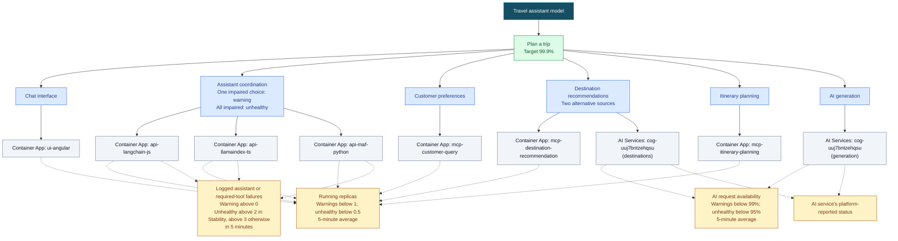
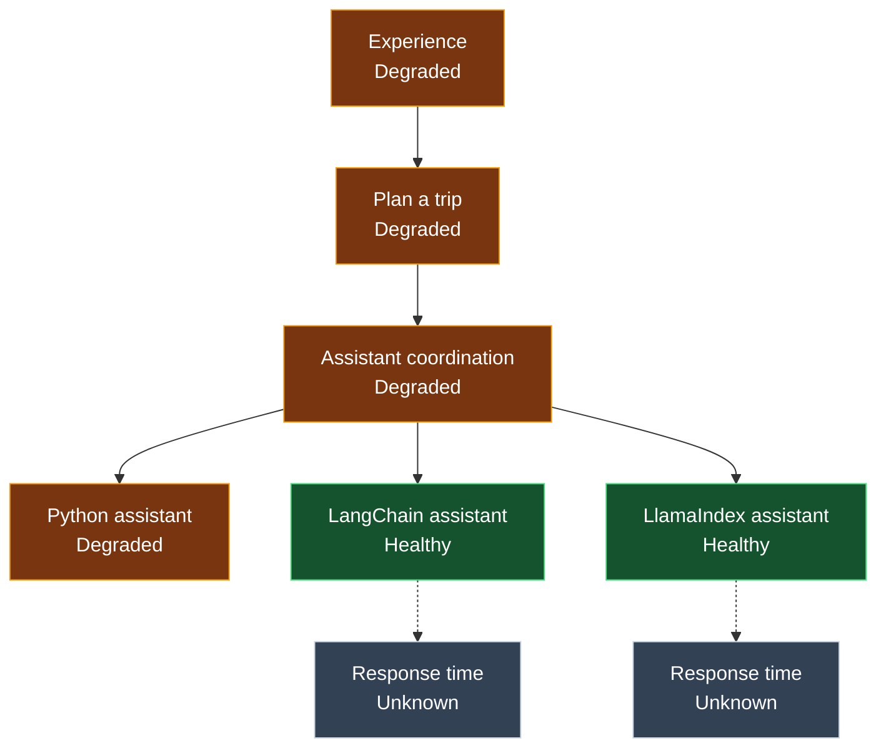

# Health Model for Azure AI Travel Agents

**Deployed:** The effect of an unavailable assistant is an assumption. One Degraded assistant was observed to degrade the shared flow; other alternative-choice scenarios remain unverified.

## What does health mean for my workload?

- People can open the chat, select an assistant, discover tools and get travel advice.
- Preference extraction, destination recommendations and itinerary planning work.
- Slow answers and overloaded services are distinguishable from unavailable services.

## User flows

| User flow | What users do | Depends on | Signals | Health target | Alert |
|-----------|---------------|------------|---------|---------------|-------|
| Plan a trip | Open chat, describe preferences, explore destinations and build an itinerary | Chat interface, assistant coordination, preference extraction, destination recommendations, itinerary planning and advice generation | Running service instances, AI's reported status and request availability, logged assistant or required-tool failures, plus the selected comparison signals | 99.9% (assumed) | Degraded or unhealthy, no notification routing |

**Not modelled:** Echo Test, which is not selected by default; local LLM providers, which are not configured by the Azure deployment.

The four models have the same dependencies and basic availability checks. Each adds one different kind of evidence:

| Model | Additional evidence | What the comparison tests |
|-------|---------------------|---------------------------|
| Platform | None | Whether running instances, AI availability and selected error logs detect user-visible failures |
| Stability | Container terminations and a more sensitive logged-error threshold | Whether crashes and repeated workflow errors are detected without unnecessary warnings |
| Capacity | CPU and memory usage | Whether resource pressure gives useful early warning |
| Experience | Response times of UI, assistants, tools and AI | Whether slow answers are detected while services still run |

Together the models schedule about 33,120 log checks and 84,960 metric checks per day. Actual charges are unknown.

## Diagram

The three assistant choices share the same user flow. Destination recommendations can come from the destination service or AI, depending on the selected assistant.

**Colors:** green = user flows; blue = system components; orange with a dashed border = optional component (none included); gray = Azure resources; amber = health signals.

Read top to bottom. Solid arrows mean **depends on**; dotted arrows connect measurements. Shared parts take the worst known health of what they need; assistant and destination choices account for alternatives. **Unknown** means there is not enough information to tell.

## Live baseline

At 08:56 UTC on 28 October, each model's overall state was Healthy. Experience had seven Unknown response-time checks. A Healthy overall state does not establish that a chat or inference succeeded.

Two malformed-input defects in the snapshot parser were reproduced and repaired locally. Captured Resource Health names follow Azure's generated-name pattern, and an independent offline retest passed.

## Live usage

Three Python requests ran against the existing application revision. Two completed in 56.74 and 82.93 seconds, with their specialists observed in sampled traces. The itinerary request reached its customer and itinerary specialists but hit the 110-second client deadline.

Observed model-chat spans covered 43.19 and 61.98 seconds of the two completed requests. The timeout trace had large intervals without recorded chat spans, so its cause remains unknown.

The live comparison shows root state and checks with data:

| Model | Baseline 08:56 | After usage 09:03 | Latest 10:44 |
|-------|----------------|-------------------|----------------------|
| Platform | Healthy, 15 / 15 | Healthy, 15 / 15 | Healthy, 15 / 15 |
| Stability | Healthy, 22 / 22 | Healthy, 22 / 22 | Healthy, 22 / 22 |
| Capacity | Healthy, 29 / 29 | Healthy, 29 / 29 | Healthy, 29 / 29 |
| Experience | Healthy, 17 / 24 | Degraded, 22 / 24 | Healthy, 18 / 24 |

Experience's Python response-time signal reported 46.37 seconds, averaged across routes. It cannot identify the timed-out request or establish answer completeness. The other models had no response-time signal. Failure and resource-pressure scenarios remain untested.

| Entity | Signal | State | Value | Error |
|--------|--------|-------|-------|-------|
| Python assistant | Response time | Degraded | 46,367.7 ms | None |
| Python assistant | Running replicas | Healthy | 1 | None |
| Python assistant | Logged assistant failures | Healthy | 0 | None |
| LangChain assistant | Response time | Unknown | No data | None |
| LlamaIndex assistant | Response time | Unknown | No data | None |

The two Healthy alternative assistants each had an Unknown response-time signal. Experience was observed Degraded through 09:07 UTC and Healthy again at 09:08 UTC, initially with a 0ms Python response metric. At 10:44 UTC all four roots were Healthy, but six of Experience's 24 checks were Unknown, including response time for all three assistants. Neither state proves that a new request succeeded.

Experience's trip-flow alert fired at 09:02:38 UTC and its monitor condition resolved at 09:07:39 UTC. It had no configured notification recipients.

**Candidate:** Experience is the most informative model for this slow-response sample. It is not a complete readiness or correctness check: missing response samples, route-level averaging, unrouted alerts and untested pressure/failure cases remain.

The destination service also logged 320 unavailable-stream keepalive warnings in each of two later five-minute windows. The same 32 sessions produced 33,963 warnings over observed spans of 7 hours 41 minutes to 9 hours 24 minutes, representing 24 MB of billable-size log data. Actual charges and user impact are unknown. The models do not directly check those warnings.

## Early comparison

These are predictions from observed source data, not states observed in deployed models. Other checks can change the overall state.

| What was recorded | Platform | Stability | Capacity | Experience |
|-------------------|----------|-----------|----------|------------|
| Three assistant or required-tool errors in five minutes | The error check would be Degraded | The error check would be Unhealthy | The error check would be Degraded | The error check would be Degraded |
| A preference reply took 66.44 seconds while the average across routes was 22.16 seconds | No response-time check | No response-time check | No response-time check | Response-time check would be Healthy |
| An assistant request hit the client deadline while selected error logs stayed at zero | Error check would be Healthy | Error check would be Healthy | Error check would be Healthy | Error check would be Healthy; response-time check would be Degraded |
| Two later replies lacked required-tool evidence, with no selected errors; the assistant averaged 38.52 seconds | Error check would be Healthy | Error and termination checks would be Healthy | Error and that assistant's resource-pressure checks would be Healthy | Response-time check would be Degraded, but does not confirm the requested work |
| A hotel request completed in 105.94 seconds with a successful tool call; the assistant averaged 89.51 seconds across routes | No response-time check | No response-time check | No response-time check | Response-time check would be Unhealthy |
| The destination service had intermittent four-minute HTTP timeouts and continuing keepalive failures | No response-time check | No response-time check | No response-time check | Its response-time check can be Unhealthy, but does not identify affected requests |
| The destination service logged 320 keepalive failures for the same 32 sessions in each of two quiet windows | No direct check for these warnings | No direct check for these warnings | No direct check for these warnings | No direct check; destination response data was unavailable |
| CPU and memory stayed at or below 2.1% and 25% in sampled usage windows | No capacity check | No capacity check | Capacity checks would be Healthy | No capacity check |
| Four health checks ran while AI recorded zero requests | AI availability check would be Healthy | AI availability check would be Healthy | AI availability check would be Healthy | API response, AI availability and AI latency checks would be Healthy |
| Six response-time samples were unavailable in quiet windows | No response-time check | No response-time check | No response-time check | Those six checks could be Unknown |

## What happens when something breaks

These are configured expectations, not results from deliberate fault injection.

| If this happens | The model shows | Alert |
|-----------------|-----------------|-------|
| One assistant has no running replicas, while the other choices are healthy | That Container App turns Unhealthy; Assistant coordination, Plan a trip and Travel assistant model turn Degraded | Trip-planning degraded alert |
| All three assistant choices have no running replicas | All three assistant Container Apps, Assistant coordination, Plan a trip and Travel assistant model turn Unhealthy | Trip-planning unhealthy alert |
| mcp-itinerary-planning has no running replicas | Its Container App, Itinerary planning, Plan a trip and Travel assistant model turn Unhealthy | Trip-planning unhealthy alert |
| AI request availability falls below 95% | Both AI Services copies and AI generation turn Unhealthy; Destination recommendations turn Degraded; Plan a trip and Travel assistant model turn Unhealthy | Trip-planning unhealthy alert |

## Assumptions

- 99.9% is an initial health target, not a user commitment.
- Customer preference and itinerary tools are required for a full trip; destination recommendations use the selected assistant's source.
- One unavailable assistant or destination source makes the trip-planning flow Degraded when another choice remains healthy. If every choice is Degraded or Unhealthy, it becomes Unhealthy.
- Measurements use five-minute windows and refresh every minute. Terminations above zero warn, and above three are unhealthy; planned replacements also count.
- Logged assistant or required-tool failures warn above zero. Stability becomes unhealthy above two, based on three failed test requests; the others become unhealthy above three. Multiple log entries for one failure count separately.
- Required-tool discovery failures from one assistant are also checked in application traces. That check and the console-error check are evaluated separately, so the same logged event is not added twice.
- CPU and memory warnings start above 80%, unhealthy above 95%.
- UI/tool response warnings start above 1 second, unhealthy above 3 seconds. Assistant/AI warnings start above 30 seconds, unhealthy above 60 seconds.
- Experience response-time checks can be Unknown when no requests arrive. AI may report 0ms even when no inference ran.
- AI uses Azure's reported availability; apps use running-instance checks.
- Use the workload's resource group and a supported health-model region. A separate region can reduce shared regional failure risk.

## What to do next?

- Assess Experience's missing response data and separately scoped failure or pressure scenarios.
- Decide separately whether to deploy the locally tested Python guard fix and whether to investigate MCP session cleanup.
- Identify alert recipients, model ownership and attributable monitoring charges.

Technical details and evidence are in [modelspec.md](modelspec.md); the [open task list](modelspec.md#open-tasks) is at the end.
